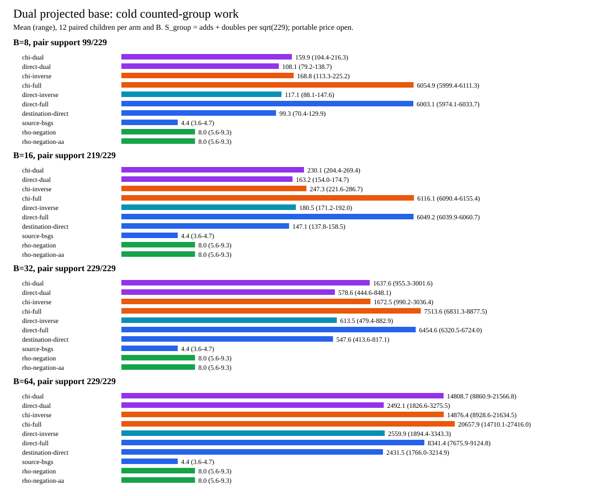

# Explicit dual transport of a projected destination base

**Status:** The frozen [protocol](PROTOCOL_V1.md) and [amendment](AMENDMENT_V2.md) completed 480/480 cold children and 480/480 independent checker replays, with zero child or replay failures. Four exhaustive signed-pair gates and their replays passed. The [paired audit](RUN_V1/PAIR_AUDIT_V1.json) compared 96 dual/inverse cells and 13,482 relation witnesses with zero mismatches. The [raw run](RUN_V1/), [run report](reports/run-20261115T054358Z/RUN_REPORT_V1.md), and [SHA-256 manifest](RUN_V1/ARTIFACT_FILES.sha256) are the evidence. Execution began 2026-11-15 05:43:58 UTC and finished 05:53:35 UTC.

## Instance, map, and boundary

The source is `E: y²=x³−21x+37` and the different-`j` destination is `E′: y²=x³−81x+179` over `F_(211²)`. Both rational groups have order 44,655; the held-out target subgroup has prime order 229. The forward degree-three map has kernel `{O,(3,±1)}`. The independently found dual kernel is `{O,(202,±50)}`. Normalized Vélu followed by `(x,y)↦(x/9,y/27)` gives `ψ:E′→E`. The [proof map](PROOF_MAP.md) explains why `[153]ψ(Y)` is the unique order-229 source preimage of a projected destination point `Y` when `φψ=[3]` and `3·153≡1 mod 229`. The two composition identities were checked by both native implementations on every 44,655 rational point of each curve, including exceptional points. This finite check is not a general Lean theorem about the curve maps.

The candidate received the [witness-free public base](RUN_V1/DUAL_BASE_PUBLIC_V1.json), SHA-256 `59864a39ea05ab57823a7e072822ea781aaf625bfcc0a1752faeab63ef819383`; the independent checker alone received the source witness file. Four held-out targets, three rotated rounds, B=8/16/32/64, ten arms, 1,832 relation trials per child and 300-second wall caps were fixed. The prespecified generic two-class counting floor is `sqrt(pi/4)=0.886227` group operations per `sqrt(229)`; the same-target signed rho and BSGS arms are measured references.

## One-unit whole-child table

`S_group` counts **all** additions and doublings in each cold child's setup, query and verification divided by `sqrt(229)`. This is a partial operation view: field work outside group calls, square-root internals, polynomial/table work, allocations, process startup and I/O are not converted. Complete portable `S` remains unset. Values are means of 12 completed, independently replayed children per row; the [machine summary](RUN_V1/SUMMARY_V1.json) holds full precision and ranges. Repeated controls were rerun in every paired cell.

| B | Arm | Complete | Mean `S_group` |
| ---: | --- | ---: | ---: |
| 8 | χ dual | 12/12 | 159.902 |
| 8 | direct dual | 12/12 | 108.137 |
| 8 | χ inverse | 12/12 | 168.823 |
| 8 | χ full image | 12/12 | 6,054.866 |
| 8 | direct inverse | 12/12 | 117.059 |
| 8 | direct full image | 12/12 | 6,003.102 |
| 8 | destination direct | 12/12 | 99.349 |
| 8 | source BSGS | 12/12 | 4.361 |
| 8 | signed rho | 12/12 | 7.979 |
| 8 | rho A/A | 12/12 | 7.979 |
| 16 | χ dual | 12/12 | 230.086 |
| 16 | direct dual | 12/12 | 163.244 |
| 16 | χ inverse | 12/12 | 247.333 |
| 16 | χ full image | 12/12 | 6,116.063 |
| 16 | direct inverse | 12/12 | 180.492 |
| 16 | direct full image | 12/12 | 6,049.222 |
| 16 | destination direct | 12/12 | 147.054 |
| 16 | source BSGS | 12/12 | 4.361 |
| 16 | signed rho | 12/12 | 7.979 |
| 16 | rho A/A | 12/12 | 7.979 |
| 32 | χ dual | 12/12 | 1,637.630 |
| 32 | direct dual | 12/12 | 578.629 |
| 32 | χ inverse | 12/12 | 1,672.455 |
| 32 | χ full image | 12/12 | 7,513.563 |
| 32 | direct inverse | 12/12 | 613.454 |
| 32 | direct full image | 12/12 | 6,454.562 |
| 32 | destination direct | 12/12 | 547.637 |
| 32 | source BSGS | 12/12 | 4.361 |
| 32 | signed rho | 12/12 | 7.979 |
| 32 | rho A/A | 12/12 | 7.979 |
| 64 | χ dual | 12/12 | 14,808.697 |
| 64 | direct dual | 12/12 | 2,492.134 |
| 64 | χ inverse | 12/12 | 14,876.431 |
| 64 | χ full image | 12/12 | 20,657.933 |
| 64 | direct inverse | 12/12 | 2,559.868 |
| 64 | direct full image | 12/12 | 8,341.370 |
| 64 | destination direct | 12/12 | 2,431.537 |
| 64 | source BSGS | 12/12 | 4.361 |
| 64 | signed rho | 12/12 | 7.979 |
| 64 | rho A/A | 12/12 | 7.979 |

Pair support was 99/229, 219/229, 229/229 and 229/229 for B=8,16,32,64. All paired relation arms had the same deterministic trials, relation rows, rank and recovered scalar. Mean trials were 33.583, 26.000, 125.583 and 396.333; useful ranks were 9, 17, 33 and 65. The dual map therefore transports these *fixed* columns without changing relation yield.

At B=64, counted-group direct-inverse/direct-dual is **1.027179**, while direct-dual/signed-rho is **312.322**. At B=8 the latter is **13.552**. These are partial operation ratios, not complete speed ratios. χ inverse/χ dual at B=64 is 1.004574 in this unit. The direct dual's mean whole-child CPU was 9.006 ms against 15.557 ms for direct inverse, 9.110 ms for destination direct, and 0.614 ms for signed rho. Those CPU observations were on a shared Darwin L0 host and do not establish an isolated wall ratio.

## Disjoint CPU phases at B=64

The runner checked `relation + row + recovery = query` and `setup + query + verification + other = total` for every child. The means below are thread CPU milliseconds; the [summary](RUN_V1/SUMMARY_V1.json) includes all arms and base widths.

| Arm | Setup | Relation | Row | Recovery | Whole child |
| --- | ---: | ---: | ---: | ---: | ---: |
| χ dual | 1.715 | 4,160.122 | 2.268 | 0.018 | 4,164.131 |
| direct dual | 3.608 | 4.885 | 0.499 | 0.008 | 9.006 |
| χ inverse | 8.491 | 4,174.276 | 2.309 | 0.020 | 4,185.102 |
| direct inverse | 10.101 | 4.963 | 0.479 | 0.008 | 15.557 |
| destination direct | 3.554 | 5.035 | 0.506 | 0.009 | 9.110 |
| source BSGS | 0.548 | 0.002 | 0 | 0 | 0.557 |
| signed rho | 0.548 | 0.059 | 0 | 0 | 0.614 |

The dual setup CPU is lower than inverse setup CPU in this run, but the candidate cold total remains much larger than same-target BSGS and rho in counted group work. The dual construction does not change the factor-base relation set. This is a correctness and component-cost finding, not an end-to-end ECDLP improvement over the generic controls.

The [12 B=64 child records](RUN_V1/children/) give a further **derived stage diagnostic** when the `setup_group_ops`, `query_group_ops` and `verify_group_ops` additions and doublings are summed separately, averaged, then divided by `sqrt(229)`. Mean setup/query/verification `S_group` is 805.736/1,685.374/1.024 for direct dual, 873.470/1,685.374/1.024 for direct inverse, and 1.718/5.237/1.024 for signed rho. Thus the dual saves 67.734 counted `S_group` in setup on these paired cells and changes none of their query group work. Granting the dual arm **zero setup cost** still leaves its measured query plus verification count at 1,686.398, or 211.344 times the measured whole-child rho count. This is a fixed-target sensitivity calculation, not a measured 64-target reused-setup result or a complete operation price.

## Verification, limitations, next discriminating gates

The runner snapshots, independent checker source and binaries, input hashes, exact commands, all child records and exit files, exhaustive pair gates, host receipt, native audit and SHA-256 manifest are in [RUN_V1](RUN_V1/). `sha256sum --quiet -c ARTIFACT_FILES.sha256` passed. The release library suite passed 4,083 tests (117 ignored) and the four touched examples' tests passed; their full outputs and exit files are beside this report. [Lean V4](LEAN_BUILD_V4.stdout) built the conditional scalar theorem with only `propext` in `#print axioms`; the concrete curve-map bridge and fresh Lean checker remain open.

The complete portable price is still blocked by disjoint accounting and calibration of field, square-root, polynomial/table, allocation, startup and I/O work. Physical-core isolated wall timing, a genuinely shared-setup 64-target panel and a larger-order dual trend remain pending from the frozen protocol. The next run should first close the native primitive price and independent counter replay on this exact cell, then execute the already specified 64-target reuse panel; a larger-order comparison requires its own frozen parameters and cap. The [problem record](../../../problems/nonrational-isogeny-fiber-dlp-cost-gap.md) retains these exit criteria. Canonical scoreboard graphs were inspected and left unchanged because this is an unpriced, L0, order-229 result with no new admitted boundary crossing.
