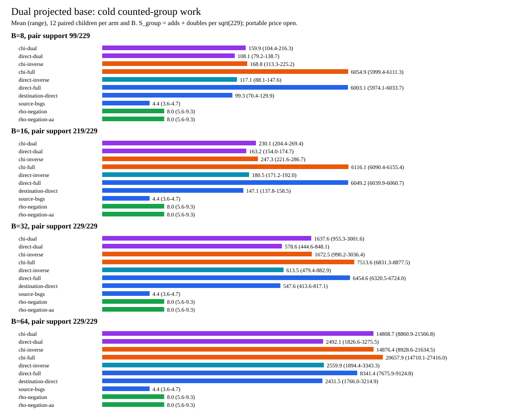

# RUN_V1: dual transport cold panel

The [frozen protocol](../../PROTOCOL_V1.md) and [amendment](../../AMENDMENT_V2.md) specified the explicit degree-three dual-isogeny transport on the different-`j` pair over `F_(211²)`, order 229, against inverse-Vélu, destination-direct, source BSGS and signed rho. The exact public base, targets, plan, source/binary hashes and command are in [RUN_V1](../../RUN_V1/). Execution ran 2026-11-15 05:43:58–05:53:35 UTC on Darwin arm64, shared L0. The host had no reserved physical core and could not enforce the 512 MiB address-space cap; observed RSS is retained per child.

All 480 scheduled cold children and 480 independent checker replays exited zero. The four exhaustive pair-set gates and their checker replays passed. Each of the 40 arm-by-B rows completed 12/12 cases, under the 1,832-trial and 300-second child limits. There were no timeouts, failed attempts or censored cells in this run. The dual identity gate and independent replay checked both compositions on all 44,655 points of each curve. The [paired audit](../../RUN_V1/PAIR_AUDIT_V1.json) matched 96 dual/inverse cells and 13,482 relation witnesses with zero mismatches. The [manifest](../../RUN_V1/ARTIFACT_FILES.sha256) verified with `sha256sum --quiet -c` from the run directory.

The graph plots mean and observed range of `S_group=(adds+doubles)/sqrt(229)` for all ten cold arms at B=8/16/32/64. The machine [summary](../../RUN_V1/SUMMARY_V1.json) and [results report](../../RESULTS_V1.md) give the full same-unit table and disjoint CPU phases. At B=64, measured mean `S_group` was 2,492.134 direct dual, 2,559.868 direct inverse, 2,431.537 destination direct, 4.361 BSGS and 7.979 signed rho. The derived inverse/dual counted-group ratio is 1.027179. Complete portable `S` is unset because native non-group primitives and startup/I/O have not been converted. The CPU values are descriptive shared-host thread measurements; an isolated wall claim is pending.

The runner and checker sources, binaries, command, input hashes, host receipt, per-child JSON/exit/stderr, exhaustive pair records, dual identities and full manifest remain in the raw run. The graph source is the committed native runner, which writes `DUAL_GRAPH_V1.svg` from `SUMMARY_V1.json`; this copy is beside the run report. No canonical boundary graph was changed because the result has no admitted complete portable or isolated crossover.
