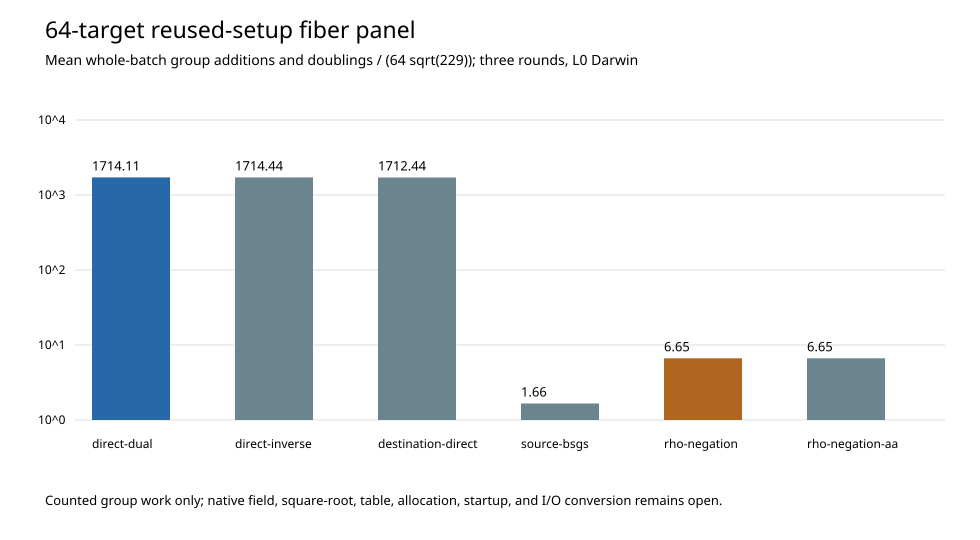

# Reused-setup dual-isogeny fiber panel on 64 public targets

**Single-target priority, clarified 2026-11-18 after review.** This panel is
an amortization diagnostic only. Its per-target batch quotient is excluded
from the cold single-target ECDLP comparison and cannot establish a
single-target advantage. The primary [480-child cold study](../dual_projected_base_20261115/RESULTS_V1.md)
used the same curve pair, four held-out targets, and same-target rho and BSGS
controls. At B=8 its mean whole-child counted `S_group` was 108.137 direct
dual, 7.979 signed rho, and 4.361 source BSGS; at B=64 the corresponding
values were 2,492.134, 7.979, and 4.361. Complete portable `S` remains
unset there as well. The cold result is the relevant fixed-target boundary;
the batch result below asks only what happens when setup is shared.

**Measured 2026-11-18 17:01:06–17:01:11 UTC.** The [V1 protocol](PROTOCOL_V1.md)
and [pre-run scheduling correction](AMENDMENT_V2.md) produced 18/18 complete
whole-batch children and 18/18 independent native replays. All 1,152 target
results verified their source and destination scalar equations. The [paired
audit](RUN_V1/PAIR_AUDIT_V1.json) matched 192 dual/inverse target cells and
76,711 relation witnesses, with zero mismatches. The [run directory](RUN_V1/),
[manifest](RUN_V1/ARTIFACT_FILES.sha256), [native summary](RUN_V1/SUMMARY_V1.json),
and [run report](reports/run-20261118T170106Z/RUN_REPORT_V1.md) are the source
records. The manifest passed `sha256sum --quiet -c` after the run.

## Instance, boundary, and unit

The source is `E: y²=x³−21x+37` and the different-`j` destination is
`E′: y²=x³−81x+179` over `F_(211²)`. The subgroup has prime order 229. The
candidate used the witness-free [dual base](../dual_projected_base_20261115/RUN_V1/DUAL_BASE_PUBLIC_V1.json),
SHA-256 `59864a39ea05ab57823a7e072822ea781aaf625bfcc0a1752faeab63ef819383`.
The [64-target public file](BATCH_PUBLIC_V1.json), SHA-256
`68bef77625d123eea3c893224eb16d4b8530089ea61c9b3c778f176b7cbe7e3d`,
has no scalar or target-selection seed. Those values are in the separate
[checker input](BATCH_CHECKER_V1.json), SHA-256
`d40b5343db83975c0743035dbdf4961d59efa84132f845159de23eed09a6e080`.
The first four public targets are the prior held-out points; the other 60 are
distinct. Each arm received these same 64 targets and three rounds.

The prespecified two-class generic **single-target** counting floor is
`sqrt(pi/4)=0.886227` group operations per `sqrt(229)` in the cold study;
it is not an acceptance boundary for this batch quotient. Signed rho is
rerun on the same 64 targets, and rho A/A checks deterministic control
replay. The table's single unit, `S_group`, is each child's **whole-batch**
setup, query, and verification additions plus doublings, divided by
`64*sqrt(229)`, then averaged over the three completed rounds. It is a
partial operation view. A complete portable `S` remains unset because base
field work outside group calls, square-root internals, polynomial/table work,
allocations, startup, and I/O lack a disjoint calibrated conversion.

| Arm | Complete batches / targets | Mean `S_group` per target |
| --- | ---: | ---: |
| Direct dual | 3/3; 192/192 | 1,714.111 |
| Direct inverse Vélu | 3/3; 192/192 | 1,714.442 |
| Destination direct | 3/3; 192/192 | 1,712.437 |
| Source BSGS | 3/3; 192/192 | 1.659 |
| Signed rho | 3/3; 192/192 | 6.654 |
| Signed rho A/A | 3/3; 192/192 | 6.654 |

The native summary gives mean whole-batch counted operations of 1,660,109
direct dual, 1,660,430 direct inverse, 1,658,488 destination direct, 1,607
BSGS, and 6,444 signed rho. Within the paired relation arms, mean query work
was exactly 1,646,809 counted operations and mean verification was 1,120.
The dual setup used 12,180 versus inverse setup's 12,501: **321 fewer
counted operations per 64-target batch**. The inverse/dual whole-batch
`S_group` ratio is **1.000193**; dual/rho is **257.621**. These are partial
count ratios, not complete ECDLP speed ratios. Both transported source bases
and all paired relations, ranks, and answers matched. Destination direct used
the same relation stream and had a lower counted setup of 10,559.

## Verification, timing, and decision

Every completed child has a JSONL record of 64 targets plus one summary,
stderr, exit status, and independent replay receipt. The replay checked 2,304
source/destination scalar equations and every reported relation witness and
rank with separate field and curve arithmetic. The native pair audit compared
the dual and inverse rows, destination row controls, and rho A/A streams.
Observed peak child RSS was at most 12,206,080 bytes. The maximum 512 MiB
threshold was not enforced by Darwin's address-space limit; this is an L0
shared-host run. Mean whole-child thread CPU was 370.987 ms dual, 378.721 ms
inverse, and 2.921 ms rho. These CPU observations are descriptive; no isolated
wall ratio is admitted.

The new code's touched example tests passed (2 tests; checker example builds
with 0 tests). The required `cargo test --release --lib` was run after the
sparse fixture set was completed, but compilation failed on a duplicate test
function already present twice in current `main` at
`src/cryptanalysis/ic_framework/plugins.rs:5285` and `:5322`. This branch
does not edit that file. The [validation receipt](VALIDATION_V1.md) records
both attempts and exact commands. The result therefore remains unmerged and
does not inherit a passing full-library gate from the earlier study.

**Secondary batch interpretation:** sharing the dual construction is real in
the runner, but the unchanged relation query dominates counted group
work for B=64 on these targets. The separately frozen complete primitive
price, independent counter census, L2 wall timing, and larger-order
dual/inverse trend are still open. This panel does not change the curve's
factor-base support. The [open problem](../../../problems/nonrational-isogeny-fiber-dlp-cost-gap.md)
retains those exit criteria. The canonical IC scoreboard and progress graphs
were inspected and left unchanged: this result has no admitted complete
portable `S` or L2 wall boundary crossing. No new mathematical identity was
introduced; the prior conditional Lean theorem and finite map checks retain
their original scope.
