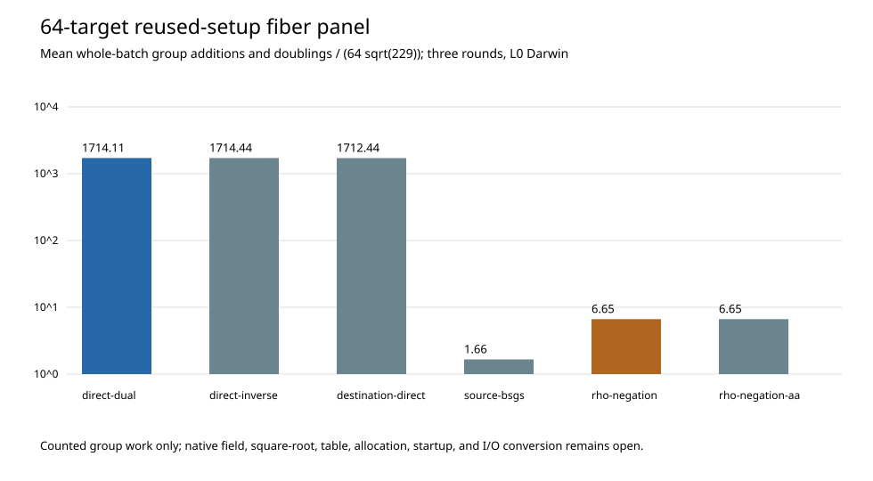

# Run report: 64-target reused-setup dual transport

**Run ID:** `run-20261118T170106Z`
**Source commit:** `0077f9d154724ca7ecbf9914040dc95a9eb3ab28`
**Start/end:** 2026-11-18 17:01:06–17:01:11 UTC
**Host:** Apple M4 Pro, macOS 27.2, Rust 1.99.1, L0 shared Darwin;
no enforced address-space cap. The full receipt is
[`HOST.txt`](../../RUN_V1/HOST.txt).

The [protocol](../../PROTOCOL_V1.md) and [pre-run amendment](../../AMENDMENT_V2.md)
fixed one B=64 factor base constructed once per child, 64 distinct public
order-229 targets, three rounds, and six arms. Their deterministic seeds and
rotated child launch order are in the protocol. The frozen candidate
[base](../../../dual_projected_base_20261115/RUN_V1/DUAL_BASE_PUBLIC_V1.json),
[target input](../../BATCH_PUBLIC_V1.json), and separate
[checker file](../../BATCH_CHECKER_V1.json) are identified by SHA-256 in
[`FROZEN_INPUTS.sha256`](../../RUN_V1/FROZEN_INPUTS.sha256). The exact child
commands are in [`COMMANDS.txt`](../../RUN_V1/COMMANDS.txt). Frozen runner
and checker sources and binaries are in [`RUN_V1`](../../RUN_V1/).

All **18 requested children** exited zero and emitted 64 target rows plus one
whole-child summary; **18 independent replays** passed. The native
[pair audit](../../RUN_V1/PAIR_AUDIT_V1.json) compared 192 dual/inverse cells
and 76,711 relation witnesses with no mismatch. The
[run status](../../RUN_V1/RUN_STATUS.txt) reports zero failures. No child
timed out or was censored. Peak RSS across children was 12,206,080 bytes.
The recorded files pass the [SHA-256 manifest](../../RUN_V1/ARTIFACT_FILES.sha256).

The graph and table use `S_group = (setup + query + verification additions and
doublings) / (64 sqrt(229))`, averaged over three completed children per arm.
This is counted work, with no conversion of non-group costs. The
[native table](../../RUN_V1/SUMMARY_V1.json) has full precision, the
whole-batch operation counts, and each arm's min/max range. The graph's
editable data is the same native table.

| Arm | Completed batches | Mean `S_group` per target |
| --- | ---: | ---: |
| Direct dual | 3/3 | 1,714.111 |
| Direct inverse Vélu | 3/3 | 1,714.442 |
| Destination direct | 3/3 | 1,712.437 |
| Source BSGS | 3/3 | 1.659 |
| Signed rho | 3/3 | 6.654 |
| Signed rho A/A | 3/3 | 6.654 |

The raw whole-batch ranges were 1,576,643–1,720,411 for dual,
1,576,964–1,720,732 for inverse, 1,575,022–1,718,790 for destination
direct, 1,607–1,607 for BSGS, and 6,297–6,623 for each rho arm. Whole-child CPU and wall are
recorded in the native table as L0 descriptors. An isolated wall comparison
and a complete portable `S` were not measured. The six-arm source and target
streams were fixed across arms; the pair audit checked the dual/inverse
relation rows and rho A/A operations. The child files and replay receipts are
under [`RUN_V1/children`](../../RUN_V1/children/). The separate library-suite
validation failure is recorded in [`VALIDATION_V1.md`](../../VALIDATION_V1.md);
it did not change these frozen child records.
