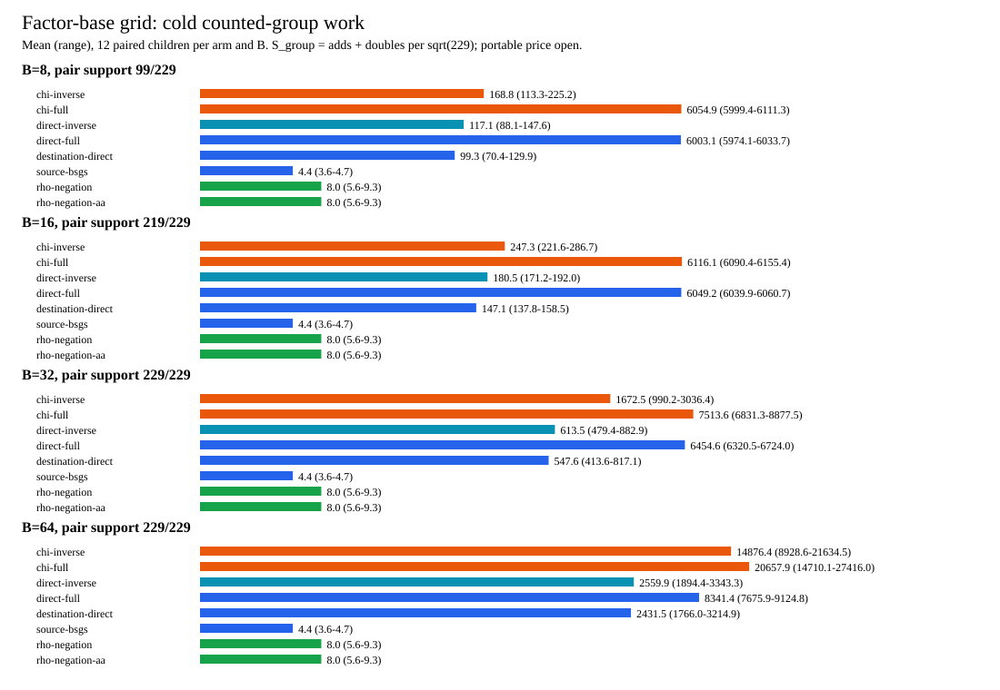

# Factor-base grid V2 accounting replay

**Status:** The frozen V2 panel completed 384/384 cold children and 384/384 independent checker replays. Four exhaustive pair-set gates and their replays passed. The [native V1/V2 audit](V2_AUDIT.json) compared all 384 deterministic records and 33,705 relation witnesses with zero mismatches. The [V2 protocol](PROTOCOL_V2.md), [raw run](RUN_V2/), and [run report](reports/run-20261115T043825Z/RUN_REPORT_V2.md) preserve the exact inputs and execution. The run began 2026-11-15 04:38:25 UTC and finished 04:40:50 UTC.

## Workload and boundary

The source is `y²=x³−21x+37`, the different-`j` degree-three destination is `y²=x³−81x+179`, and the working field is `F_(211²)`. The subgroup order is 229. Four held-out public targets, three rounds, base prefixes 8/16/32/64, eight arms, fixed streams, a 1,832-trial relation cap and a 300-second per-child wall cap are frozen in [V1](PROTOCOL_V1.md). All relation arms used the identical projected destination base in each paired cell. The prespecified generic two-class counting floor is `sqrt(pi/4)=0.886227` in group operations divided by `sqrt(229)`; matched signed rho and source BSGS are the same-target references.

## Whole-child counted-group table

`S_group` is **all** additions and doublings in setup, query and verification for one cold child, divided by `sqrt(229)`. It omits field work outside group calls, polynomial/table work, square-root internals, allocation, startup and I/O. It is therefore a lower-bound operation view; the complete portable `S` remains unset. Each row is a mean of 12 completed, independently checked children. The table repeats controls at each base size because every cell was run separately. The [machine summary](RUN_V2/SUMMARY_V2.json) retains full precision and ranges.

| B | Arm | Complete | Mean `S_group` |
| ---: | --- | ---: | ---: |
| 8 | χ inverse Vélu | 12/12 | 168.823 |
| 8 | χ full image | 12/12 | 6,054.866 |
| 8 | direct inverse Vélu | 12/12 | 117.059 |
| 8 | direct full image | 12/12 | 6,003.102 |
| 8 | destination direct | 12/12 | 99.349 |
| 8 | source BSGS | 12/12 | 4.361 |
| 8 | signed rho | 12/12 | 7.979 |
| 8 | rho A/A | 12/12 | 7.979 |
| 16 | χ inverse Vélu | 12/12 | 247.333 |
| 16 | χ full image | 12/12 | 6,116.063 |
| 16 | direct inverse Vélu | 12/12 | 180.492 |
| 16 | direct full image | 12/12 | 6,049.222 |
| 16 | destination direct | 12/12 | 147.054 |
| 16 | source BSGS | 12/12 | 4.361 |
| 16 | signed rho | 12/12 | 7.979 |
| 16 | rho A/A | 12/12 | 7.979 |
| 32 | χ inverse Vélu | 12/12 | 1,672.455 |
| 32 | χ full image | 12/12 | 7,513.563 |
| 32 | direct inverse Vélu | 12/12 | 613.454 |
| 32 | direct full image | 12/12 | 6,454.562 |
| 32 | destination direct | 12/12 | 547.637 |
| 32 | source BSGS | 12/12 | 4.361 |
| 32 | signed rho | 12/12 | 7.979 |
| 32 | rho A/A | 12/12 | 7.979 |
| 64 | χ inverse Vélu | 12/12 | 14,876.431 |
| 64 | χ full image | 12/12 | 20,657.933 |
| 64 | direct inverse Vélu | 12/12 | 2,559.868 |
| 64 | direct full image | 12/12 | 8,341.370 |
| 64 | destination direct | 12/12 | 2,431.537 |
| 64 | source BSGS | 12/12 | 4.361 |
| 64 | signed rho | 12/12 | 7.979 |
| 64 | rho A/A | 12/12 | 7.979 |

Pair support was 99/229, 219/229, 229/229 and 229/229 at B=8,16,32,64. Mean relation trials were 33.583, 27.667, 126.167 and 398.000; useful ranks were 9, 17, 33 and 65. Every paired relation arm had the same deterministic trials, relation rows, rank, and recovered scalar. Thus changing construction did not change useful relation yield for these columns.

## Disjoint CPU accounting

V2 split relation search, row insertion and scalar recovery. For each completed child, `relation + row + recovery = query` and `setup + query + verification + other = total` were checked. At B=64, mean thread CPU (ms) was:

| Arm | Setup | Relation | Row | Recovery | Whole child |
| --- | ---: | ---: | ---: | ---: | ---: |
| χ inverse Vélu | 8.395 | 3,679.435 | 1.391 | 0.011 | 3,689.238 |
| direct inverse Vélu | 10.489 | 5.388 | 0.586 | 0.009 | 16.479 |
| destination direct | 3.355 | 5.134 | 0.540 | 0.008 | 9.043 |
| source BSGS | 0.388 | 0.003 | 0 | 0 | 0.400 |
| signed rho | 0.484 | 0.043 | 0 | 0 | 0.535 |

At B=64, the counted-group inverse/destination-direct ratio is 1.053, while the χ/direct-inverse ratio is 5.811. These are **partial operation ratios**, not end-to-end speed ratios. CPU is descriptive on a shared Darwin L0 host with high concurrent load. V1 and V2 CPU are not pooled. The χ exhaustive fallback counter was serialized in V2 and summed to zero across all 384 records.

## Verification and remaining obligations

The [manifest](RUN_V2/ARTIFACT_FILES.sha256) verified with `sha256sum --quiet -c`; the run plan hashes were identical. The independent checker replays finite-field and curve operations, base construction, relations, row equations, scalar recovery and both source/destination scalar verification. The native audit compared the V1 and V2 answers, witnesses, ranks, trials, group and field counters, and phase-sum invariants. The source and binary snapshots and their SHA-256 values are in [RUN_V2](RUN_V2/). The V2 phase repair is an accounting update; it did not change the solver or the V1 mathematical outcomes.

The complete portable `S`, physical-core isolated wall result, and an order trend for this base-grid construction remain open. The next transport test must use only the projected destination columns as input, construct and charge an explicit dual isogeny, check `φ([153]ψ(Y))=Y` for each order-229 column, then solve the same four targets against the destination-direct and inverse-Vélu arms with matched BSGS/rho. A dual-map construction alone would establish transport correctness, while the cold complete cost decides whether it helps ECDLP.
