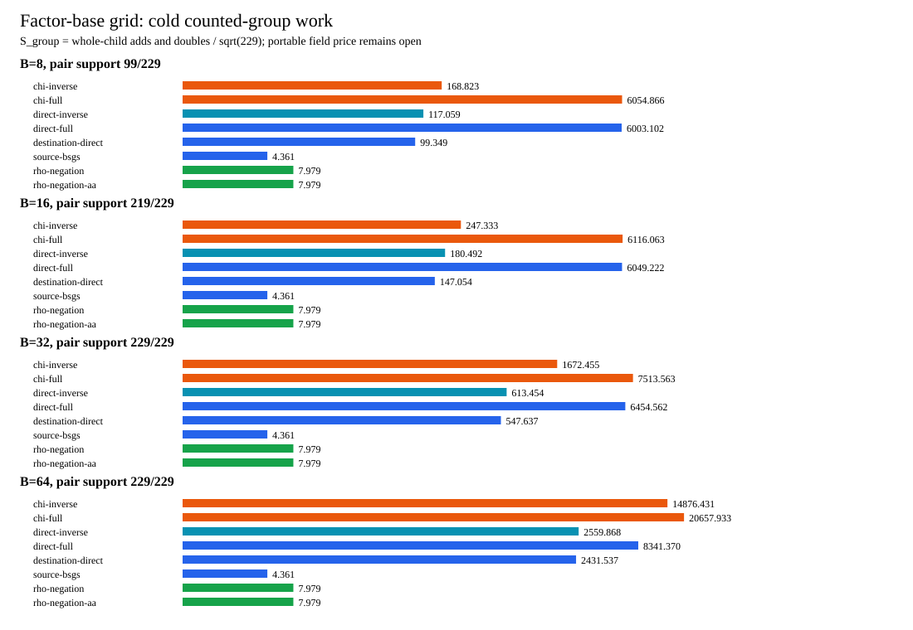

# RUN_V1: different-j factor-base grid

**Run:** 2026-10-16 23:25:10–23:42:40 UTC. **Status:** 384/384 cold
solve children and 384/384 independent checker replays exited zero;
four exhaustive χ pair-set gates and their independent replays exited
zero. This is a counted-group and shared-host CPU record. Its complete
portable `S` field is unset.

## Frozen workload and reference

The [V1 protocol](../../PROTOCOL_V1.md) fixes the source
`y²=x³−21x+37` and different-`j` destination `y²=x³−81x+179`
over `F_(211²)`, the rational degree-three kernel
`{O,(3,1),(3,−1)}`, and the order-229 subgroup. It uses four held-out
public targets, three rotated rounds, base prefixes of 8/16/32/64,
and eight arms per cell: χ/inverse Vélu, χ/full image, direct-pair/
inverse Vélu, direct-pair/full image, destination-direct, source BSGS,
signed rho, and signed-rho A/A. Each child has an 1,832-trial relation
cap and a 300-second wall cap. The host's 512 MiB address-space cap is
unsupported; observed peak RSS remained below 512 MiB. The signed-rho
reference is matched on every target and round. The prespecified
generic two-class floor is `sqrt(pi/4)=0.886227` in counted group
operations per `sqrt(229)`.

The [raw run](../../RUN_V1/) contains the exact public base, 384
child JSON records, stdout/stderr and exits, 384 replay records,
exhaustive pair records, source and binary snapshots, input hashes,
host note, run plan, summary, graph source and SHA-256 artifact
manifest. The artifact manifest verified after the run. The
[V1 summary](../../RUN_V1/SUMMARY_V1.json) is the full machine table.
The graph below was rendered by `summarize_grid` in the frozen
[runner source](../../RUN_V1/RUNNER_SOURCE_V1.rs.txt).

## Observations

The exhaustive χ result matched independent pair enumeration for all
229 subgroup residues at every base size. Pair support was 99/229,
219/229, 229/229 and 229/229 for B=8,16,32,64. The respective
unordered signed-index pair counts were 136, 528, 2,080 and 8,256.
All five relation arms constructed the same frozen projected base in
all 12 children per size, including destination-direct. Within each
base size, their trials, relation counts, useful rank and recovered
scalars agreed in every paired cell. Mean relation trials were 33.583,
27.667, 126.167 and 398.000; mean useful ranks were 9, 17, 33 and 65.

`S_group` below is the **whole cold child**'s setup, query and final
verification additions plus doublings, divided by `sqrt(229)`.
It excludes field and other native work outside those calls, so it is
a lower-bound operation view, not the complete portable price. Every
row is the mean of 12 completed same-target children. The rho and
BSGS controls are intentionally repeated across B in the raw records;
their identical counted-group means appear once here.

| B | Arm | Completed | Mean `S_group` |
| ---: | --- | ---: | ---: |
| 8 | χ inverse Vélu | 12/12 | 168.823 |
| 8 | χ full image | 12/12 | 6,054.866 |
| 8 | Direct inverse Vélu | 12/12 | 117.059 |
| 8 | Direct full image | 12/12 | 6,003.102 |
| 8 | Destination direct | 12/12 | 99.349 |
| 16 | χ inverse Vélu | 12/12 | 247.333 |
| 16 | χ full image | 12/12 | 6,116.063 |
| 16 | Direct inverse Vélu | 12/12 | 180.492 |
| 16 | Direct full image | 12/12 | 6,049.222 |
| 16 | Destination direct | 12/12 | 147.054 |
| 32 | χ inverse Vélu | 12/12 | 1,672.455 |
| 32 | χ full image | 12/12 | 7,513.563 |
| 32 | Direct inverse Vélu | 12/12 | 613.454 |
| 32 | Direct full image | 12/12 | 6,454.562 |
| 32 | Destination direct | 12/12 | 547.637 |
| 64 | χ inverse Vélu | 12/12 | 14,876.431 |
| 64 | χ full image | 12/12 | 20,657.933 |
| 64 | Direct inverse Vélu | 12/12 | 2,559.868 |
| 64 | Direct full image | 12/12 | 8,341.370 |
| 64 | Destination direct | 12/12 | 2,431.537 |
| all B | Source BSGS | 48/48 | 4.361 |
| all B | Signed rho | 48/48 | 7.979 |
| all B | Signed-rho A/A | 48/48 | 7.979 |

The V1 summary also records mean whole-child CPU. At B=64, χ inverse
was 4,224.214 ms, direct inverse 15.719 ms, destination direct
9.561 ms, and matched rho 0.475 ms. These are **descriptive thread-CPU
observations on shared Darwin L0**. A broad release-library test ran
concurrently during the early panel and was interrupted at 23:29 UTC;
the host had no reserved physical core, and no wall ratio is admitted.
The per-child CPU and wall observations remain in the raw records.

## Validation boundary and next run

The independent Rust checker recomputed the finite-field and curve
arithmetic, each public base, relation witness, modular row solve,
target scalar and mapped scalar. It did not call the runner's row solver.
The V1 runner combined relation search, row insertion and scalar
recovery into `query_cpu_ns` and omitted its χ fallback-evaluation
counter from solve JSON. Those are **accounting gaps**; the frozen
[V2 protocol](../../PROTOCOL_V2.md) specifies a complete 384-child
rerun with disjoint CPU phases and a deterministic V1/V2 audit. The
run's native arithmetic counts do not price square-root internals,
polynomial and table control flow, allocations, startup and I/O into a
portable group unit. The partial count results here do not establish
an end-to-end speed ratio or a scaling trend beyond this order.
