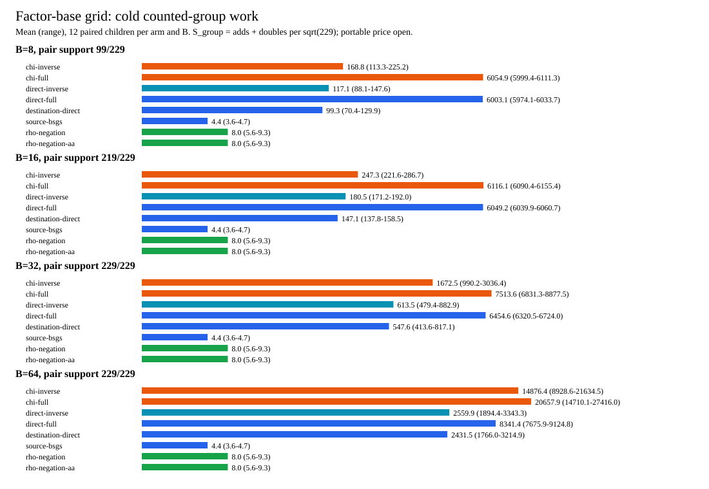

# RUN_V2 execution report

The frozen [V2 protocol](../../PROTOCOL_V2.md) repeated V1's 384-child panel without changing targets, base prefixes, streams, relation caps, arm order or algorithms. The run began 2026-11-15 04:38:25 UTC and finished 04:40:50 UTC on shared Darwin arm64 (L0). There was no physical-core reservation. The child wall cap was 300 s; this host did not support the stated address-space hard cap, so memory observations are descriptive.

All 384 children, 384 independent checker replays, four exhaustive χ pair-set gates and their replays exited zero. The [raw directory](../../RUN_V2/) contains child outputs, exits, replay records, frozen source and binary copies, input hashes, host note, plan, summary and SHA-256 manifest. `sha256sum --quiet -c` passed. The [native V1/V2 audit](../../V2_AUDIT.json) passed 384 deterministic comparisons, 33,705 relation witnesses and both plan hashes with no mismatch; the serialized χ fallback sum was zero.

The [results report](../../RESULTS_V2.md) gives the full same-unit table and disjoint setup, relation, row, recovery and verification CPU observations. Those CPU readings are shared-host diagnostics. Complete portable `S` and isolated wall ratios remain unset. The source and destination were public synthetic order-229 fixtures; these results do not extrapolate to deployed curves.
