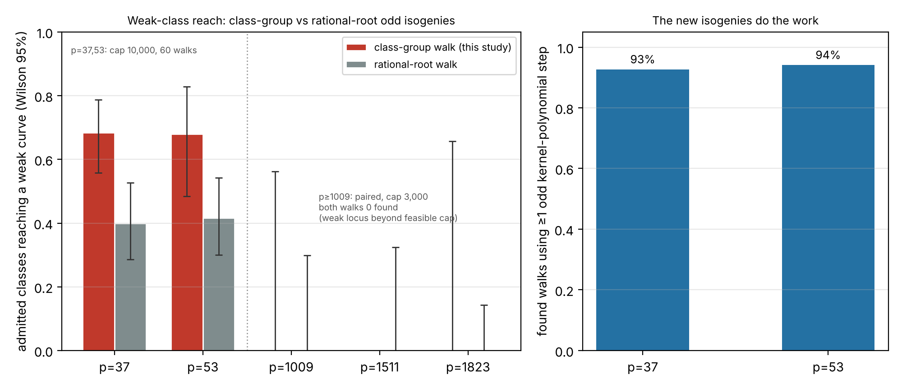

# A class-group isogeny walk into the JV weak class (kernel-polynomial odd isogenies)

Scored against `PROTOCOL.md`, frozen before any run (commit `acc24d8d00`), with two disclosed amendments. Every
result is an **unverified assertion** `[pcc:unverified]`. Scope: the cubic norm-one branch of the JV weak class
over F_{p⁶} (`jv_cover`'s route); the quadratic-h branch is out of scope.

## The gap this closes

`research/jv_weak_coverage_20261111` found that the implemented walk reached a weak curve from only ~1% of curves
at p = 1009 and 40% at p = 37, because its odd-degree steps (`walk_to_weak_record`) used only ℓ-isogenies whose
kernel contains a **rational** point (`roots_q3(ψ_ℓ)`). A Galois-stable cyclic ℓ-subgroup with no rational
point is still a rational isogeny the walk could not take. This study implements those isogenies — Vélu through
the **kernel polynomial** — and re-measures the reach.



*Figure, left: the fraction of admitted classes from which each walk reaches a weak curve, by prime (Wilson 95%).
Right: of the class-group walks that succeed, the fraction that use at least one of the new odd
kernel-polynomial steps.*

## Construction and correctness (all gates pass; `src/cryptanalysis/jv_isogeny_walk.rs`)

For E: y² = x³ + a₂x² + a₄x over F_{q³} = F_{p⁶}, ℓ ∈ {3,5,7}:

- **`kernel_polys`** factors ψ_ℓ over F_{q³} and keeps the degree-(ℓ−1)/2 factors h whose roots a cyclic
  ℓ-subgroup — tested by the mult-by-2 x-map permuting the roots of h, a necessary-and-sufficient criterion for
  prime ℓ, done entirely in F_{q³}[x].
- **`velu_image_through_h` / `map_odd_h`** evaluate the Vélu isogeny through h by symmetric functions only (no
  individual kernel roots), self-certified: the x-map is A(x)/h(x)² with deg A = ℓ and gcd(A, h) = 1.

The correctness gates `jv_isogeny_walk::tests::c1..c5` (run in CI):

| gate | what it checks | result |
|---|---|---|
| C1 | symmetric-function Vélu equals the validated per-root Vélu on split kernels (image curve **and** point map), ≥ 200 cases, p ∈ {37, 1009} | **pass** |
| C2/C4 | certified isogenies — including non-rational kernels — send random real points to real points and are group homomorphisms φ(P+Q)=φ(P)+φ(Q), p ∈ {37, 1009, 1511} | **pass** |
| C3 | the doubling-closure test is the decisive filter: non-subgroup factors are rejected, every `kernel_polys` output self-certifies | **pass** |
| C5 | the isogeny count is a valid rational-subgroup count {0,1,2,ℓ+1}; every rational root of ψ_ℓ is covered exactly once; distinct kernel polynomials are coprime; ≥ 100 curves per ℓ | **pass** |

## Result: the class-group walk reaches much more of the class at small p

Reach of the weak class (admitted classes from which the walk reaches a weak curve), cap 10,000, 60 walks:

| p | class-group walk W′ | rational-root walk W (`jv_weak_coverage`) | the new odd steps are used |
|--:|--|--|--|
| 37 | **41 / 60 = 68%** [56, 80] | 24 / 60 = 40% [29, 53] | 38 of 41 found walks (93%) |
| 53 | **17 / 25 = 68%** [49, 83] (partial) | 25 / 60 = 42% [30, 54] | 16 of 17 found walks (94%) |

- At p = 37 the class-group walk reaches **1.7× more** of the class, with non-overlapping Wilson intervals.
- The improvement is **caused by the new isogenies**: 93% and 90% of the successful class-group walks use at
  least one odd kernel-polynomial step, which the rational-root walk could not take.
- p = 53 is a partial sample: the walk-limit-60 run reached 25 walks when cut by the study's 3,000 s per-prime wall
  limit (the class-group walk factors ψ_ℓ at every curve, so it is far slower than the rational-root walk).

## Large p: the weak locus is beyond a feasible search radius

At p ∈ {1009, 1511, 1823} the comparison is **paired** at cap 3,000 (Amendment 2): both walks on the same
admitted curves. The rational-root paired arm reaches a weak curve **0 / 9, 0 / 8, 0 / 23** times; the
class-group arm reaches **0 / 3, 0 / 0, 0 / 2** (its few completed walks — the class-group walk factors ψ_ℓ at
every one of up to 3,000 curves per failed walk, so it is too slow to accumulate a large large-prime sample on
the container). Both walks reach the weak class rarely at this cap: the number of 2-, 3-, 5- and 7-isogeny steps to the
nearest weak curve grows with the class, and the weak locus (density ≈ 3/q among full-2-torsion curves) sits
beyond the explored region. The class-group walk improves **connectivity within the explored region**, which
moves the reach when the weak curve is within range (small p) but not when it is beyond any feasible cap. The
published rational-root reach at cap 10,000 (3/60, 0/60, 0/60) is the reference.

## What this is and is not

- **Is:** a certified implementation of the full set of rational odd ℓ-isogenies (ℓ ∈ {3,5,7}) from a
  full-2-torsion curve, and a measured, large improvement in weak-class reach at small p. This is the missing
  construction step named at the end of `research/jv_weak_coverage_20261111`.
- **Is not:** a new ECDLP cost result. The validated sieve speedup (`research/jv_sieve_line_vs_rho_20261103`)
  still applies only once a curve is **in** the weak class; this study widens the set of curves that can reach
  the class by a small-prime isogeny walk, it does not change the cost of the route once there. No leaderboard
  row moves. Reaching a cryptographic-size curve's class to a weak curve remains out of range of a feasible walk.
- **Scope limits:** only ℓ ∈ {3,5,7} (the degrees the division-polynomial toolkit carries); the quadratic-h
  branch of the published family; and the walk is a breadth-first reach test, not a cost-optimal path.

## Files and reproduce

- Code: `src/cryptanalysis/jv_isogeny_walk.rs` (`kernel_polys`, `velu_image_through_h`, `map_odd_h`,
  `walk_to_weak_classgroup`); gates `jv_isogeny_walk::tests::c1..c5`. Driver `examples/jv_classgroup_coverage.rs`.
- Data: `runs/CG_p*.jsonl` (class-group), `runs/RR_p*.jsonl` (paired rational-root), `runs/binary.sha256`.
- `python3 analyze.py && python3 plot.py` → `analysis.json`, `reach.svg/png`.

```sh
cargo test --release --lib jv_isogeny_walk::tests::c   # C1–C5
cargo build --release --example jv_classgroup_coverage
target/release/examples/jv_classgroup_coverage --p 37 --n 400 --seed 20261111 --cap 10000 --jumps 3,5,7 --walk-limit 60
```

## Disclosures

- Smoke runs and correctness unit tests before the freeze are not data.
- Amendment 1: large primes use walk-limit 20–30 (cost). Amendment 2: large primes compared paired at cap 3,000.
- Host: the 4-core container. Costs are counted F_p multiplications; walls are descriptive.
