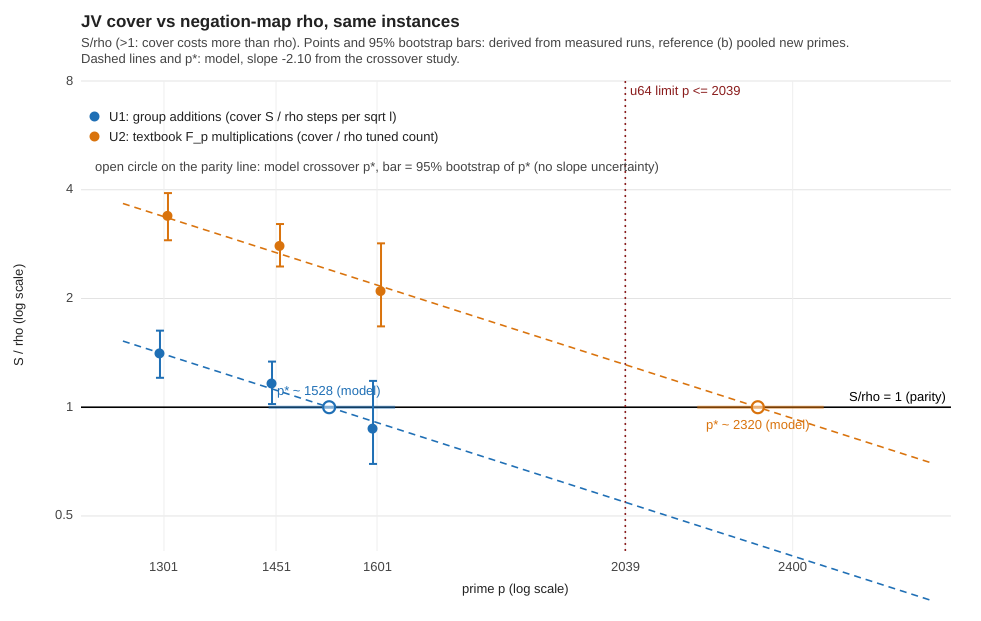

# JV cover vs the matched negation-map rho: frozen re-scoring (2026-11-01)

**Scope.** The `jv_cover` genus-3 weak class only (never prime order), lower-bound comparison, no statement about prime-order or deployed curves. Rules are those of [`PROTOCOL.md`](PROTOCOL.md) (hashes in [`results/FROZEN.sha`](results/FROZEN.sha), frozen before any new run). The cover side is the 9 existing records; **no new cover runs**. Nothing here enters the leaderboard or `benchmarks/`.

Labels: **measured** = read from a run record; **derived** = computed from measured values by the Rust tool in [`fit/`](fit/); **model** = extrapolation.

Files: [`scaling.svg`](scaling.svg) / [`scaling.png`](scaling.png), [`REPORT.pdf`](REPORT.pdf), [`table.md`](table.md), [`fit.txt`](fit.txt) / [`fit.json`](fit.json) (every statistic), [`walls.txt`](walls.txt), raw records in [`results/`](results/) (`new/` 108 new runs, `inputs/` copies of the 9 cover records, 18 old runs, 64 red-team runs, `replay/`), `run.sh`, `fit/`.

## Headline (derived)

Against the **negation-map rho on the same instances** (frozen primary: estimator (b), 126 runs pooled over the three primes; homogeneity across p was not rejected), the cover costs **more** than rho in group additions at p = 1301 (S/rho 1.405) and p = 1451 (1.160, lower end 1.020, marginal), and is **not resolved** at p = 1601 (0.870 [0.697, 1.183]). In textbook F_p multiplications the cover costs more than rho at every prime (3.38, 2.79, 2.09). Distance remaining (the factor the cover must improve): 1.40 / 1.16 / none (not resolved, point 1.15x ahead) in U1, 3.38 / 2.79 / 2.09 in U2. This confirms the review's conclusion with a frozen design: the earlier "below rho at 1451 and 1601" claim holds only against the no-negation `rhodp`.

Measured improvement is the success criterion; this study measures the gap, it does not gate on it. The gap shrinks with p at about p^-2.1 (the crossover study's slope, here only used as a model).

## Results

### Result per prime, primary estimator (b) pooled new primes (frozen choice: homogeneity holds)

S/rho = geometric mean over the 3 cover seeds of S, divided by the reference mean; 95% percentile bootstrap, 20000 resamples of seeds and reference runs jointly (derived). Distance remaining = the factor by which the cover must improve to reach the matched rho (S/rho itself when above 1; the cover is ahead by 1/(S/rho) otherwise).

| unit | p | cover geo-mean S (measured) | reference mean (derived) | S/rho [95% boot] | verdict | distance remaining |
|---|---|---|---|---|---|---|
| U1 group additions | 1301 | 1.310 | 0.9322 | **1.405** [1.206, 1.629] | above | x1.40 [1.21, 1.63] |
| U1 group additions | 1451 | 1.081 | 0.9322 | **1.160** [1.020, 1.338] | above | x1.16 [1.02, 1.34] |
| U1 group additions | 1601 | 0.811 | 0.9322 | **0.870** [0.697, 1.183] | not resolved | none: ahead by x1.15 [0.85, 1.44] |
| U2 textbook F_p mults | 1301 | 1.310 | 0.3879 | **3.376** [2.899, 3.915] | above | x3.38 [2.90, 3.92] |
| U2 textbook F_p mults | 1451 | 1.081 | 0.3879 | **2.787** [2.452, 3.215] | above | x2.79 [2.45, 3.21] |
| U2 textbook F_p mults | 1601 | 0.811 | 0.3879 | **2.090** [1.674, 2.842] | above | x2.09 [1.67, 2.84] |

### All three reference estimators (w = 0)

| unit | estimator | n | ref mean | p=1301 | p=1451 | p=1601 |
|---|---|---|---|---|---|---|
| U1 group additions | (a) per-prime | 42/42/42 | 0.9203/1.0095/0.8669 | 1.423 [1.183, 1.716] above | 1.071 [0.906, 1.286] not resolved | 0.935 [0.717, 1.285] not resolved |
| U1 group additions | (b) pooled new primes | 126 | 0.9322 | 1.405 [1.206, 1.629] above | 1.160 [1.020, 1.338] above | 0.870 [0.697, 1.183] not resolved |
| U1 group additions | (c) pooled + p=251 | 190 | 0.9111 | 1.437 [1.239, 1.657] above | 1.187 [1.049, 1.363] above | 0.890 [0.716, 1.213] not resolved |
| U2 textbook F_p mults | (a) per-prime | 42/42/42 | 0.3830/0.4201/0.3607 | 3.420 [2.843, 4.123] above | 2.573 [2.178, 3.090] above | 2.248 [1.723, 3.087] above |
| U2 textbook F_p mults | (b) pooled new primes | 126 | 0.3879 | 3.376 [2.899, 3.915] above | 2.787 [2.452, 3.215] above | 2.090 [1.674, 2.842] above |
| U2 textbook F_p mults | (c) pooled + p=251 | 190 | 0.3791 | 3.455 [2.978, 3.982] above | 2.852 [2.522, 3.277] above | 2.139 [1.721, 2.915] above |

### Section 5a band (primary estimator; native operations priced at w group-addition equivalents each, on both arms)

Cover native count = `f4_native_ops` (emitted, a LOWER BOUND: F_p additions, pair selection, memory traffic not emitted). Reference native count = canon_cmp + hash + dp_check + scalar_ops + table_ops + cycle_cmp (emitted by the walk; `fp_adds` listed separately below, not priced in the band).

| unit | p | w=0 | w=0.1 | w=1 | same verdict at all w | cover native/sqrt(l) (lower bound) | rho native/sqrt(l) |
|---|---|---|---|---|---|---|---|
| U1 group additions | 1301 | 1.405 [1.206, 1.629] above | 1.467 [1.260, 1.702] above | 1.498 [1.286, 1.738] above | yes (above) | 23.94 | 15.81 |
| U1 group additions | 1451 | 1.160 [1.020, 1.338] above | 1.211 [1.065, 1.397] above | 1.236 [1.088, 1.426] above | yes (above) | 19.71 | 15.81 |
| U1 group additions | 1601 | 0.870 [0.697, 1.183] not resolved | 0.908 [0.727, 1.235] not resolved | 0.927 [0.742, 1.261] not resolved | yes (not resolved) | 15.12 | 15.81 |
| U2 textbook F_p mults | 1301 | 3.376 [2.899, 3.915] above | 1.873 [1.608, 2.172] above | 1.549 [1.330, 1.796] above | yes (above) | 23.94 | 15.81 |
| U2 textbook F_p mults | 1451 | 2.787 [2.452, 3.215] above | 1.545 [1.360, 1.783] above | 1.278 [1.124, 1.474] above | yes (above) | 19.71 | 15.81 |
| U2 textbook F_p mults | 1601 | 2.090 [1.674, 2.842] above | 1.159 [0.928, 1.576] not resolved | 0.958 [0.767, 1.304] not resolved | NO | 15.12 | 15.81 |

Unpriced counters listed (section 5a): reference `fp_adds` 42.1 per sqrt(l) (about 45.1 per step), emitted; cover F_p additions: NOT emitted (cover is a lower bound); cover residual-table and factor-base bytes: not operations, not charged (5a, 2026-11-01). Because the cover count is a lower bound, an "above" verdict at w = 0 can only widen under complete counts; a "below" or "not resolved" verdict could flip.

### Extrapolated fair crossover p* (model)

Model: S/rho(p) = G (p/p_i)^-2.10 through the three measured points (slope from the crossover study, not re-fitted here), p* where S/rho = 1. Interval: 2.5/97.5 percentile of the same bootstrap draws (no slope uncertainty). Slope sensitivity: -1.99 / -2.21 (the crossover study's 95% t interval).

| unit | estimator | p* (model) [95% boot] | p* at slope -1.99 | p* at slope -2.21 | below the u64 limit p <= 2039? |
|---|---|---|---|---|---|
| U1 group additions | (a) per-prime | 1529 [1443, 1633] | 1534 | 1525 | yes (whole interval) |
| U1 group additions | (b) pooled new primes | 1528 [1441, 1629] | 1533 | 1524 | yes (whole interval) |
| U1 group additions | (c) pooled + p=251 | 1545 [1459, 1643] | 1551 | 1540 | yes (whole interval) |
| U2 textbook F_p mults | (a) per-prime | 2322 [2191, 2479] | 2384 | 2268 | no: beyond the limit |
| U2 textbook F_p mults | (b) pooled new primes | 2320 [2187, 2474] | 2381 | 2266 | no: beyond the limit |
| U2 textbook F_p mults | (c) pooled + p=251 | 2346 [2216, 2494] | 2409 | 2290 | no: beyond the limit |



The extrapolation uses the crossover study's slope -2.10 (model, not re-fitted); the U1 crossover (about 1528) lies inside the implementation's u64 range p <= 2039, the U2 crossover (about 2320) lies beyond it: a cover that beats the matched rho in textbook F_p multiplications could not be run by this implementation without lifting the u64 limit. The old post-hoc red-team estimates were p* of 1568-1596 (U1) and 2327-2419 (U2).

## Reference, homogeneity and controls (measured / derived)

* **Reference runs:** 14 per instance (2 old + 12 new, run indices 2..13, all 12 rounds complete, none excluded), 42 per prime, 126 at the new primes, 190 with the red team's 64 at p = 251. `l` and `c_add_e` of every run equal the cover record's.
* **Reference means (steps/sqrt l):** 0.920 (1301), 1.010 (1451), 0.867 (1601); pooled (b) 0.932, (c) 0.909; theory 0.888. s_harness and s_tuned: see `fit.txt`; s_tuned/s_harness = 0.41612-0.41613 on every run; s_harness differs from steps/sqrt(l) by -0.017% on average (max |.| 0.022%), so U1 equals group additions up to doublings, setup and batch products.
* **Homogeneity across p (steps/sqrt l):** one-way ANOVA F = 1.16, permutation p = 0.314; Kruskal-Wallis H = 2.08, permutation p = 0.354 (chi-square p 0.354). Not rejected, so the frozen primary is (b). With p = 251 added: 0.396 / 0.251. Across the 9 instances: 0.718 / 0.565. Power is low; "holds" means "not rejected".
* **Positive control: passed.** z against theory: (b) +1.15, (c) +0.64 (per prime: +0.51, +1.75, -0.31); all within 3 se. The pooled negation-map rho is consistent with sqrt(pi/4)/sqrt(1-1/256).
* **Consistency control: passed.** The tool reproduces the crossover study's S/rhodp and S/rhostrong (n = 6) point estimates and interval ends exactly to 3 decimals (e.g. 1.349 [1.085, 1.699], 1.063 [0.819, 1.477], 0.910 [0.658, 1.339]), and the red team's R4, R5, R6, R7 point estimates to 3 decimals (R5 1.480 / 1.221 / 0.916; R7 3.540 / 2.922 / 2.192; pooled 82 runs 0.8851 +- 0.0537); their interval ends agree within 0.01 under a different RNG stream.
* **Replay: bit-identical.** Four existing runs (p=1301 s1 run0, p=1451 s1 run0, p=1601 s1 run0, p=1601 s3 run1) rerun with the new binary equal the old records in every field except `wall_ms` (`results/replay/REPLAY.txt`). The binary (sha256 `8f62beea...8863`, git 3dcc7f2c7a) differs from the study's (`4a1284e9...9752`); only 4 of the 18 old runs were replayed.

## Statement of what holds

1. Frozen primary: S/rho (U1) is above 1 at 1301 and 1451, not resolved at 1601; (U2) above at all three. At 1451 the U1 verdict is marginal (lower end 1.020 under (b); (a) gives 1.071 [0.906, 1.286], not resolved; (c) 1.187 [1.049, 1.363] above). It depends on the pooled estimator the protocol froze.
2. 3 cover seeds per prime remain the limit (10 distinct seed multisets). More cover seeds would be needed for any statement at 1601.
3. Section 5a: U1 verdicts are the same at w = 0, 0.1, 1 in all three cells (above, above, not resolved). In U2 the order holds at 1301 and 1451 (above) but **not at 1601**: above at w = 0, not resolved at w = 0.1 and 1. The cover native count is a lower bound; an "above" is robust to missing counts, "not resolved" is not. F_p additions are unpriced on the cover (not emitted) and listed for rho (42 per sqrt l), so a complete band cannot be computed.

## Deviations and notes (plain)

1. **Runtime above projection.** The protocol projected K = 12 at about 2.8 h; actual 12906 s = 3.58 h (mean run wall 473 s, against the 368 s projected from the old runs: 337 / 508 / 574 s at 1301 / 1451 / 1601 with four jobs on four cores). All 108 runs launched before the 3 h 36 min launch deadline and all completed (exit 0); the cut rule did not bind. Study wall from the first command, about 4.4 h, within the 5 h cap.
2. **Tool edited after the freeze (layout only).** `fit/src/main.rs` was changed after freezing, only in the SVG layout (subtitle, label and legend positions, top margin); no statistic changed. Current sha256 prefix `af4e1355...` (frozen: `8efe0e95...`). The edit was made with a short Python text substitution; no number was computed in Python.
3. **Not routed through isolab-eks / not logged in the repository's usual places.** The brief specified this 4-core box, so the runs were local; I did not touch `docs/` (session log), conductor, resume checkpoints or the leaderboard, as instructed.
4. **Reference mixes binaries and dp_bits.** The 18 old runs and 64 red-team runs come from the study's binary; the 108 new runs from the rebuilt binary (replay identical on 4 runs). The p = 251 runs use `--dp-bits 12`, the others 16; only estimator (c) uses them.
5. The old rhostrong n = 6 per-prime means (0.971, 1.017, 0.892) moved to 0.920, 1.010, 0.867 with 42 runs per prime, as expected from their sampling error (se 0.14-0.19 before).
6. The cover records were measured with `JV_LIN` default "fast"; the review showed "sparse" would count 1/0.949 times as many multiplications. Cover S is used as recorded.
7. The pooled reference is slightly above theory (+1.15 se), not significant; no flag is raised.

## Reproduce

```text
cargo build --release --example jv_cover --offline      # binary sha256 in results/versions.txt
research/jv_cover_negrho_rescore_20261101/run.sh         # 3.6 h on 4 cores
cd research/jv_cover_negrho_rescore_20261101/fit && cargo build --release --offline && ./target/release/negrho_rescore ../results ..
```
