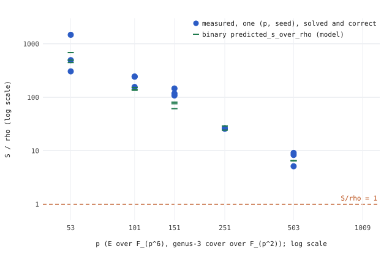

# Interim run report: Joux–Vitse cover S/rho against p (2026-10-24, 05:50Z snapshot)

**Status: interim.** The study's main run (`../../run.sh`) was still running when this report was made: later runs (p = 1009) were in progress, and the agent's fit tool (`../../fit/`) had not yet written the slope fit. A final report replaces this one in the same PR. Protocol: [`../../PROTOCOL.md`](../../PROTOCOL.md), frozen before the main run.

Scope: the `jv_cover` genus-3 cover of E(F_{p^6}) over F_{p^2}, full rational 2-torsion, weak class only. This is not a statement about prime-order or generic curves.

*Figure. Each blue point is one measured (p, seed) `--exp dlp` run, with the binary's `s_over_rho` field as recorded. Green ticks are the binary's own `predicted_s_over_rho` (model). The dashed line is S/rho = 1. Source data: `data.csv`, from `../../results/dlp_p*_s*.json`. Layout only: `plot.py`.*

## Recorded values (measured; all solved = correct = true, oracle mismatches = 0)

| p | subgroup bits | S/rho, per seed (as recorded) |
|--:|--:|:--|
| 53 | 32.4 | 495.8 · 305.7 · 1476.6 |
| 101 | 37.9 | 156.3 · 243.5 · 244.6 |
| 151 | 41.4 | 108.2 · 146.3 · 117.9 |
| 251 | 45.8 | 26.5 · 25.7 · (seed 3 killed, exit 137, recorded in `results/walls.txt`) |
| 503 | 51.8 | 9.10 · 5.13 · 8.35 |

Notes:
- At p ≤ 251 the recorded ratio uses each record's own 16-run rho mean. At p = 503 it uses `--rho-ref 1.3`. The protocol's primary comparison uses the pooled rho mean over p ≤ 251 for every point, and that recomputation and the fit belong to the final report.
- Every S/rho here is a weight-0 lower-bound comparison (AGENTS.md §5a). No ranking of cover against rho is made, and no point is below 1.
- Observation only: the recorded ratio falls by about two orders of magnitude from p = 53 to p = 503. Slope, interval and the extrapolated p* are left to the protocol's fit.
