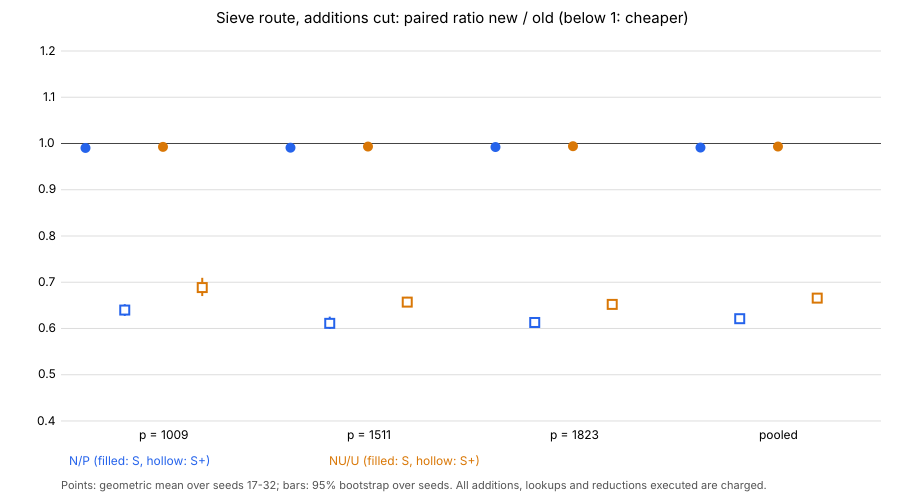

# Cutting the additions of line enumeration and the sieve (L8), 2026-11-03

Frozen protocol: `PROTOCOL.md` (hash, binaries and timestamp in `results/FROZEN.sha`, 2026-11-03T02:21:28Z).
Records: `results/*.json|log`. Analysis (Rust, `fit/`): `analysis/analysis.txt`. Labels: **measured** = read from a
record, **derived** = computed from records in Rust, **model** = a stated cost model.

## Result in one paragraph

Two changes that leave every line, hit, relation, descent digest and the discrete logarithm bit-identical remove
almost all of the enumeration's additions and 17-19% of the sieve's, and do not raise the multiplications.
**Measured/derived, 48 paired instances:** S+ ratio N/P = **0.621 [0.614, 0.629]**, S ratio **0.990 [0.990, 0.991]**;
with the line search (NU vs U) S+ **0.666 [0.658, 0.674]**, S **0.992 [0.992, 0.993]**. In the like-for-like
`bitop/v1` **model** the effect is much smaller: ratio 0.880 [0.874, 0.886] (11.7% of the proxy removed) if the
linear algebra is priced as 11-bit multiplications, 0.953 [0.951, 0.956] (4.5% removed) if its multiplications
are priced as 58-bit ones. S+ over-states the gain because it prices an add as a full multiplication.

## Where the additions go (measured, V2/P records, p = 1511)

* Enumeration: 100% of `enum_adds` (12.1k per B, 4.7e9 per run) is `roots_by_table`, the root search of
  `G = Im(B^2 h)` (degree 8) by forward differences over all `x in F_p`: `8p + 36` per B, 0.50 lines per B.
* Sieve: `sieve_adds` is 28.8k per line = `19p` (the difference tables of `P2` (8), `P3` (9), `P4` (2),
  advanced at every `x`, though only the ~`p/2` base `x` are read) plus 84. `sieve_lookups` is one per root.
* S+/S = 3.2 / 4.2 / 4.3 at p = 1009 / 1511 / 1823 (arm P); adds are 97% of the emitted native operations (the counter
  lookups the rest).

## The two changes (exact; defaults on, `JV_ADDS_INC=0` / `JV_ADDS_SHARE=0` turn them off)

1. **Incidence root search.** For `m = 9`, `b1 != 0`, `G(x) = 0` iff `b0 = nu b1 - x` for a root `nu` of
   `nu^2 + 2 (h0/h1)(x) nu + w`: the roots of `G` for a set of B's are the incidences of the B's with ~`p` lines
   of the `(b0, b1)` plane. Per round (all threads' B's together, ~10k B's) one scan: each line walked over `b1`
   with 1 addition and 1 lookup per step. Per B this is 78-393 additions and 145-774 additions+lookups instead of 8.1-14.6k
   (**measured**, `analysis.txt`); falls back to the old search for `b1 = 0` and non-squarefree `G` (counted).
   The remaining multiplications of the old search (evaluations at the table build, ~70 per B) are no longer executed.
2. **Shared `P3`, `N(B)` for multi-line B's.** 6-8% of B's have 2+ lines (7.7% = 30k of 390k at p = 1511);
   their `P3`, `P4` values are computed once and read at base steps: sieve adds per line 28.8k -> 23.4k at
   p = 1511 (-19%), with 2 emitted reads per base step.

Code: `src/cryptanalysis/jv_sieve.rs` (+~420 lines: `nu_lines`, `roots_by_incidence`, `SharedB`,
`lines_for_b_hint`, `factor_lazy_hint`, a `shared` argument to `sieve_line`, `hints`/`share` to `sieve_batch`,
four record fields, `total_plus` includes the new lookups/reads; two unit tests). `cargo fmt` clean for the file;
`cargo clippy --lib -- -D warnings` shows no finding (only the toolchain's unknown-lint note from the repo's
clippy flags); 12 `jv_sieve` tests pass (`cargo test --release --lib jv_sieve::tests`).

## Controls (measured)

| control | result |
|:--|:--|
| C1 P (old binary) = V2 sparse records, every field but `wall_ms` | 48/48 PASS |
| C2 N0 (new binary, both switches off) = P, every field but `wall_ms`; new fields zero | 48/48 PASS |
| C3 N vs P and NU vs U: all outcome fields equal (`bs, lines, hits, roots, relations, rels_verified, descent_*, la_*, solved, correct`, ...); `d(total_muls) = d(table+enum+sieve muls)`; search natives equal | 48/48 and 48/48 PASS |
| C4 every run solved, correct, 0 failed verifications, not exhausted | PASS |
| C5 unit tests: scan = `roots_by_table` for all `p^2` B's at p = 53, 101, 103; hinted lines = plain lines in order; shared-array sieve = plain sieve | PASS |

## Ratios (derived, geometric mean new/old, 95% bootstrap over seeds, 20000 resamples)

| comparison | metric | p = 1009 | p = 1511 | p = 1823 | pooled |
|:--|:--|:--|:--|:--|:--|
| N / P | S | 0.9893 [0.9880, 0.9905] | 0.9899 [0.9887, 0.9910] | 0.9913 [0.9903, 0.9922] | **0.9901 [0.9895, 0.9908]** |
| N / P | S+ | 0.6398 [0.6272, 0.6528] | 0.6111 [0.5990, 0.6257] | 0.6130 [0.6024, 0.6243] | **0.6212 [0.6141, 0.6285]** |
| NU / U | S | 0.9916 [0.9903, 0.9929] | 0.9923 [0.9916, 0.9931] | 0.9931 [0.9925, 0.9936] | **0.9923 [0.9918, 0.9929]** |
| NU / U | S+ | 0.6885 [0.6699, 0.7091] | 0.6570 [0.6469, 0.6683] | 0.6521 [0.6447, 0.6603] | **0.6657 [0.6581, 0.6739]** |

Section 5a band (natives at `w` GAE each, `w = 0, 0.1, 1`; pooled N/P: 0.9901, 0.4917 [0.4906, 0.4930], 0.4866
[0.4855, 0.4877]; NU/U: 0.9923, 0.5281, 0.5223): the change improves at every `w` in the band (upper ends below 1).
H1 (S does not rise, S+ falls) and H2 (the same with the line search) are **supported**; model prediction before
data (S+ 0.59-0.72, S 0.989-0.994) held. Distance to the matched rho: unchanged in kind. V2's rows are at S/rho
0.0046 and S+/rho 0.017 (p = 1511, seed 17); the S+ distance falls by the S+ ratio, the S distance by 1%.
Rho was not rerun here, so no band comparison against rho is made.

## Like-for-like unit (model; added on the red team's request, not a decision statistic)

`bitop/v1` priced per `docs/units/BITOPS.md` at b = 11: add 0.096, word op 0.043 of a multiplication; words from
the counters (`fit/src/main.rs::proxy`); the linear algebra's `la_muls` at 1 or at 27.3 (58-bit/11-bit multiply).

| comparison | proxy ratio, LA at 1 | share removed | proxy ratio, LA at 27.3 | share removed |
|:--|:--|:--|:--|:--|
| N / P pooled | 0.8797 [0.8736, 0.8860] | 11.7% | 0.9530 [0.9507, 0.9555] | 4.5% |
| NU / U pooled | 0.9036 [0.8986, 0.9087] | 9.4% | 0.9776 [0.9770, 0.9782] | 2.2% |

In P adds are 16-22% of the proxy (LA at 1) and 7-9% (LA at 27.3), so even deleting every add would give at most
x1.19-1.28 resp. x1.08-1.10; N realises roughly 55-60% of that ceiling in both pricings. The
red team's x1.19 ceiling is reproduced. The proxy was not measured by the bitop recorder. The new loops'
index arithmetic is emitted to it (scan: 3 words per step, B index decomposition, shared-array stores and reads).

## Considered and not built (model)

Anything that replaces additions by multiplications raises S: tabulating `A1'` instead of `P2 = w A1'^2`
(-4 of 19 adds per step, +1 mul per base step, +3.7% muls), evaluating `P3`, `N` from per-run `h0, h1` tables
(3-4 muls per `x`), early termination (a counter needs `m - c` of the remaining base steps; prunes only the last
few), Newton gap-skipping (as many adds as single steps). No further mul-neutral reduction of the 19 adds per
step was found; the sieve's adds are now 45-55% of S+ and the multiplications (enumeration factoring 29%, descent
and linear algebra) are untouched.

## Deviations and limits

* NI and NS (single-change ablations) were not run: the pre-declared cut rule (time budget; counted metrics are
  host-independent) dropped them. The split between the two changes is therefore only from the prototype
  (p = 1009 seed 1: INC removes the 4.2e9 enumeration adds; SHARE the 0.86e9 sieve adds, 18%), not frozen data.
* The new binary has defaults on; the repository's earlier records are unchanged because the old binary is P.
  `table_muls` rises by ~28-50k per run (the `nu` table, charged once) while enumeration muls fall ~30M.
* `m = 9` only; larger `m` falls back. P's source is the round-3 tree before the edit (binary hash in `FROZEN.sha`).
* The source commit is in the main session's WIP branch (`FROZEN.sha` records the file hash). Disk: the analyzer's
  target directory lived in the scratchpad and is not in `fit/`.
* S+ is V2's definition (an add or lookup = a multiplication); it is shown for continuity, the proxy for realism.

## Post-study change: the switches are opt-in (main session, 2026-11-03)

When the frozen runs were made, the new binary (fb936de1…) had both changes on by default, with `JV_ADDS_INC=0` / `JV_ADDS_SHARE=0` to turn them off.

Before merging, the default was flipped so the plain sieve route stays bit-identical to every earlier record:
- `adds_switch` now treats unset as **off**.
- `JV_ADDS_INC=1 JV_ADDS_SHARE=1` turns the changes on.

Checked with the rebuilt binary at p = 1009, seed 17:
- With no switches set, the output equals the frozen `N0_1009` record (= P) in every field except `wall_ms`.
- With both switches set to 1, it equals the frozen `N_1009` record.

The frozen arm N therefore corresponds to `JV_ADDS_INC=1 JV_ADDS_SHARE=1` on current code. No number in this study changes.
