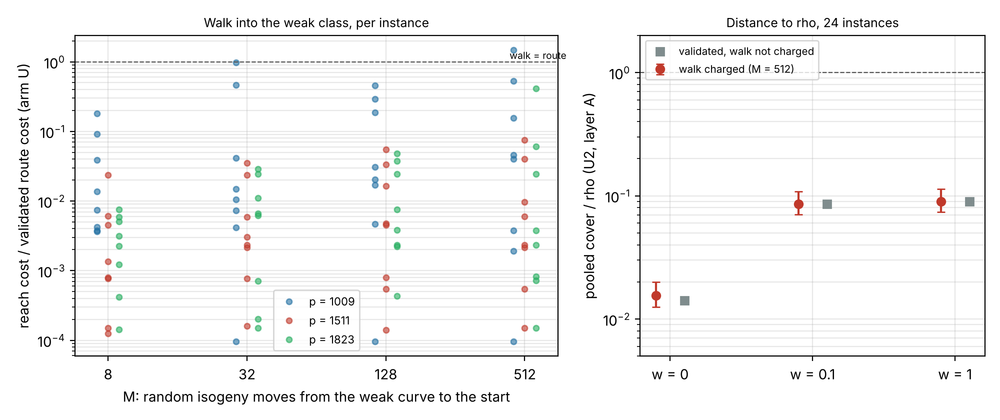

# The isogeny walk into the weak class, charged: the validated JV row stays about 11× below rho

Scored against `PROTOCOL.md`, frozen before any run (commit `a2159b02c9`). Every number is an **unverified
assertion** `[pcc:unverified]`. **Class:** an accounting item on a validated row
(`research/jv_sieve_line_vs_rho_20261103`). It adds the one cost that row left out, for curves of the weak
class only.



*Figure:*
- *Left: reach cost (walk + point transport + model change) over the validated route cost of the same instance,
  for 24 instances and 4 starting distances.*
- *Right: pooled cover ÷ rho at M = 512 with the walk charged (red, 95 % bootstrap), against the validated row
  without it (grey).*
- *Data: `analysis.json`, `arith.json`, `runs/`.*

## Verdict (decision rule of PROTOCOL.md): **walk charged, still below rho**

- **The runs.** 96 runs: p ∈ {1009, 1511, 1823}, seeds 17–24 (the validated instances), M ∈ {8, 32, 128, 512} random
  isogeny moves from the weak curve to a non-weak start C.
  - Every run found a weak curve, solved, verified the logarithm on C, and started from a non-weak C.
  - There were **0 failures**.
- **Pooled cover ÷ rho, arm U, U2, layer A, at M = 512:**

| w | walk charged [95 %] | validated, walk not charged |
|---|---|---|
| 0 | **0.0155** [0.0125, 0.0200] | 0.0141 |
| 0.1 | **0.0858** [0.0707, 0.1088] | 0.0857 |
| 1 | **0.0900** [0.0739, 0.1138] | 0.0900 |

- **Prediction.** Registered 0.85 on this verdict, which held. The reach median per prime was 4.3 %, 0.42 % and 0.31 %,
  all below 10 % as predicted (registered at 0.6).

## The tail

- **The walk cost is heavy-tailed, and its tail grows with M.**
  - Medians stay at 0.1–4 % of the route.
  - The worst instance rises from 0.18× the route (M = 8) to **1.48×** (M = 512, p = 1009, seed with a 2/6-step path:
    1.9·10⁹ F_p multiplications).
  - Walk paths are 1 to 10 isogeny steps. The cost is the breadth-first search, not the path.
- **Arithmetic mean, the cost an attacker pays.** This statistic was declared after the run (`arith.py`).
  - At M = 512 the walk adds **21 %** at p = 1009, **1.6 %** at p = 1511 and **6.2 %** at p = 1823.
  - The charged arithmetic mean is **0.039 / 0.012 / 0.0086 × rho**.
- **Saturation.** The medians barely move between M = 128 and 512, but the maximum keeps growing. Larger M, or a
  truly uniform start, could put more mass in the tail. Nothing measured here comes within 25× of erasing the gap.

## What this does and does not cover

- **Covered:** curves in an isogeny class that holds a weak curve, starting up to 512 random moves away.
- **Not covered: the class coverage.** `research/jv_weak_class_law_20261007` (toy sizes, exhaustive) finds **no** weak
  curve in classes whose 2-volcano has depth 1, which is half of all classes. For depth ≥ 2, 86–95 % of classes
  hold one. A curve in any other class cannot use this route at any cost. This is quoted, not re-measured.
- **Unpriced:** the walk's hash-set probes are not emitted (declared in PROTOCOL.md). They are one probe per curve
  met, small next to the multiplications of each Vélu step, but not counted.
- **Not uniform:** M random moves is a proxy for a random curve of the class.

## Reproduce

`runs/plan.txt` holds the 96 (p, seed, M) rows. The command for each row:

```sh
env JV_LIN=sparse JV_FB_LINE=32768 JV_FB_LINE_MODE=table \
  target/release/examples/jv_isogeny_walk --e2e --sizes P --seeds S --e2e-moves M --stop 64 --json runs/pP_sS_mM.json
python3 analyze.py && python3 arith.py && python3 plot.py
```

The binary sha256 is in `runs/binary.sha256`. The runs took 1,504 s on the 4-core container. Wall time is
descriptive; all costs are counted F_p multiplications.
