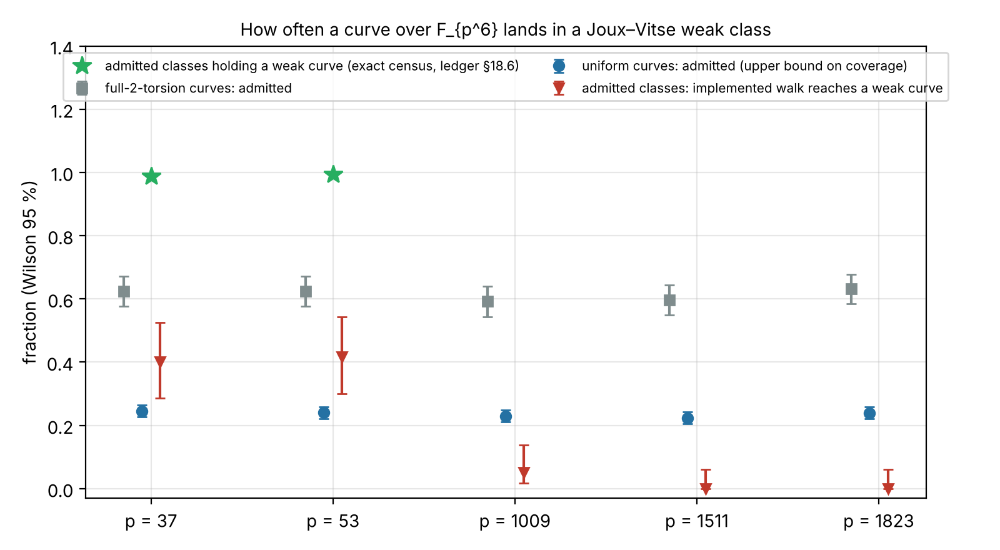

# How often a curve over F_{p⁶} lands in a Joux–Vitse weak class

Scored against `PROTOCOL.md`, frozen before any run (commit `1b824d8168`), with two amendments made during the runs,
both disclosed. Every number is an **unverified assertion** `[pcc:unverified]`.

**Scope.** The cubic norm-one branch used by `jv_cover`'s route. The quadratic-h branch of the published family is
out of scope.

*Figure, by prime:*
- *blue: share of uniform curves whose class passes the proved necessary condition (admitted);*
- *grey: the same for curves with full 2-torsion;*
- *red: share of admitted classes in which the implemented walk reaches a weak curve;*
- *green: share of admitted classes that hold a weak curve, from the exact censuses at small p (ledger §18.6).*
- *Wilson 95 % intervals. Data: `analysis.json`, `runs/`.*

## Results

| p | U: uniform curves admitted (n = 2,000) | F: full-2-torsion admitted (n = 400) | W: walk reaches a weak curve (of 60 admitted) | operational coverage U × W |
|--:|--|--|--|--|
| 37 | 24.5 % [22.6, 26.4] | 62.5 % [57.7, 67.1] | 40 % [29, 53] | 9.8 % |
| 53 | 24.0 % [22.2, 25.9] | 62.5 % [57.7, 67.1] | 42 % [30, 54] | 10.0 % |
| 1009 | 22.9 % [21.1, 24.8] | 59.3 % [54.4, 64.0] | **5 %** [1.7, 13.7] | **1.1 %** |
| 1511 | 22.3 % [20.5, 24.2] | 59.8 % [54.9, 64.4] | **0 %** [0, 6.0] | **< 1.5 %** (upper bound) |
| 1823 | 24.0 % [22.1, 25.9] | 63.3 % [58.4, 67.8] | **0 %** [0, 6.0] | **< 1.6 %** (upper bound) |

- **About a quarter of all curves are admitted, at every size.** Admission means the class passes the proved
  necessary condition `t ≡ ±(p⁶+1) (mod 16)`; 22–24.5 % of uniform curves pass it, flat from p = 37 to 1823. That is
  the **upper bound** on how often a random curve lands in a weak class.
  - Among curves with full 2-torsion the share is 59–63 %, matching the ledger's 63 %.
  - The prediction of 1/8 for uniform curves failed: the share is about twice that.
- **Do admitted classes really hold a weak curve?** At p = 37–67 the exact censuses say 98.8–99.6 % do, and the share
  rises with p. At p ≥ 1009 it stays unresolved, except for the classes this study reached.
  - **New:** 3 random admitted classes at p = 1009 were reached. They are the first large-field witnesses: a
    192–252-bit attempt found none.
  - If the census share carries over, about 23 % of all curves lie in a weak class.
- **The implemented walk reaches far fewer of them.**
  - At p = 37–53 it reaches a weak curve from about 40 % of admitted starts, although about 99 % of those classes
    hold one. Its walks close well below the cap: the result is the same at 10,000 and 100,000 curves at p = 37.
  - At p = 1009 it reaches 3 of 60; at p = 1511 and 1823, 0 of 60 each.
  - The reason: the odd jumps (3, 5, 7) exist only where an ℓ-torsion point is rational over F_{q³}. From a random
    start, they and the 2-isogenies within the full-2-torsion locus reach a small part of the class.
  - **Operational coverage of the route as implemented** is therefore about 10 % of curves at toy sizes and about
    1 % at p = 1009, and its upper bound is about 1.5 % at p = 1511 and 1823. The prediction (W < 0.1 at p ≥ 1009,
    0.7) held.
- **Successful walks from random starts are expensive.** The three p = 1009 walks took 19–153 isogeny steps and
  1.8·10⁹ to 3.0·10¹⁰ F_p multiplications. That is 0.008–0.14 × the matched rho at p = 1009, and up to about 30×
  the route itself.

## Consequence for the validated row and the walk charge

- `research/jv_walk_charge_20261111` built its starts by moving away from a weak curve with the same restricted
  moves, so its walk charge covers starts the walk can reach. It does not cover an arbitrary curve of the class.
- For an arbitrary admitted curve at p ≥ 1009, the implemented walk usually never arrives. When it does, it can cost
  a sizeable fraction of rho.
- The validated sieve result stands for curves **in** the weak class. Reaching that class from a typical curve
  needs a walk over the whole class group: odd isogenies with irrational kernel points, i.e. kernel polynomials of
  degree (ℓ−1)/2. That walk is not implemented. **That is the next construction step.**

## Disclosures

- Smoke runs before the freeze: p = 1009, 6 curves, and a cap sweep on one curve. They are not data.
- Amendment 1: the walk was limited to the first 60 admitted curves per prime.
- Amendment 2: the cap was lowered from 100,000 to 10,000 curves. The 100,000-cap records of p = 37 and 53 are kept in
  `runs/attempt2/`; p = 37 matched exactly, 24 of 60.
- Host: the 4-core container. All costs are counted F_p multiplications; walls are descriptive.
- Binary: `jv_weak_coverage` (sha256 in `runs/binary.sha256`) and PARI/GP 2.15 `ellcard` for U.
