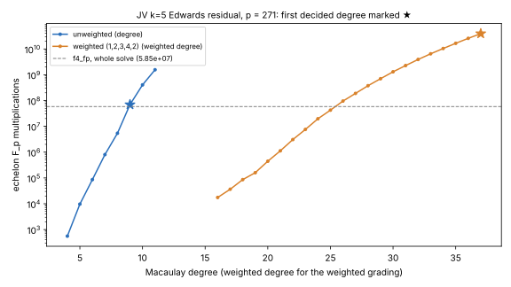

# Weighted grading for the k = 5 Joux–Vitse Edwards test: a loss (2026-11-06)

**Question.** Does the weighted grading that cut the D₄ route's solve
(`RESEARCH_GLV_INVARIANT_FACTOR_BASES.md`, "854× with the weighted solve")
cut the per-residual decision cost `C″` of the 2-torsion Edwards route
(`src/cryptanalysis/jv_quintic_edwards.rs`)? That route's note
(`research/notes/index-calculus/RESEARCH_K5_TORSION_JOUX_VITSE.md` §5) does
not list it among its levers.

**Answer: no.** The weighted grading is about 670× more expensive than the
current solver [pcc:unverified].

Report: [`REPORT.pdf`](REPORT.pdf) (source `REPORT.typ`). Graph:
[`fig_weighted.svg`](fig_weighted.svg), from `plot.py` over `raw/`.

## Setup

- **Probe:** the ignored test `weighted_probe` in `src/cryptanalysis/jv_quintic_edwards.rs`.
- **Instance:** `p = 271`, seed 2, three random residuals.
- **System:** `(e₁, e₂, e₃, e₄, π)`, with the five Weil components and `π² − e₄`.
- **Solvers compared:**
  - `f4_fp::solve` (grevlex, the route's solver);
  - the Macaulay solve `gaudry_quartic::solve_system_w_inner`, with weights all 1;
  - the same solve with weights `(1, 2, 3, 4, 2)`. Here `e_i` has weight `i` in the `y²`, and `π` has weight 2, since `π² = e₄`.
- **Degrees:** each Macaulay arm is raised until the system is decided, either as no solutions or as "1 is not standard".
- **Change to `gaudry_quartic`:** that case previously shared its outcome with "a variable is not standard", which decides nothing. The two are now separate outcomes.

## Result (identical on all three residuals to within 0.5 %)

| solver | decided at | matrix | `F_p` multiplications |
|---|---|---|---:|
| `f4_fp` grevlex (the route today) | degree 2 steps, inconsistent | 720 × 768 at most | 5.85·10⁷ |
| Macaulay, unweighted | degree 9, no solutions | 1,802 × 2,002 | 7.0·10⁷ (echelon), 1.3·10⁸ (all) |
| Macaulay, weights (1,2,3,4,2) | weighted degree 37, inconsistent | 28,981 × 26,618 | 3.9·10¹⁰ (echelon) |

Weighted degrees 16–36 end on "a variable is not standard", which decides
nothing. The equations have weighted degree 16, against total degree 4.

Why the weighting fails here:
- The symmetrised `A` is bounded by total degree 4 in the `e_i`, so its weighted degrees spread over 0–16.
- The weighted grading therefore fits this system worse than the plain one.
- On the D₄ route the system was weighted-homogeneous at the top, and the weighting matched it.

## The other half of the check: precomputing the target-independent part

A trial's five Weil components are fixed combinations of target-free polynomials, with target-dependent coefficients:
- the coefficients are the `F_p` coordinates of `y_R^{2k}` times the fixed `F_{p⁵}` coefficients;
- every trial lies in the same fixed space of 105 monomials;
- the five combinations are generic, so nothing about the trial's ideal is smaller than today's input.

The fixed shape is what trace replay already uses (1.74–1.77×, `research/joux_vitse_n1_20261015`). No precomputation was found that shrinks the matrix, so none was built. This half is an argument, not a measurement.

## Not claimed

- No change to `C″`, to any leaderboard row or to `benchmarks/`.
- One prime, `p = 271`. Matrix sizes and degrees do not depend on `p`; the multiplication counts depend on it only through sparsity.
- A local probe, not an Iso Lab run.

Sources checked: the research-kb MCP server is not available in this session, so the knowledge-base search was not run. The repository was searched instead, with `rg -i weighted` over `research/notes` and `src`.
