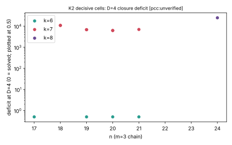
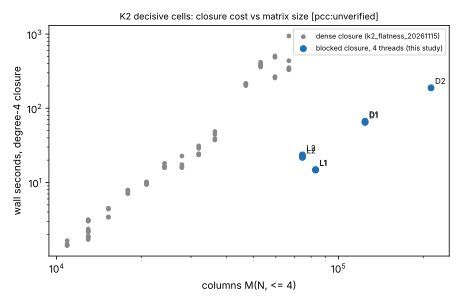

# K2 decisive cells: the degree-4 closure stalls at k = 7 and k = 8 (m = 3) `[pcc:unverified]`

Extension of `research/k2_flatness_20261115` (61/61 chain systems solved at D = 4 for n <= 18, k <= 6). Protocol
[PROTOCOL.md](PROTOCOL.md) frozen in commit `017ced659b` before any decisive-cell data (`REGISTRATION.sha256`,
`registered-at.txt`). Every number is an unverified assertion (no pcc claim, validator or replay certificate); no
leaderboard or benchmark row.

## Instrument

[`k2m4r.rs`](k2m4r.rs), standalone (no `src/` edits). System builders, solution enumeration and the registered
"solved at D" test are unchanged from `k2close.rs`; the closure is now a packed-u64, tile-major Four-Russians echelon
fed in batches (`--engine m4`), with the dense original kept as `--engine ref`.

- Reproduction (raw/validate_*): 80 (cell, target, D) rows over the original P, A, B, C and N cells, both engines:
  0 mismatches in solved / rank / target rank / columns (`raw/validate_compare.txt`); D_sol reproduced (P: 3 and 4;
  A, B, C: 4). Larger original rows (n = 16-18, m = 4 n = 11) solve at D = 4 in 4-13 s against 44-490 s dense.
- Controls in the grid: positive P passes (D_sol <= 4 on all 8 targets); negative N, N-D1 stall (deficits 9116,
  10178, 104657 of 12951 / 12951 / 124314 columns).

## Route

No EKS access from this container: no `kubectl`, the AWS identity available is rejected by STS (InvalidClientTokenId),
the checkpoint upload token expired 2026-11-05, and GitHub dispatch needs a pushed commit (not permitted here). The
grid therefore ran locally (4 threads, `ulimit -v 9 GB`, CPU lock): 430 s wall for the registered grid, far inside the
3 CPU-hour budget. `.resume` checkpoint upload and `benchrec upload` could not run (see session log).

## Results (registered grid, seed 1; `raw/grid.jsonl`, `results.md`, `results.json`)

| cell | m | n | k | N | columns | targets | D = 4 result | deficit | s (4 thr) | peak RSS GB |
|:--|--:|--:|--:|--:|--:|--:|:--|--:|--:|--:|
| L1 | 4 | 13 | 3 | 38 | 82993 | 2 | solved, D_sol = 4 both | 0 | 14.9 / 14.7 | 0.86 |
| L2 | 3 | 19 | 6 | 37 | 74519 | 2 | solved, D_sol = 4 both | 0 | 23.5 / 21.8 | 0.79 |
| **D1** | 3 | 21 | 7 | 42 | 124314 | 2 | **stall at D = 4 (both)** | 6979 | 64.6 / 66.9 | 1.96 |
| **D2** | 3 | 24 | 8 | 48 | 213053 | 1 | **stall at D = 4** | 24922 | 188.5 | 5.31 |
| **D3** | 4 | 16 | 4 | 56 | 396607 | 0 | **not run (memory gate, registered)** | - | - | - |

Registered verdict: D1 **breaks**, D2 **breaks**, D3 **not reached**; overall **breaks** (any decisive cell
breaking). Controls pass. D3 needs up to 19.7 GB of echelon basis, over the 9 GB cap; it is open.

## Post-hoc exploration (not registered; `raw/explore.jsonl`, `raw/explore_ref.jsonl`)

Two targets each, m = 3, D = 4: k = 6 at n = 17, 20, 21 solves (6/6, deficit 0); k = 7 at n = 18, 19, 20 stalls
(6/6, deficits 6.2k-10.9k of 92k-113k columns). The stall tracks k (>= 7), not n: at k = 7 it appears already at n = 18,
where 3k > n, and k = 6 still solves at n = 21. Within a cell both targets have the same rank and degree profile
(the deficit is a property of the chain's first equation and the subspace, not of the target, and it does not depend
on whether solutions exist). The deficit is the same on the dense reference engine for n = 18, k = 7, target 0
(rank 81298, deficit 10873, 843 s; m4: 25.7 s). Both engines use one definition, the registered one.

## Interpretation and limits

- What it shows: for the chain presentation, the degree-<= 4 closure no longer reaches the ideal at k = 7 (m = 3);
  the D = 4 flatness of the original study ends between k = 6 and k = 7 on these draws. D = 5 was not scanned (D = 5 at
  N = 39-48 is 0.6-1.7 million columns before products), so D_sol >= 5 is not established, and the semi-regular degree
  (7-9) is not approached or excluded.
- What it does not show: one seed (seed 1) per cell, 1-2 targets; the direct presentation (degree 6); cost against rho;
  the m = 4 decisive cell (not run). A single-draw "breaks" is the registered rule's output, not a rate.
- Instrument speed (derived): the blocked closure is about 30x faster than the dense one at 66712 columns (11.8 s vs
  352 s original, same cell); memory is the limit (basis ~ cols^2/8 bytes), which blocks D3 locally.

 

## Open items

D3 (m = 4, k = 4) on a >= 24 GB EKS node; a D = 5 closure at k = 7 (n = 18-21) to find D_sol; more seeds at k = 7.

## Sources checked

research-kb unavailable (no tool in this session); lead atlas not read. Read: `research/k2_flatness_20261115/*`,
`research/descent_m3_memory_20261115/README.md`.
