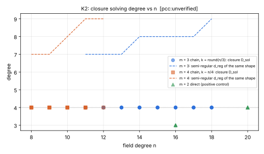

# K2 flatness test: GF(2) degree-bounded closure of binary decomposition systems, m = 3 and 4 `[pcc:unverified]`

Lever 3 of `research/noneric_lane_survey_20261115/README.md`; lead K2 `LEAD-KOB-flat-degree-crossover-bar`
(`research/leads_20261112/README.md` §2c, `lanes/lane_K_koblitz_binary.md` §2). Protocol frozen in
[PROTOCOL.md](PROTOCOL.md) (commit `6806177b5d`) before the grid. Every number here is an unverified assertion
(no pcc claim, no validator, no replay certificate); no leaderboard or benchmark row.

## Ownership check (step 1)

- **K2 is unowned.** The survey's lane map (2026-11-15 ~18:50Z) lists "K2 (binary m = 3/4 flatness) not started
  by anyone"; no open or closed PR matches "flatness", "K2 closure", "binary closure degree" beyond the m = 2 / prime
  lanes (GitHub REST search, isogeny-labs/crypto, 2026-11-15 ~19:00Z); no session-log entry since 11-13 names K2.
- Neighbouring lanes, none of which covers binary m = 3/4: #2902 (native **m = 2** closure/F4 instrument, open),
  #4291 (closure depth in Rust, **prime** Kummer chains, open), #4278 (grevlex solving-degree bounds, **prime**
  two-summand Kummer chain, open), #4098 (PKM fall degree, prime); the 11-15 02:20Z entry adds
  `dreg_forecast::effective_degree` (binary-subspace **m = 2** shapes, k >= 7); ml-cryptanalysis PR #101 "binary deep
  chain" is m = 2. Prior m = 3 degree data: `research/ic_semiregular_law_20261005` (direct S_4 "x4" refutation
  degrees 8-10 at l = 4-6, Koblitz, n = 23-61, following the semi-regular law) and
  `docs/ic/runs/ic-descent-degrees-m3-2026-09-22.json` (Buchberger, n <= 11).
- Reusable code found: `pq_descent_symbolic` (symbolic descent, m <= 3), `pq_xl`, `gf2_elim`,
  `descent_algebraic::rank_profile`, `ic_descent_degrees::semi_regular_degree`. To stay clear of the concurrent
  edits in `src/` the instrument is a standalone file here (same S_3/S_4 formulas as `semaev_s4_word`); nothing
  under `src/` was touched.

## Premise correction

The direct descent of S_4 is **degree 6**, not <= 4 (S_4 is quartic in each abscissa; x^3 = x * x^2 is a Boolean
quadratic): measured `gen_deg` > 5 on n = 12, k = 4. So the lead's "degree-<= 4 closure of the m = 3 system in
N = 3k variables" is undefined as stated (this also explains the "x4" degrees 8-10 above). K2 is measured on the
standard degree-<= 3 **chain presentation** with auxiliary abscissae: m = 3: S_3(x1, x2, U) = 0, S_3(U, x3, xR) = 0
(N = 3k + n, 2n equations); m = 4: S_3(x1, x2, U1), S_3(U1, x3, U2), S_3(U2, x4, xR) (N = 4k + 2n, 3n equations).

## What was built

[`k2close.rs`](k2close.rs) (standalone Rust, `rustc -C opt-level=3 -C target-cpu=native`): random binary curve and
random k-dimensional subspace V of F_{2^n}; symbolic Weil descent (checked against the word formula on 64 random
points per system); all F_2 solutions by enumeration along the chain (exact quadratic solver); the closure W_D
(smallest subspace of degree-<= D multilinear polynomials containing the equations, closed under f -> x_i f for
deg f <= D - 1) by semi-echelon GF(2) elimination in a degree-descending order. **Solved at D** iff rank W_D =
M(N, <= D) - rank(solution evaluation vectors) (for inconsistent systems: 1 in W_D). Controls: m = 2 direct S_3
(positive), random systems of the chain's exact shape with a planted solution (negative). [`dreg.py`](dreg.py) is the
Boolean semi-regular degree (same series as `ic_descent_degrees::semi_regular_degree`). [`run_grid.sh`](run_grid.sh),
[`analyze.py`](analyze.py) (mechanical decision rule), [`make_report.py`](make_report.py).

## Results (raw: [`raw/grid.jsonl`](raw/grid.jsonl), sha256 `fc226574…`; [`results.json`](results.json))

| series | m | n | k | N | eqs | targets (sat) | D_sol per target | share D_sol <= 4 | d_reg (semi-regular) | cols at D=4 | median s at D=4 |
|:--|--:|--:|--:|--:|--:|:--|:--|--:|--:|--:|--:|
| A | 3 | 11 | 4 | 23 | 22 | 4 (0) | 4 4 4 4 | 1.00 | 7 | 10903 | 1.48 |
| A | 3 | 12 | 4 | 24 | 24 | 4 (2) | 4 4 4 4 | 1.00 | 7 | 12951 | 2.23 |
| A | 3 | 13 | 4 | 25 | 26 | 4 (0) | 4 4 4 4 | 1.00 | 7 | 15276 | 4.39 |
| A | 3 | 14 | 5 | 29 | 28 | 4 (0) | 4 4 4 4 | 1.00 | 8 | 27841 | 17.385 |
| A | 3 | 15 | 5 | 30 | 30 | 4 (2) | 4 4 4 4 | 1.00 | 8 | 31931 | 28.833 |
| A | 3 | 16 | 5 | 31 | 32 | 4 (0) | 4 4 4 4 | 1.00 | 8 | 36457 | 44.485 |
| A | 3 | 17 | 6 | 35 | 34 | 4 (2) | 4 4 4 4 | 1.00 | 8 | 59536 | 486.597 |
| A | 3 | 18 | 6 | 36 | 36 | 4 (0) | 4 4 4 4 | 1.00 | 9 | 66712 | 351.826 |
| B | 3 | 15 | 3 | 24 | 30 | 4 (0) | 4 4 4 4 | 1.00 | 6 | 12951 | 1.874 |
| B | 3 | 15 | 4 | 27 | 30 | 4 (0) | 4 4 4 4 | 1.00 | 7 | 20854 | 9.955 |
| B | 3 | 15 | 6 | 33 | 30 | 4 (2) | 4 4 4 4 | 1.00 | 8 | 46938 | 213.23 |
| C | 4 | 8 | 2 | 24 | 24 | 4 (1) | 4 4 4 4 | 1.00 | 7 | 12951 | 3.043 |
| C | 4 | 9 | 2 | 26 | 27 | 4 (0) | 4 4 4 4 | 1.00 | 7 | 17902 | 7.74 |
| C | 4 | 10 | 2 | 28 | 30 | 4 (0) | 4 4 4 4 | 1.00 | 8 | 24158 | 16.305 |
| C | 4 | 11 | 3 | 34 | 33 | 4 (0) | 4 4 4 4 | 1.00 | 9 | 52956 | 388.785 |
| C | 4 | 12 | 3 | 36 | 36 | 1 (1) | 4 | 1.00 | 9 | 66712 | 942.182 |
| N | 3 | 12 | 4 | 24 | 24 | 1 (1) | >4 | 0.00 | - | 12951 | 0.208 |
| N | 4 | 8 | 2 | 24 | 24 | 1 (1) | >4 | 0.00 | - | 12951 | 0.079 |
| P | 2 | 16 | 8 | 16 | 16 | 4 (2) | 3 3 3 3 | 1.00 | 5 | - | - |
| P | 2 | 20 | 10 | 20 | 20 | 4 (2) | 4 4 4 4 | 1.00 | 5 | 6196 | 0.465 |

Not completed (stopped by the compute budget, excluded): C m=4 n=12 k=3 seed 1 target 1.

Controls: positive PASS, negative PASS. Verdict: series A (m = 3) **flat**, series C (m = 4) **flat**, overall **flat** (on the measured range).

- **Solving degree is 4 on every completed target**: 32 m = 3 targets (n = 11-18, k = 4-6, N = 23-36), 12 more at
  n = 15 with k = 3, 4, 6, and 17 m = 4 targets (n = 8-12, k = 2-3, N = 24-36). D = 3 never solves (0 of 62 D = 3 runs).
  Sat and unsat targets behave alike (10 of 61 had solutions).
- The generic (semi-regular) degree of the same shapes rises 7 -> 9; the negative control (same shape, no
  structure) stalls at D = 4 with deficits 9,116 and 10,178 of 12,950 columns, so D = 4 is structure of the
  chain systems, not an artefact of the instrument.
- **Dependence on k at fixed n = 15:** none in the degree (4 at k = 3, 4, 5, 6); only the matrix grows.
- Cost of this naive closure grows as about cols^3.4 (fit over 15 cells with cols > 12k): 1.5 s at N = 23 to
  350-940 s at N = 35-36.

**Verdict (registered rule): flat on the measured range** (series A m = 3: flat; series C m = 4: flat; controls pass).

### Deviations from the protocol

- The grid ran under one hold of the shared CPU lock (the per-call lock in the first `run_grid.sh` version starved
  behind other sessions; the call order and arguments are unchanged).
- The run was stopped by the ~2 CPU-hour budget (process time limit) during C (12, 3): 1 of 4 targets completed
  (D_sol = 4); seed-1 target 1 was mid-D = 4 and is excluded as incomplete; seed 2 and the A-ext cell (19, 6) were
  not run.

## What this means, and what it does not

- Flat D = 4 at these sizes is the small-instance behaviour the FPPR / Petit-Quisquater first-fall-degree argument
  rests on; whether it persists is exactly what is contested in the literature (pointers to check, not verified
  here: Huang-Kosters-Yeo 2015 on last fall degrees; Kosters-Yeo 2015 "Notes on summation polynomials"), and lane A
  saw the m = 2 closure stall from n >= 35. This test covers k <= 6 (m = 3) and k <= 3 (m = 4), **not** the lead's
  square cells (k = 10, 11 at m = 3; k = 8 at m = 4). It neither confirms nor refutes the lead's prior (0.15).
- It does not move any row. Under the lead's own cost model with flat D = 4 and the chain's larger variable count,
  the crossover with rho moves *up* (derived, `[pcc:unverified]`): n* ~ 205 for the lead's N = n + 8, ~ 281 for the
  m = 4 chain (N = 3n + 8), ~ 436 for an m = 3 chain analogue (N = 2n + 3). The per-relation yield 2^(mk-n)/m! is
  unchanged; closure degree is a proxy (WEAKNESSES E-GB-064).

## Next step

The decisive cells are where the degree would have to break: m = 3 chain at k = 7-8 (n = 21, 24; N = 42, 48;
M(48, <= 4) = 213,053 columns) and m = 4 at k = 4 (n = 16, N = 56, 396,607 columns). This dense incremental closure (cols^3.4) cannot
reach them in budget; use an M4RI/blocked GF(2) echelon or the native F4 instrument of #2902 restricted to degree 4,
run on isolab-eks per CLAUDE.md, with the same protocol extended (preregister the k = 7, 8 cells before running).
A D = 5 closure is not needed unless a D = 4 stall appears.

## Sources checked

- research-kb: **unavailable** in this session (no `kb_status`/`search_knowledge` tool); KB pass owed before any
  claim of novelty. Lead atlas not read (vault-encrypted per `research/leads_20261112`).
- `research/noneric_lane_survey_20261115/README.md`; `research/leads_20261112/README.md` §1, §2c, §3;
  `research/leads_20261112/lanes/lane_K_koblitz_binary.md` §2; `docs/session-logs/2026-11-13..15.md`;
  `research/ic_semiregular_law_20261005/{PREREGISTRATION,RESULTS}.md`; `docs/ic/runs/ic-descent-degrees-m3-2026-09-22.json`;
  `src/cryptanalysis/{pq_descent_symbolic,binary_semaev_s4,descent_algebraic,ic_descent_degrees,dreg_forecast}.rs`;
  PRs #2902, #4291, #4278, #4098 (titles/state via GitHub search).
