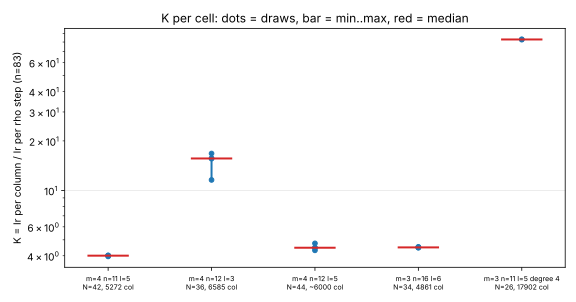

# K conversion: column touches to rho steps

**Result.** Measured with Callgrind on this host, one binary. One rho step costs
6665 Ir at n = 83 and 725 Ir at n = 61. One column of the dense degree-3
closure costs 26,000 to 105,000 Ir on the m = 4 cells, so K (rho steps per
column touch) is **4.0 to 15.6** with the n = 83 step (pooled m = 4 median
4.48, range 3.96 to 16.77), and K grows with matrix size: 83 at 17,902 columns
(degree 4, N = 26). K is above 1, so the conversion **raises** the priced rows,
the opposite of the sign the note guessed (its K is the reciprocal).

## Definitions (frozen in PROTOCOL.md before any run)

K = (Ir per column touch) / (Ir per rho step). A column touch is one column of the
degree-D Macaulay matrix (the engine's `columns` = C(N, <=D), the note's w = 1
oracle unit). Ir per column = Callgrind Ir inside the dense full-MutantXL closure
(including the matrix build) divided by `columns`. A rho step = Ir inside
`StrongRhoG::solve` divided by the solver's `walk_steps`. Units are
`callgrind.Ir`, simulated user-space instructions; no wall-clock claim.

## K per cell (4 draws each; median [min, max])

| cell | columns | Ir per column | K, n = 83 step | K, n = 61 step |
|:--|--:|--:|:--|:--|
| m4-11-5 | 5272 | 26407 to 26786 | 4.01 [3.96, 4.02] | 36.81 [36.40, 36.92] |
| m4-12-3 | 6585 | 77150 to 111783 | 15.64 [11.57, 16.77] | 143.74 [106.34, 154.08] |
| m4-12-5 | 6305-6510 | 28760 to 31728 | 4.48 [4.31, 4.76] | 41.12 [39.64, 43.73] |
| m3-16-6 | 4861-4861 | 29871 to 30186 | 4.50 [4.48, 4.53] | 41.33 [41.17, 41.61] |
| m3-11-5-deg4 | 17902 | 550987 to 554271 | 82.91 [82.66, 83.16] | 761.74 [759.48, 764.01] |

Rho step: n = 83 capped walk of 10^6 steps, seeds 1 to 3: 6665.4, 6666.1, 6663.0 Ir/step.
n = 61 complete solves, seeds 1 to 3 (all verified): 724.3, 725.5, 725.6 Ir/step. The ecbench record
(`research/ecbench_rho_optimized_20261014`) gives 1003.5 Ir/step on another curve, binary and compiler;
it is not mixed in.

## Controls

- A/A: the same closure draw twice differs by 0.0048%; the same rho seed twice is identical (441330607 Ir both).
- Positive control: Ir inside the collected interval tracks the engine's own `closure_word_ops` across the 16 degree-3 draws (Spearman 0.83).
- Null control: the collected interval is 75 to 79% of total process Ir (the rest is parsing, system build and the plain XL basis).
- Cell m4-12-3 (l = 3, a denser system: 6585 columns, 18 to 29 M word-ops) has K about 3.5 times the other three, which sit within 12% of each other. Within-cell draw spread is 1% to 45%.

## Derived conversion of the two ECC2K-130 rows

This is **derived arithmetic**: row + log2 K, on rows the descent-degree note priced and on K measured at N = 26 to 44.
It is a change of unit (accounting), not an improvement. The degree question (does the closure stay at degree 4, or
5, up to N near 394) is unchanged and unmeasured; rho stays 2^60.81 and its n = 131 step cost is unmeasured.

| row | K used | K | log2 K | converted row | converted gap to rho |
|:--|:--|--:|--:|--:|--:|
| degree 4, w=1, ell=33 | low(min,n83) | 3.96 | 1.99 | 2^70.42 | +9.61 |
| degree 4, w=1, ell=33 | primary(median,n83) | 4.48 | 2.16 | 2^70.59 | +9.78 |
| degree 4, w=1, ell=33 | high(max,n83) | 16.77 | 4.07 | 2^72.50 | +11.69 |
| degree 4, w=1, ell=33 | n61 median | 41.12 | 5.36 | 2^73.79 | +12.98 |
| degree 4, w=1, ell=33 | deg4 growth cell n83 | 82.91 | 6.37 | 2^74.80 | +13.99 |
| degree 5, w=1, ell=34 | low(min,n83) | 3.96 | 1.99 | 2^73.12 | +12.31 |
| degree 5, w=1, ell=34 | primary(median,n83) | 4.48 | 2.16 | 2^73.29 | +12.48 |
| degree 5, w=1, ell=34 | high(max,n83) | 16.77 | 4.07 | 2^75.20 | +14.39 |
| degree 5, w=1, ell=34 | n61 median | 41.12 | 5.36 | 2^76.49 | +15.68 |
| degree 5, w=1, ell=34 | deg4 growth cell n83 | 82.91 | 6.37 | 2^77.50 | +16.69 |

Reading: the old gaps were +7.62 and +10.32 bits. At the pooled median K the converted gaps are
+9.78 and +12.48; across the m = 4 degree-3 range
+9.61 to +11.69 and +12.31 to +14.39. Because K grows with
matrix size and these rows have about 2^49 columns, the rows with K from small cells are **lower bounds** on the
oracle side, and the n = 131 step (wider field) would make K smaller by an unmeasured factor. No conversion measured here brings either row below rho.

## Limits

- n = 131 rho is not supported by the binary (group order exceeds u128): the denominator is n = 83 (primary) or n = 61.
- Degree 3 cells for the m = 4 numbers; degree 4 only at N = 26 (two draws). Degree 4 at N >= 34 costs too much under Callgrind.
- Symbol deviation from PROTOCOL.md 2.1: `from_system_closed_full` is inlined, so the toggle symbol is the function it calls, `ReducedBasis::from_system_closed_impl`. Same interval.
- Host: shared 4-vCPU Xeon 2.10 GHz VM, no PMU, no isolation tier; Ir is contention-independent. Binary and versions in PROVENANCE.txt. Conductor not installed in this container.
- The "(11,4), (12,4)" cells were read as n = 11 and n = 12 at m = 4.

Files: PROTOCOL.md, raw.jsonl, RESULT.json, run_k.py, analyze.py, make_report.py, PROVENANCE.txt.
Next improvement to try: measure K at degree 4 for N >= 34 on a larger host, and an n = 131 wide rho step.
