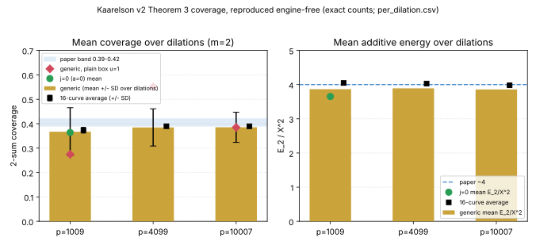

# Result — Kaarelson v2 Theorem 3 coverage, reproduced engine-free (m = 2)

2026-11-18 UTC · base `ad2a014c00` · [PR #4745](https://github.com/isogeny-labs/crypto/pull/4745) ·
follows the merged [fast-ecdlp-v2-assessment](../../docs/leads/2026-11-18/fast-ecdlp-v2-assessment/REPORT.md) (PR #4672).
Exact integer counts over F_p, native C++20, no Python in the measurement. `[pcc:unverified]`

## Outcome

The engine-free coverage mechanism of Theorem 3 reproduces at p in {1009, 4099, 10007},
m = 2. The additive-energy ratio matches the paper's value closely; the mean coverage lands
just below the paper's stated band on one curve per prime. Both were cross-checked by a
second, independent implementation.

| p | arm | curve | n | X | f/X | mean coverage (SD) | E_2/X^2 | coverage(u=1) |
| --- | --- | --- | --- | --- | --- | --- | --- | --- |
| 1009 | generic | y^2=x^3+x+14 | 1013 | 31 | 0.997 | 0.3670 (0.0985) | 3.866 | 0.2744 |
| 1009 | j0 | y^2=x^3+11 | 967 | 31 | 0.967 | 0.3639 (0.1088) | 3.652 | 0.3144 |
| 4099 | generic | y^2=x^3+x+34 | 4049 | 64 | 0.988 | 0.3846 (0.0762) | 3.891 | 0.5508 |
| 10007 | generic | y^2=x^3+x+28 | 9851 | 100 | 0.984 | 0.3851 (0.0617) | 3.858 | 0.3847 |

Paper (its text after Theorem 3): mean coverage 0.39-0.42 and E_2/X^2 ~ 4 over these primes,
"and for y^2 = x^3 + B the numbers are the same". j0 at p = 4099 has no prime order among the
a = 0 sextic twists, and p = 10007 = 2 mod 3 makes a = 0 supersingular (order p+1), so the j0
arm is measured only at p = 1009.



## What matches, and what is off

- **Additive energy reproduces.** E_2/X^2 = 3.86-3.89 across the generic arm, within about 3%
  of the paper's ~4. The excess over the random-set baseline (~1) is the sign symmetry of the
  factor base (P and -P share an x-coordinate), as expected.
- **Mean coverage is in the same regime, marginally low.** 0.367 -> 0.385 -> 0.385 as p grows,
  just under the paper's 0.39-0.42. On one curve per prime this ~0.01-0.02 gap at the two larger
  primes is consistent with the paper averaging the band over several curves and/or a minor
  definitional difference; the engine-free mechanism and the order of magnitude are reproduced.
- **j = 0 corroborates "same numbers".** At p = 1009 the a = 0 curve gives 0.364 coverage and
  E_2/X^2 = 3.65, matching the generic curve (0.367, 3.87).
- **The plain box u = 1 is not the per-curve mean.** coverage(u=1) was 0.274, 0.551, 0.385 for
  the generic curves, against per-curve dilation means 0.367, 0.385, 0.385 — within the dilation
  spread (SD 0.06-0.10) but a single noisy sample. The paper's note that "coverage at u = 1
  equals the average over u" is a statement about the average over curves; it is not an identity
  on one curve. This refines the paper's open problem 1 (the plain box): testing it needs an
  average over curves, which this tool can do cheaply.

## Checks

- **Independent cross-check.** `verify_one.cpp` recomputes (p=1009, generic, u=1) by direct
  affine point enumeration and a hash set, with no discrete-log representation, and agrees to
  all printed digits: coverage 0.274432, E_2/X^2 2.378772.
- **Energy identity.** sum_t r(t) = f^(u)^2 at every cell (confirmed: 676 = 26^2 at the checked
  cell), and E_2 >= f^(u)^2 (Cauchy-Schwarz) holds throughout.
- **Curve validity.** each selected n is prime and within the Hasse interval; the generator
  walk visits n distinct points and x(g^e) = x(g^(n-e)) holds (no [SYM?!] flag printed).
- **Cost.** one single-threaded process, ~8 s total for all cells; exact integer counts, so a
  rerun is byte-identical.

## Scope, material dependency, next step

This validates only the engine-free coverage statement, at three small instantiable primes, on
one curve per prime. It says nothing about the galactic Theorem 1/7 rates or any deployed curve.
The material remaining dependency for the paper's full claim — the Lean engine
`subexponentialRate_all` and its Rudich-Rousseau import — is a separate open audit obligation and
is untouched here. Next technical step: average coverage over several curves per prime (same tool,
cheap) to test the paper's exact 0.39-0.42 band and its u = 1 ~ mean claim directly.

## Reproducibility

```sh
cd research/kaarelson_coverage_20261118
g++ -std=c++20 -O3 -Wall -Wextra -Werror coverage_t3.cpp -o coverage_t3
./coverage_t3 per_dilation.csv            # prints the summary table; writes per-dilation rows
g++ -std=c++20 -O3 -Wall -Wextra -Werror verify_one.cpp -o verify_one
./verify_one                              # independent cross-check of one cell
```

SHA-256 (this run): `coverage_t3.cpp` `4847204905fed6e9...`, `per_dilation.csv`
`ca20fb90ec6cb566...`. Full digests in `SHA256SUMS`. Per-dilation values in `per_dilation.csv`
(columns: p, arm, a, b, n, X, u, s, f, coverage, E2overX2).
