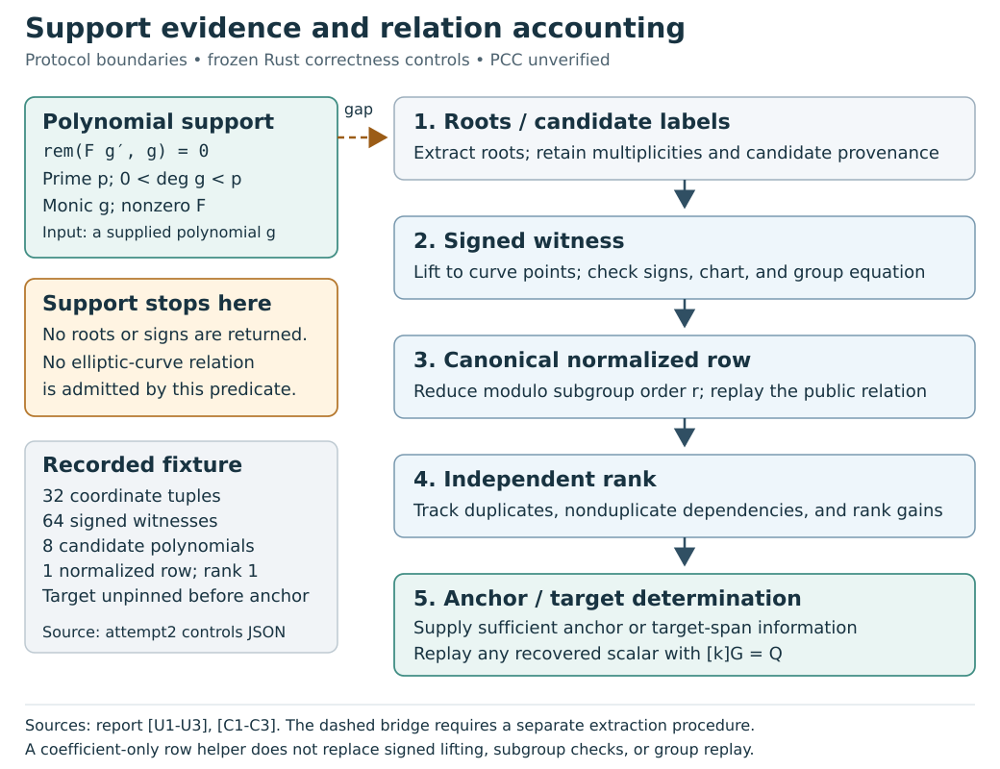

# Derivative support and fixed-target relation accounting

**Rust integration contract | 2026-11-22 America/Los_Angeles | [crypto PR #4980](https://github.com/isogeny-labs/crypto/pull/4980)**

Native qualification evidence is dated 2026-11-23 UTC.

## 1. Scope and status

The integration adds a guarded derivative-support predicate and its coefficient
Jacobian to the existing polynomial module, plus fixed-target row construction
and focused relation-rank controls using the existing audited matrix. These are
reusable implementation and accounting components. Frozen native qualification
recorded **4/4 example tests, 5/5 separately authored adversarial tests, and
6/6 selected original module tests passing**. The full-library release gate
failed to compile on delimiter errors in an untouched baseline file; no
full-library tests ran. The evidence registration
`PCC-20261123-08e731` and baseline-gate record `PCC-20261123-db257a` both
have **unverified** standing.
[pcc:PCC-20261123-08e731] [pcc:PCC-20261123-db257a] [pcc:unverified]

The source basis is the KeyAI M16 written contract [U1], inspected cancellation
and fixed-fiber Lean draft sources [U2, U3], and this repository's prior radical
support and row-audit implementations [C1-C3]. This work imports neither a Lean
proof nor the upstream Python replay. Its algebraic statements are adopted
source contracts with readable arguments below, not newly certified theorems.
No timing, search-cost improvement, or solver-degree bound is reported.
[pcc:unverified]

## 2. Polynomial support contract

Let $F\ne0$ and let $g$ be monic of degree $q>0$ over a prime field
$\mathbb F_p$, with $q<p$. Define

$$S_F(g)=\operatorname{rem}(Fg',g).$$

The adopted contract is

$$S_F(g)=0\quad\Longleftrightarrow\quad g\mid F^q
\quad\Longleftrightarrow\quad \operatorname{rad}(g)\mid F.$$

At a root of $g$ of multiplicity $e\le q<p$, the multiplicity in $g'$ is
$e-1$. Thus $Fg'$ contains the required multiplicity precisely when $F$ vanishes
there. Neither polynomial needs to be squarefree, and $F$ need not split over
the base field. This is a classical support criterion; the earlier RR9 predicate
already tests radical divisibility [U1, C3]. [pcc:unverified]

The Rust functions `poly_support_residual`, `poly_support_holds`, and
`poly_support_jacobian_at_root` take `(Fp, support, candidate)` with ascending
coefficients. They reject empty representations, unreduced coefficients, zero
$F$, a nonmonic or constant $g$, and $q\ge p$. Trailing zero coefficients are
accepted in $F$; $g$ must have a literal leading one. A nonzero constant $F$ is
valid input and supports no positive-degree $g$.

**Prime-field boundary.** `Fp` retains its existing caller-supplied primality
precondition. The new APIs check that the modulus is odd and lies strictly
between $2$ and $2^{62}$; those checks are not a primality test. Polynomial
coefficient arithmetic uses $p$. Relation-matrix arithmetic separately uses
the prime subgroup order $r$.

**Required negative control.** Over $\mathbb F_3$, $g=X^3$ and $F=X-1$ give
$g'=0$, although $g\nmid F^3$. The raw residual is misleading when the
characteristic condition is removed; all guarded APIs must reject this input.

<!-- PDF page break -->

## 3. Jacobian contract and its limit

At a supported $g$, put $H=Fg'/g$. For a variation $h$ with degree less than $q$,

$$dS_{F,g}(h)=\operatorname{rem}(Fh'-Hh,g).$$

The returned matrix has entry $(i,j)$ equal to the coefficient of $X^i$ in
$dS_{F,g}(X^j)$; the leading monic coefficient stays fixed. The API rejects an
off-support candidate. It returns the matrix, not its rank, and deliberately
accepts nonsquarefree $F$ so singular controls remain observable.

Locally at a root $\alpha$ of multiplicity $e$, the diagonal terms are
$(j-e)F'(\alpha)$ for $0\le j<e$. Hence nonsingularity follows when
$\gcd(g,F')=1$. Squarefree $F$ is sufficient; repeated roots of $F$ outside the
support of $g$ do not force singularity. Conversely, $F=(X-1)^2$, $g=X-1$
gives a zero Jacobian. These are local statements at supplied certificates;
they do not bound global elimination or the work needed to find $g$ [U1].
[pcc:unverified]

## 4. From a supported polynomial to useful relations

<!-- PDF page break -->

The support predicate ends before root extraction or signed lifting. A proposed
M16 norm chart has additional geometric hypotheses: denominator coprimality,
admissible target and support, multiplicities, and the divisor-to-group
correspondence [U1, section 3]. This integration does not implement that full
chart. A supported polynomial alone cannot be admitted as an elliptic-curve
relation.

For an actual signed relation in a prime-order subgroup,

$$\sum_i v_iP_i=Q,$$

the fixed-target coefficient row is $(v_1,\ldots,v_B,-1)$, with zero right-hand
side and coefficients reduced modulo $r$. The `fixed_target_row` helper only
constructs coefficients. The existing `AuditedMatrix` checks subgroup and
factor-base quotient mappings and replays the public group equation before
admitting a row [C2]. Its receipt distinguishes valid occurrences, normalized
duplicates, dependent rows, and independent rank increments.

The actual helper takes witness indices and a target sign $\sigma\in\{1,-1\}$
for $\sum_iP_i+\sigma Q=O$. With the factor-base convention
$[h]P_i=[c_i]B_{j(i)}$, it accumulates
$v_j=-\sigma h^{-1}\sum_{i:j(i)=j}c_i$ modulo $r$ before appending $-1$.
This preserves multiplicities, cancelling pairs, global sign, and cofactor
normalization. The cofactor must be invertible modulo $r$.

Cancellation pairs $P+(-P)$ can create distinct signed witness labels while
leaving the canonical row unchanged. The inspected upstream family in [U2]
has exactly this behavior. Nonduplicate rows can also be linearly dependent,
so neither deduplication nor witness count replaces rank computation.

For valid relations with one fixed nonzero target, any coefficient dependency
$\sum_j c_jv_j=0$ implies $(\sum_j c_j)Q=0$, hence $\sum_j c_j=0$ over
$\mathbb F_r$. Thus appending the constant target coefficient adds no rank
in this setting [U3]. This condition is not asserted for the identity target.
Existing `base_rank` continues to denote a projection rank. It does not count
target-cancelled base equations or establish reusable base logarithms.
[pcc:unverified]

A valid homogeneous relation still need not determine the target scalar.
Independent anchor information or a sufficient target-span certificate is
required. Any recovered scalar must pass the public check $[k]G=Q$. The focused
example retains this distinction between rank, determination, and replay.
The new `target_is_determined` accessor tests `rank == base_rank + 1` and
rejects audits containing invalid rows. Deserialized data still require full
receipt replay; the accessor itself authenticates neither data nor a scalar.

## 5. Native qualification and evidence status

The acceptance scope is bounded native correctness of the new APIs and their
connection to existing relation accounting. The polynomial controls cover
repeated and mixed multiplicities, a degree-16 case in characteristic $2^{31}-1$,
off-support and irreducible candidates, nonzero constant support, representation
errors, the characteristic counterexample, exact Jacobian entries, and both
singular and nonsingular nonsquarefree-support cases. The relation controls
cover cancellation-label collapse, nonduplicate dependence, public group
rejection, and target determination before and after anchor information.

The [focused example](https://github.com/isogeny-labs/crypto/blob/988280cc865c46f0d45cbbfa84fa84ebc05c2852/examples/keyai_rank_derivative_controls.rs)
declares the public Prime31 fixture
$y^2=x^3+847514846x+2087444724$ over $p=2147483647$, with prime subgroup
order $r=2147446831$, cofactor one, generator
$G=(625037715,2100627251)$, and target $Q=-2G$.
Its nine signed factor-base columns come from $[1]G$ through $[9]G$;
construction scalars are not passed to the matrix. A separate cofactor control
uses $y^2=x^3+x$ over $\mathbb F_{13}$, declared group order 20, subgroup order
5, cofactor 4, and $G=(4,4)$. Its test passed with target scalar 3 after the
explicit anchor. These are known-answer correctness fixtures.
[pcc:PCC-20261123-08e731] [pcc:unverified]

### Frozen execution

The [qualification package](https://github.com/isogeny-labs/crypto/blob/988280cc865c46f0d45cbbfa84fa84ebc05c2852/research/keyai_rank_derivative_20261122/qualifier/README.md) compiled the complete touched
production modules and actual root example against a declared dependency
closure. Selected dependency items were copied byte-for-byte with source hashes
and ranges recorded in the [source manifest](https://github.com/isogeny-labs/crypto/blob/988280cc865c46f0d45cbbfa84fa84ebc05c2852/research/keyai_rank_derivative_20261122/evidence/qualifier/attempt2/source-manifest.json).
No solver or arithmetic implementation was substituted. This package does not
compile or test the complete root library, and its manifest does not claim a
hermetic toolchain. It uses a correctness profile, with no performance evidence.

The [pre-call manifest](https://github.com/isogeny-labs/crypto/blob/988280cc865c46f0d45cbbfa84fa84ebc05c2852/research/keyai_rank_derivative_20261122/evidence/qualifier/attempt2/pre-call.json) binds frozen
source and binary hashes to the exact calls. Tests ran with one test thread and
a 90-second per-call deadline; the manifest-output call had a 10-second deadline.
The [post-call receipt](https://github.com/isogeny-labs/crypto/blob/988280cc865c46f0d45cbbfa84fa84ebc05c2852/research/keyai_rank_derivative_20261122/evidence/qualifier/attempt2/post-call.json) records zero
exit codes for all five calls, unchanged source and binary hashes, and agreement
with the embedded source manifest. [pcc:PCC-20261123-08e731] [pcc:unverified]

| Suite and raw output | Observed outcome |
|:--|:--|
| [Actual example](https://github.com/isogeny-labs/crypto/blob/988280cc865c46f0d45cbbfa84fa84ebc05c2852/research/keyai_rank_derivative_20261122/evidence/qualifier/attempt2/example-tests.stdout) | 4 passed; 0 failed |
| [Separately authored adversarial tests](https://github.com/isogeny-labs/crypto/blob/988280cc865c46f0d45cbbfa84fa84ebc05c2852/research/keyai_rank_derivative_20261122/evidence/qualifier/attempt2/adversarial-tests.stdout) | 5 passed; 0 failed, including 2,830 independent powered-divisibility cases |
| [Original support-module tests](https://github.com/isogeny-labs/crypto/blob/988280cc865c46f0d45cbbfa84fa84ebc05c2852/research/keyai_rank_derivative_20261122/evidence/qualifier/attempt2/support-module-tests.stdout) | 6 passed; 0 failed; 6 other module tests filtered out |

The adversarial checks compare support against slow powered divisibility,
Jacobian entries against dual-number division, and rank against enumerated
minors; they also check arithmetic and input guards. They ran on the same host,
so separate authorship is not an independent-host execution or signed verdict.
[pcc:PCC-20261123-08e731] [pcc:unverified]

### Observed fixture accounting

The [complete controls output](https://github.com/isogeny-labs/crypto/blob/988280cc865c46f0d45cbbfa84fa84ebc05c2852/research/keyai_rank_derivative_20261122/evidence/qualifier/attempt2/controls.stdout.json)
records the following counts for one deterministic public construction.
These are parallel descriptions of that fixture, not additive losses or a
random-target yield estimate. [pcc:PCC-20261123-08e731] [pcc:unverified]

| Quantity | Recorded value |
|:--|--:|
| Ordered coordinate tuples / signed witnesses | 32 / 64 |
| Distinct degree-16 candidate polynomials | 8 |
| Distinct normalized relation rows | 1 |
| Independent / dependent relation occurrences | 1 / 63 |
| Base-projection rank / rank including target, before anchor | 1 / 1 |
| Jacobian matrices checked / rank of each | 8 / 16 |

The target was undetermined before the anchor. An extra repeated row left rank
one. One explicit generator anchor raised rank to two, determined the target,
and recovered $2147446829=r-2$, followed by the public group check. An off-support
root was rejected. These observations exercise the support-to-row accounting
boundary on supplied witnesses; they do not measure a relation search.
[pcc:PCC-20261123-08e731] [pcc:unverified]

The retained [first qualification attempt](https://github.com/isogeny-labs/crypto/blob/988280cc865c46f0d45cbbfa84fa84ebc05c2852/research/keyai_rank_derivative_20261122/evidence/qualifier/attempt1/build-result.json)
failed to compile because its wrapper omitted the `Fp64` namespace import and
the existing `prefetch_cache_line` dependency. It ran no tests. The second
attempt corrected the wrapper wiring without changing production code.

| Remaining evidence item | Current status |
|:--|:--|
| Full-library `cargo test --locked --release --lib` gate | Exit 101 before tests; inherited delimiter errors; no full-library pass |
| Separate-role source reviews | Completed at source level; no remaining findings reported |
| [PCC-20261123-08e731](https://github.com/isogeny-labs/crypto/blob/988280cc865c46f0d45cbbfa84fa84ebc05c2852/pcc/claims/PCC-20261123-08e731.json) | Registered statement/data record; standing unverified |
| [PCC-20261123-db257a](https://github.com/isogeny-labs/crypto/blob/988280cc865c46f0d45cbbfa84fa84ebc05c2852/pcc/claims/PCC-20261123-db257a.json) | Registered baseline-gate record; standing unverified |
| Upstream Lean build / imported proof / new identity certificate | None added or claimed |
| Timings, scaling, or speedup | Not collected or claimed |

The [full-library command](https://github.com/isogeny-labs/crypto/blob/988280cc865c46f0d45cbbfa84fa84ebc05c2852/research/keyai_rank_derivative_20261122/evidence/root-library.command.txt) used one Cargo job,
one test thread, and a 1,200-second cap. It
[finished](https://github.com/isogeny-labs/crypto/blob/988280cc865c46f0d45cbbfa84fa84ebc05c2852/research/keyai_rank_derivative_20261122/evidence/root-library.post-call.txt) at 06:47:19 UTC on 2026-11-23
with exit 101. The [compiler log](https://github.com/isogeny-labs/crypto/blob/988280cc865c46f0d45cbbfa84fa84ebc05c2852/research/keyai_rank_derivative_20261122/evidence/root-library.stderr.log) reports
mismatched and unclosed delimiters in
`src/cryptanalysis/binary_hyperelliptic_index_calculus.rs`.
The [baseline receipt](https://github.com/isogeny-labs/crypto/blob/988280cc865c46f0d45cbbfa84fa84ebc05c2852/research/keyai_rank_derivative_20261122/evidence/root-library-baseline.json) records the same
working and pinned-main blob, `f001a1b641abd48bb0130c1a9a246e37c28bcc3a`;
a separate [baseline parse check](https://github.com/isogeny-labs/crypto/blob/988280cc865c46f0d45cbbfa84fa84ebc05c2852/research/keyai_rank_derivative_20261122/evidence/root-baseline-parser.stderr.log)
reproduced the delimiter errors. This untouched-file blocker leaves the
full-library qualification open. [pcc:PCC-20261123-db257a] [pcc:unverified]

The evidence record is unsigned. Registration does not promote these outputs
to a signed scientific verdict. Canonical benchmark and leaderboard charts
remain unchanged because this integration adds no performance series or
leaderboard promotion. [pcc:unverified]

## 6. Provenance and reuse

**Integrated source and evidence snapshot.** Published commit
[`988280cc865c46f0d45cbbfa84fa84ebc05c2852`](https://github.com/isogeny-labs/crypto/tree/988280cc865c46f0d45cbbfa84fa84ebc05c2852)
contains the [polynomial API](https://github.com/isogeny-labs/crypto/blob/988280cc865c46f0d45cbbfa84fa84ebc05c2852/src/cryptanalysis/semaev_prime_poly.rs),
[fixed-target accounting](https://github.com/isogeny-labs/crypto/blob/988280cc865c46f0d45cbbfa84fa84ebc05c2852/src/cryptanalysis/ic_framework/useful_rank.rs),
[example](https://github.com/isogeny-labs/crypto/blob/988280cc865c46f0d45cbbfa84fa84ebc05c2852/examples/keyai_rank_derivative_controls.rs), qualification
package, native receipts, and root-gate records. Implementation/evidence links
use this immutable snapshot; prior sources retain their own revisions.

**[U1] KeyAI M16 written support and norm-chart arguments.**
[THEOREMS.md](https://github.com/KeyAIGit/ecdlp-lean-verification/blob/74390a6d11dbb57608d503c443a7283667ab2505/release_candidates/m16-20260910/THEOREMS.md)
and [intake status](https://github.com/KeyAIGit/ecdlp-lean-verification/blob/74390a6d11dbb57608d503c443a7283667ab2505/release_candidates/m16-20260910/README.md),
commit `74390a6d11dbb57608d503c443a7283667ab2505`.
Written contracts and archived finite checks; no Lean certificate is imported.

**[U2] Cancellation-family rank source.**
[M16CancellationRelationRank.lean](https://github.com/KeyAIGit/ecdlp-lean-verification/blob/313528b6dc9e9b88df2b3fce7ee696de55f6a0b0/Ecdlp/Proved/M16CancellationRelationRank.lean),
draft PR #353 head `313528b6dc9e9b88df2b3fce7ee696de55f6a0b0`.
Relevant declaration: `coefficientRank_cancellationRankSample`. [pcc:unverified]

**[U3] Fixed-target rank and multiplicity source.**
[M16FixedFiberMultiplicityRank.lean](https://github.com/KeyAIGit/ecdlp-lean-verification/blob/2a9d6ad4001715a663c1abc7ba7fe8e9711fddb1/Ecdlp/Proved/M16FixedFiberMultiplicityRank.lean),
draft PR #355 head `2a9d6ad4001715a663c1abc7ba7fe8e9711fddb1`.
Relevant declaration: `coefficientRank_eq_augmentedRank_of_target_ne_zero`.
Both draft files were absent from the inspected main revision. Their source
statements informed the controls; no local Lean build or axiom audit is claimed.
[pcc:unverified]

**[C1-C3] Existing crypto components**, all pinned to baseline
`816f9c3a942efed569049618c056d12a0c56d693`:

- [C1: semaev_prime_poly.rs](https://github.com/isogeny-labs/crypto/blob/816f9c3a942efed569049618c056d12a0c56d693/src/cryptanalysis/semaev_prime_poly.rs):
  shared field arithmetic, derivatives, modular products, division, and GCD.
- [C2: useful_rank.rs](https://github.com/isogeny-labs/crypto/blob/816f9c3a942efed569049618c056d12a0c56d693/src/cryptanalysis/ic_framework/useful_rank.rs):
  public group admission, normalized duplicate accounting, rank, and replay.
- [C3: prime31_rr9_evaluation.rs](https://github.com/isogeny-labs/crypto/blob/816f9c3a942efed569049618c056d12a0c56d693/research/prime31_ic_20261115/native/examples/prime31_rr9_evaluation.rs):
  existing private `rr9_radical_support`, introduced by merged PR #4541.
  It checks $\operatorname{rad}(M)\mid H$ for degree-eight $M$ over Prime31.

Prior cancellation-first recovery also appears in
[crypto-autoresearcher #3026, core.py](https://github.com/isogeny-labs/crypto-autoresearcher/blob/0ea33e9fafb510d41d8f6e615583bda286eca185/research/prime_field_a8_execution_20261105/core.py).
It is historical context, not an imported runtime or performance baseline.

**KB unavailable:** no MCP; `scripts/research-kb status` exited 127 because its
executable was absent. Pinned primary files supplied the fallback; this review
does not claim completeness.
