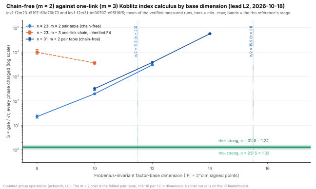

# Chain-free Koblitz index calculus with a half-dimension Frobenius-invariant base (L2), `icv1-f2m31-tm90707-c95f16f5` (K_0 over F_2^31)

Lead L2 of [`../ecdlp_exponent_assessment_20261018/LEADS.md`](../ecdlp_exponent_assessment_20261018/LEADS.md).
The scaling note (`research/notes/ecc2k130/RESEARCH_KOBLITZ_SCALING_TARGET.md`,
"The chaining term is avoidable") observes that a Frobenius-invariant
factor base of dimension near `n/2` makes `m = 2` summands enough, so the
`(m − 2)·n` chaining unknowns disappear and the binding constraint moves
to materialising `2^{dim}` points. This session measures that trade on
`icv1-f2m31-tm90707-c95f16f5` (K_0 over F_2^31; `r = 1 439 393 ≈ 2^{20.46}`,
`A = 62`) with every phase charged, against the strong signed-Frobenius
rho reference and its A/A control. Counted group operations; a measurement,
not a performance claim; no `S` on any leaderboard changes.

## Spec and sessions

- [`spec.json`](spec.json): arms `rho-strong` (reference), `rho-strong-aa`
  (control), `ic-m2-d{10,12,14}` (`koblitz-standard-subspace:dimension=D`,
  oracle `pdp3-koblitz:m=2,engine=rootfind-negfold`, the folded pair
  table, `max_trials` 2 000 000), `ic-m3-d10-f4` (the one-link chain:
  `m = 3`, `pdp3-koblitz:m=3,engine=inherited-f4,degree=3,node_budget=8192`).
  4 targets, 2 rounds, 1 warm-up, alternating, 2 400 s per run, L0.
- [`sessions/n31-interrupted-d16/`](sessions/n31-interrupted-d16/): the
  first attempt also carried `ic-m2-d16`. Its warm-up run **crashed at
  the factor-base phase with `memory allocation of 36507222032 bytes
  failed`** (signal 6; `exec/000005.stderr`): the folded pair table at
  dimension 16 asks for 36.5 GB on a 15 GB host. The session was then
  interrupted by hand (the `ic-m3-d10-f4` warm-up record in that directory
  is the interruption, signal 15/9, not a failure of the arm) and is kept
  as evidence of the materialisation wall. The spec's own description
  says "timed out"; this README is the correction: it was the allocation.
- [`sessions/n31-m3-timeout/`](sessions/n31-m3-timeout/): the rerun
  without dimension 16. Its `ic-m3-d10-f4` warm-up on the first target
  **timed out at 2400 s** (watchdog, 34 MiB resident: no table, the
  per-trial F4 decompositions are the cost), while the five other arms
  completed their first two warm-up passes. The inherited-F4 `m = 3`
  oracle has only ever completed at `n ≤ 23`
  (`research/pdp_root_finder_ecbench_20261013`), so twelve more timeouts
  would have said nothing; the session was stopped and the arm moved.
- [`sessions/n31/`](sessions/n31/): the `n = 31` session with the `m = 2`
  arms only ([`spec.json`](spec.json), rerun).
- [`spec_n23.json`](spec_n23.json), [`sessions/n23/`](sessions/n23/): the
  chained comparison at `n = 23` (`icv1-f2m23-t5197-69e76b73`), where the
  `m = 3` one-link chain completes: `ic-m2-d{8,10,12}` against
  `ic-m3-d{8,10}-f4`, with the rho reference and control, 1 800 s per run.

## Results (measured rounds, replay-audited)

`s_vs_dimension.py` draws this from the two sessions (`s_vs_dimension.svg/.png`,
values in `s_vs_dimension.diagram.json`). Audits: `sessions/n31.audit.json`
(60 records, 60 verified, 40 replays reproduced, 0 problems) and
`sessions/n23.audit.json` (84 records, 84 verified, 56 replays reproduced,
0 problems). Reports with phase tables and PDFs: [`reports/n31/`](reports/n31/),
[`reports/n23/`](reports/n23/). Every cell is 8 measured runs (4 targets ×
2 rounds), all verified; L0 (no CPU reservation), so wall time is
descriptive only.

| curve | arm | mean `S` | 95% CI | × rho | dominant phase (share) |
|:--|:--|--:|:--|--:|:--|
| `icv1-f2m23-t5197-69e76b73` | `rho-strong` | 1.318 | [1.240, 1.385] | 1 | |
| | `ic-m2-d8` | 22.73 | [20.88, 24.54] | 17.2 | pair table 58%, relations 41% |
| | `ic-m2-d10` | 195.7 | [195.1, 196.1] | 148 | pair table 98% |
| | `ic-m2-d12` | 2 981 | [2 981, 2 981] | 2 262 | pair table 99.9% |
| | `ic-m3-d8-f4` | 9 849 | [8 912, 10 979] | 7 473 | relations (F4 decompositions) 100% |
| | `ic-m3-d10-f4` | 3 606 | [3 411, 3 761] | 2 736 | relations (F4 decompositions) 100% |
| `icv1-f2m31-tm90707-c95f16f5` | `rho-strong` | 1.243 | [1.139, 1.363] | 1 | |
| | `ic-m2-d10` | 318.2 | [294.0, 343.1] | 256 | pair table 73%, relations 27% |
| | `ic-m2-d12` | 3 776 | [3 768, 3 784] | 3 038 | pair table 99.5% |
| | `ic-m2-d14` | 56 800 | [56 799, 56 801] | 45 701 | pair table 99.99% |

The A/A control equals the reference to the digit on every run (same seed
and stream). The two `m = 3` warm-up attempts at `n = 31` are kept above:
the inherited-F4 decomposition did not finish one target in 2 400 s.

## Reading

- **Chain-free beats the one-link chain at matched dimension, here.** At
  `n = 23`, dimension 10, `m = 2` costs `S = 196` against `m = 3`'s 3 606:
  18× cheaper. At dimension 8 the factor is 433× (22.7 against 9 849). The
  best of each (`m = 2` at d8, `m = 3` at d10) differ by 159×. Removing the
  `(m − 2)·n` chaining unknowns pays at these sizes: the `m = 3` oracle
  spends everything on per-trial Gröbner solves, while the `m = 2` lookup
  costs one table build plus near-free lookups. This is a stage-level comparison of two oracles
  inside one session, not a pipeline improvement: neither curve is on the
  IC leaderboard (`docs/ic/leaderboard.json` roster: `on_board: false`), so
  there is no frozen baseline row for it to ratchet.
- **The half-dimension base is the wrong regime for `m = 2`.** Cost falls
  as the dimension falls, down to the smallest dimension measured at each
  size (d8 at `n = 23`, d10 at `n = 31`). The pair table costs
  `≈ |F|²/(4n)` additions and grows ×14–16 per +2 in dimension; the
  relation phase shrinks as the base grows, but only from 41% of the cost
  at d8 to under 0.1% at d12. At `dim ≈ n/2` the table alone is `≈ r/(4n)`,
  which exceeds the whole rho solve `≈ √r` for every `r > 16n²`. The
  LEADS.md premise (a half-dimension base removes the chaining term) holds;
  its cost is a table that is itself `r/n`-sized, so the route measures the
  orbit saving without being a candidate to beat rho.
- **Distance to rho grows with `n`.** Best measured IC `S` is 17× the
  matched rho at `n = 23` and 256× at `n = 31`. The `n = 31` session did
  not include d8, so its best-dimension figure is an upper bound on the
  gap at that size, not the optimum.
- **What would change the reading.** An `m = 2` oracle whose set-up is not
  the full pair table (implicit membership, as LEADS.md L2 named: "implicit
  past `n ≈ 40`"), so that the cost is the relation phase alone, which at
  `n = 23`, d8 is `S ≈ 9.4` (13 655 gae over `√r`). That is still 7× rho at
  this size; it is the next measurement, with d6–d8 added at `n = 31`.

Classification: measurement (engineering-class comparison of two existing
oracles). No `S` on any leaderboard changes. No security claim.
