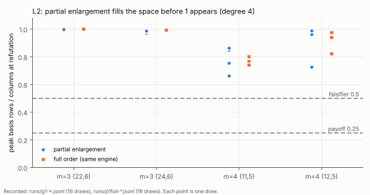
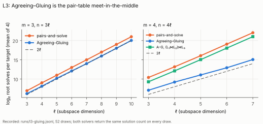
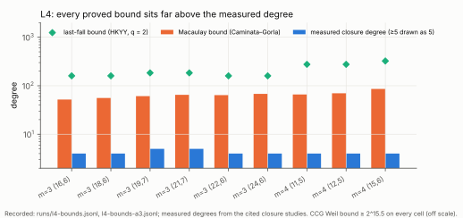

# Leads L1–L4 for Koblitz-curve index calculus, built and measured (2026-10-24)

**Status.** All four leads of
[`koblitz_ic_new_leads_20261018`](../koblitz_ic_new_leads_20261018/README.md)
are now built natively in Rust and measured under a protocol frozen before
any run ([`PROTOCOL.md`](PROTOCOL.md), with one post-hoc amendment). None
of them moves an index-calculus (IC) cost, a leaderboard row or the distance
to rho. Every statement below is labelled **measured**, **derived** or
**reported**.

## 1. Bottom line

- **L2, partial enlargement, is dead as a memory lever on these systems.**
  - All 16 recorded degree-4 draws refute, so the correctness gate passes.
  - The basis fills 0.66–0.997 of the column space before `1` appears.
  - The registered falsifier (0.5) fires on all four cells, and the payoff
    (0.25) is never reached.
  - Against the full order in the same engine, partial enlargement's peak
    is 0.85–1.07× per draw, at 1.4–2.7× the time.
- **L2's engine is the useful by-product.** Its incremental absorb never
  holds more than one row per column plus one chunk.
  - **Degree 4, measured.** 1.3–2.8 GB resident on the cells the dense
    engine ran at 4.0–7.8 GB. That comparison is across studies and hosts,
    so it is descriptive.
  - **Degree 5 at C1 (m = 3, n = 19, ℓ = 7), derived.** About 73 GB,
    against the dense engine's 217 GB projection, which exhausted 169 GB on
    the big node. C1 does not fit this 15 GB container, so it is deferred.
- **L1, λ-coordinate bases, is closed.** The equivalence holds on all
  eight curves tested, and it is now a crate unit test.
- **L3, Agreeing–Gluing, is the pair-table meet-in-the-middle.**
  - At m = 3, root solves fit 2^(2ℓ), half of pairs-and-solve; there is no
    fit below 2^(2ℓ).
  - At m = 4, they fit 2^(2ℓ+1) against 2^(3ℓ+1).
  - Both solvers return the same solution count on all 52 draws.
- **L4, the proved bound, closes as uninformative.** The Caminata–Gorla
  Macaulay bound is 52–86 at the measured cells, against measured closure
  degrees of 4 (at least 5 at ℓ = 7). That is 12–22×. At the ECC2K-130
  shape the bound is 658.
- **The distance to rho is unchanged.** The optimistic ECC2K-130 m = 4 row
  stays 10.32 bits above rho
  ([`ic_leads_review_20261018`](../ic_leads_review_20261018/README.md) §1).

## 2. L2: the partial-enlargement closure

**What was built.** `src/cryptanalysis/partial_enlargement.rs`:
`pe_closure(system, n_vars, D, mode, max_cols, max_rows)`.

- **What it explores.** The degree-D MutantXL closure `W`: the smallest
  space of polynomials of degree at most D that contains the generators
  and is closed under multiplying any element of degree below D by a
  variable. This is the space `ReducedBasis::from_system_closed_full`
  builds.
- **`partial`.** Seeds the degree-(D − 1) Macaulay rows. It then expands
  queued low rows 64 at a time, lowest leading degree first and then the
  smallest leading variable, and stops at `1`. This is MXL3/MGB-style
  partial enlargement.
- **`full`.** Runs the dense engine's order through the same code.
- **The absorb is incremental.**
  1. Reduce each batch against the reduced row echelon basis, eight pivots
     per 256-entry table (Four Russians, parallel over rows).
  2. Bring the batch to reduced row echelon form.
  3. Back-substitute the new pivots and merge.
  - So the elimination never holds more than the basis plus a chunk of
    8,192 rows.
- **Unit tests.**
  - `both_modes_agree_with_the_dense_closure`: same verdict, and the same
    saturated rank where nothing refutes.
  - `satisfiable_systems_are_never_refuted`.

**G1, correctness (measured).** All 16 draws refute at degree 4, matching
the committed closure degree 4. The draws are m = 3 (22, 6) and (24, 6),
and m = 4 (11, 5) and (12, 5), four each.

**Satisfiable controls (measured).** m = 4 (11, 5) draws 0 and 1 saturate
without refuting. Their final ranks, 95,105 and 91,008, equal the dense
engine's recorded `closure_rank` for the same draws in
`research/dreg_closure_driver_20261016/runs/control-*.jsonl`. This
independently confirms that the saturated space is the same.

**P1, peak rows (measured).** Peak basis rows over columns at refutation:

| cell | columns | partial, 4 draws | full order (same engine) |
|---|---:|---|---|
| m = 3 (22, 6) | 102,091 | 0.990, 0.997, 0.997, 0.997 | 1.000 ×4 |
| m = 3 (24, 6) | 124,314 | 0.970, 0.970, 0.983, 0.986 | not run |
| m = 4 (11, 5) | 124,314 | 0.661, 0.863, 0.848, 0.754 | 0.740, 0.766, 0.765, 0.801 |
| m = 4 (12, 5) | 149,986 | 0.976, 0.725, 0.962, 0.987 | not run |

- **Partial against full, per draw (8 pairs).**
  - Peak matrix rows: 0.85–1.07×.
  - Wall time: 1.43–2.72×.
  - Resident memory: 1.3–1.7 GB against 1.9–2.8 GB, because the full order
    seeds the whole degree-4 Macaulay matrix.
  - The host was a shared 4-vCPU container at isolation L0, so times are
    descriptive.
- **Reading.** `1` enters the closure only after the basis covers most of
  the space; once it does, every monomial of degree at most D follows.
  Stopping at `1` therefore cannot save more than the last few percent on
  the m = 3 cells, nor about a quarter on the m = 4 cells. That is the
  falsifier, firing on every cell.



*Figure 1. Peak basis rows over columns at refutation, one point per
draw. Source: `runs/g1-*.jsonl`, `runs/p1full-*.jsonl`,
`figures/plot.py`.*

**C1 (derived; not run, Amendment 1).**

- **The C1 peak.** The engine holds at most one row per column, plus one
  absorb chunk and one expansion batch. At degree 5 with 40 unknowns that
  is at most 770,851 rows of 95,016 bytes, about 73 GB. G1's ratios put
  C1's peak near that bound.
- **Why not here.** This container has 15 GB, so C1 can only end capped
  here. That would be unmeasured, so it was not run.
- **What it needs.** A host with at least 96 GB. The wall time there is
  not estimated beyond "many hours on four cores".

**What L2 changes.** Nothing in the cost rows. As an instrument it lowers
C1's memory requirement from the dense engine's projected 217 GB to about
73 GB. Running C1 is the next step for the degree-5 question.

## 3. L1: λ-coordinate bases (verified)

- **What was built.** `koblitz_ic_leads::lambda` and the crate test
  `lambda_bases_are_halved_affine_x_bases`.
- **Run.** `runs/l1-lambda.jsonl`: both Koblitz curves over F_{2^11},
  F_{2^13}, F_{2^17} and F_{2^19}, with 9–11 valid subspaces each.
- **Measured.** Every identity holds on every curve and subspace:
  - x(2P) = λ² + λ + a, checked against an independent doubling;
  - λ(−P) = λ(P) + 1;
  - {x(2P) ∈ L(W) + a} = A ⊔ (−A).
- **Class.** A closure, as derived in the earlier study.

## 4. L3: Agreeing–Gluing on the S₃ chain (measured)

- **What was built.** `koblitz_ic_leads::agreeing_gluing` provides a
  counted pairs-and-solve and a counted block-level Agreeing–Gluing.
  - **m = 3:** the right link is listed per x₃; the left link is agreed
    onto it.
  - **m = 4:** the left link goes into a table e₁ → multiplicity; the right
    links are glued onto it.
- **Correctness.** The unit test checks both solvers against
  `chained_solution_count`. On all 52 bench draws the two counts agree.

| m | ℓ | log₂ root solves, pairs-and-solve | log₂ root solves, Agreeing–Gluing |
|---|---|---|---|
| 3 | 3 → 10 | 6.97 → 21.00 | 6.21 → 20.03 |
| 4 | 3 → 7 | 10.41 → 22.04 | 7.09 → 15.07 |

- **m = 3.** Agreeing–Gluing fits 2^(2ℓ). It is the same exponent as
  pairs-and-solve at half the constant, with no fit below 2^(2ℓ).
- **m = 4.** It fits 2^(2ℓ+1) against pairs-and-solve's 2^(3ℓ+1). That is
  the pair-table meet-in-the-middle already measured in
  `binary_mitm_oracle_*`.
- **The agreeing step.** At m = 4 it discards 99.75–100% of probes, but it
  removes nothing the table lookup does not.
- **Class.** Accounting, by the registered reading. The block-level
  structure offers Agreeing–Gluing nothing new. Its published gains come
  from sparse bit-level equations, and the descended S₃ equations are dense
  in their bits.



*Figure 2. Mean root solves per target over four draws. Source:
`runs/l3-gluing.jsonl`.*

## 5. L4: proved solving-degree bounds (measured bound, closed)

**What was built.** `koblitz_ic_leads::degree_bounds`.

- **The bound.** Steiner's statement of Caminata–Gorla (ToSC 2024(1),
  arXiv 2310.03637v2): `sd ≤ reg(F^hom) ≤ d₁ + … + d_l − l + 1`, with
  `l = min(N + 1, #F)` (Corollary 2.9). It is computed on the descended
  system with all field equations adjoined.
- **The hypothesis.** It requires generic coordinates. They hold by
  Theorem 3.2 (4), because each field equation contributes x², a pure power
  of its variable.

**Measured.**

- **Degree profile.** The descended links not through x_R are cubic, and
  the links through x_R are quadratic. There are exactly (m − 2)·n cubic
  links, asserted on every built cell.
- **The bounds.** 52 to 86 at the measured cells, against measured closure
  degrees of 4 (at least 5 at ℓ = 7).
- **ECC2K-130.** At m = 4, ℓ = 33 (N = 394), the shape bound is 658.
- **Before descent.** The field-level bound is about 2^n.
- **Class.** The falsifier, a bound of at least ℓ + 4, fires on every cell,
  so L4 closes as uninformative. A useful proved bound would need a
  structure-specific argument these theorems do not supply.



*Figure 3. Source: `runs/l4-bounds.jsonl`.*

## 6. Deviations and limits

- **Amendment 1.** C1 was deferred after G1 showed it cannot fit 15 GB.
  This is post hoc and recorded in `PROTOCOL.md`.
- **A container restart** interrupted the runner during m = 4 (12, 5)
  draw 24. The 12 finished draws were committed unchanged, and the runner
  resumed with the same binary (`runs/queue.log`).
- **Full-order reference coverage.** The full order was run on two cells
  of the four, as registered.
- **Python.** It is used only for figure layout and the PDF. Every value
  comes from the Rust binaries named in `runs/binary.sha256` and
  `runs/binary-bench-l4.sha256`.
- **Conductor.** It is not installed in this container, so no task card was
  held. The sibling checkout has no `knowledge/leads/` atlas to consult.
- **Records left unchanged.** No timing claim is made, so there is no
  `benchmarks/` row. These were checked and left unchanged:
  - `docs/ic-leaderboard.html`
  - `docs/ic/LEADERBOARD.md`
  - `docs/ic/leaderboard.json`
  - `docs/ic/progress-timeline.json`
  - `docs/ic/BOUNDARY_TARGETS.md`

## 7. Next step

Run C1 with `pe_closure --mode full`. At degree 4 it was 1.4–2.7× faster
than `partial`, at about 1.5× the resident memory, still within the
engine's bound of one row per column. Use draws 0, 3, 5 and 7 of
`research/dreg_closure_scale_20261016/draws/m3-19-7.jsonl` at degree 5, on
a host with at least 96 GB. It decides whether degree 5 holds at ℓ = 7,
the question the 169 GB big node could not answer.

## 8. Reproduce

```sh
cargo test --release --lib -- cryptanalysis::partial_enlargement cryptanalysis::koblitz_ic_leads
cargo build --release --example pe_closure --example koblitz_ic_leads_bench
bash research/koblitz_ic_leads_build_20261024/run.sh OUTDIR       # G1, controls, P1
target/release/examples/koblitz_ic_leads_bench lambda|gluing|bounds
(cd research/koblitz_ic_leads_build_20261024/figures && python3 plot.py)
sh research/koblitz_ic_leads_build_20261024/build.sh               # report.pdf
```
