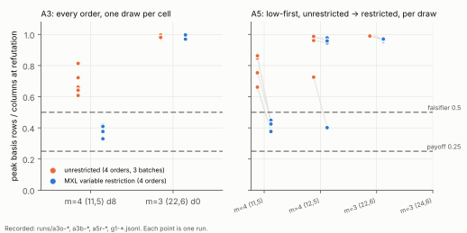

# Leads L1–L4 for Koblitz-curve index calculus, built and measured (2026-10-24)

**Status.** All four leads of
[`koblitz_ic_new_leads_20261018`](../koblitz_ic_new_leads_20261018/README.md)
are now built natively in Rust and measured under a protocol frozen before
any run ([`PROTOCOL.md`](PROTOCOL.md)). Amendment 1 is post hoc.
Amendments 2–5 were each frozen before the runs they govern.

The owner asked for every lead to be closed exhaustively, so the study does
more than the one path built first:
- **L2:** queue orders, batch sizes, seed degrees and MXL's variable
  restriction, on every cell.
- **L3:** every gluing order, plus a bit-level census of the equations.
- **L4:** the other published bounds.
- **L1:** the remaining parameter cases.

None of this moves an index-calculus (IC) cost, a leaderboard row or the
distance to rho. Every statement below is labelled **measured**, **derived**
or **reported**.

## 1. Bottom line

- **L2, partial enlargement, does not reduce memory on these systems in
  general. One variant survives on one cell.**
  - **Correctness.** All 16 degree-4 draws refute.
  - **Basis fill.** In the registered order, the basis fills 0.66–0.997 of
    the column space before `1` appears.
  - **Other orders.** Changing the queue order (high-degree first, two
    random permutations) or the batch size (16, 64, 256) keeps every
    run at 0.61–1.00 (Amendment 3). The seed-degree option changes nothing
    at D = 4.
  - **The one exception: MXL's variable restriction on m = 4 (11, 5).**
    All four draws refute below the 0.5 falsifier, at 0.38–0.45, with
    1.8–2.5× fewer products than unrestricted. No draw reaches the payoff
    (0.25).
  - **Everywhere else.** The restriction does not help:
    - m = 4 (12, 5): 1 draw of 4 below 0.5;
    - m = 3: no draw below 0.5 (Amendment 5).
  - **Class.** A stage-level instrument result on one cell, not an IC cost
    change.
- **L2's engine is the useful by-product.** Its incremental absorb never
  holds more than one row per column plus one chunk.
  - **Degree 4, measured in the same engine.** 1.3–2.8 GB resident
    against 1.9–4.2 GB for the full order.
  - **Degree 5 at C1 (m = 3, n = 19, ℓ = 7), derived.** About 73 GB.
- **C1 itself is still unmeasured** (Amendments 2 and 4). The owner
  approved four draws plus a control on RunPod, capped at $80. Three pods
  ran:
  - two never ran the job, because the repository is now private and the
    pod could not fetch its boot script;
  - the third verified its uploaded binary and started draw 0 at
    06:51Z, then was deleted before any record was fetched.
  - About $4 was spent on the first two pods and at most about $20 on the
    third. The degree-5 question at ℓ = 7 stays open.
- **L1, λ-coordinate bases, is closed in full.** Every identity holds on
  both Koblitz curves over four fields (b = 1). It also holds on three
  random b ≠ 1 per field over F_{2^11} and F_{2^13}, and for subspaces
  that contain `1`, where A = B exactly. In all, 182 subspaces.
- **L3, Agreeing–Gluing, is the pair-table meet-in-the-middle in every
  order.**
  - **m = 3:** root solves fit 2^(2ℓ).
  - **m = 4:** the registered order fits 2^(2ℓ+1). The only other order,
    (L₁ ⋈ L₂) ⋈ L₃, fits 2^(3ℓ).
  - **Bit level.** Every descended equation's support exceeds 2ℓ (15–36
    variables), so a bit-level variant's local lists are larger still.
  - **Correctness.** All counts agree on 52 draws.
- **L4, the proved bounds, all close as uninformative.** Against measured
  closure degrees of 4–5 (ECC2K-130 values in brackets):
  - Caminata–Gorla Macaulay bound: 52–86 (658);
  - Caminata–Ceria–Gorla Weil-restriction bound: ≥ 2^15.5 (2^139);
  - Huang–Kosters–Yang–Yeo last-fall bound: 160–324 (1,620).
  - Steiner's Theorem 3.7 does not apply to the S₃ chain.
- **The distance to rho is unchanged.** The optimistic ECC2K-130 m = 4 row
  stays 10.32 bits above rho
  ([`ic_leads_review_20261018`](../ic_leads_review_20261018/README.md) §1).

## 2. L2: the partial-enlargement closure

**What was built.** `src/cryptanalysis/partial_enlargement.rs`:
`pe_closure(system, n_vars, D, mode, max_cols, max_rows)`.

- **What it explores.** The degree-D MutantXL closure `W`: the smallest
  space of polynomials of degree at most D that contains the generators
  and is closed under multiplying any element of degree below D by a
  variable. This is the space `ReducedBasis::from_system_closed_full`
  builds.
- **`partial`.** Seeds the degree-(D − 1) Macaulay rows. It then expands
  queued low rows 64 at a time, lowest leading degree first and then the
  smallest leading variable, and stops at `1`. This is MXL3/MGB-style
  partial enlargement.
- **`full`.** Runs the dense engine's order through the same code.
- **The absorb is incremental.**
  1. Reduce each batch against the reduced row echelon basis, eight pivots
     per 256-entry table (Four Russians, parallel over rows).
  2. Bring the batch to reduced row echelon form.
  3. Back-substitute the new pivots and merge.
  - So the elimination never holds more than the basis plus a chunk of
    8,192 rows.
- **Unit tests.**
  - `both_modes_agree_with_the_dense_closure`: same verdict, and the same
    saturated rank where nothing refutes.
  - `satisfiable_systems_are_never_refuted`.

**G1, correctness (measured).** All 16 draws refute at degree 4, matching
the committed closure degree 4. The draws are m = 3 (22, 6) and (24, 6),
and m = 4 (11, 5) and (12, 5), four each.

**Satisfiable controls (measured).** m = 4 (11, 5) draws 0 and 1 saturate
without refuting. Their final ranks, 95,105 and 91,008, equal the dense
engine's recorded `closure_rank` for the same draws in
`research/dreg_closure_driver_20261016/runs/control-*.jsonl`. This
independently confirms that the saturated space is the same.

**P1, peak rows (measured).** Peak basis rows over columns at refutation:

| cell | columns | partial, 4 draws | full order (same engine) |
|---|---:|---|---|
| m = 3 (22, 6) | 102,091 | 0.990, 0.997, 0.997, 0.997 | 1.000 ×4 |
| m = 3 (24, 6) | 124,314 | 0.970, 0.970, 0.983, 0.986 | 0.993, 0.995, 0.993, 0.993 |
| m = 4 (11, 5) | 124,314 | 0.661, 0.863, 0.848, 0.754 | 0.740, 0.766, 0.765, 0.801 |
| m = 4 (12, 5) | 149,986 | 0.976, 0.725, 0.962, 0.987 | 0.931, 0.822, 0.940, 0.975 |

- **Partial against full, per draw (16 pairs).** The full order on m = 3
  (24, 6) and m = 4 (12, 5) was added in Amendment 3.
  - Peak matrix rows: 0.85–1.07×.
  - Wall time: 1.10–2.72×.
  - Resident memory: 1.3–2.8 GB against 1.9–4.2 GB, because the full order
    seeds the whole degree-4 Macaulay matrix.
  - The host was a shared 4-vCPU container at isolation L0, so times are
    descriptive.
- **Reading.** `1` enters the closure only after the basis covers most of
  the space; once it does, every monomial of degree at most D follows.
  Stopping at `1` therefore cannot save more than the last few percent on
  the m = 3 cells, nor about a quarter on the m = 4 cells. That is the
  falsifier, firing on every cell.


*Figure 1. Peak basis rows over columns at refutation, one point per
draw. Source: `runs/g1-*.jsonl`, `runs/p1full-*.jsonl`,
`figures/plot.py`.*

**Every order, batch and seed (Amendment 3, measured).** The engine
computes the same closure in any queue order. The unit test
`every_order_computes_the_same_closure` checks every option against the
dense closure, on refuting and saturating draws.

- **Runs.** 18 runs on each of m = 4 (11, 5) draw 8 and m = 3 (22, 6)
  draw 0, at degree 4.
- **A/A check.** The default options reproduce G1's record exactly on
  every counter except wall time.

| configuration | m = 4 (11, 5) d8 | m = 3 (22, 6) d0 |
|---|---|---|
| low-first, batch 64 (registered) | 0.661 | 0.990 |
| high-first | 0.608 | 0.974 |
| random permutation (2 seeds) | 0.813, 0.814 | 1.000, 0.996 |
| batch 16 / 256 | 0.642 / 0.722 | 0.975 / 0.981 |
| MXL restriction: low / high / random ×2 | 0.377 / 0.330 / 0.417, 0.409 | 0.970 / 0.970 / 0.998, 0.997 |

- **Seed degree.** It has no effect at D = 4: D − 1 = 3 is already the
  system degree, so each seed-3 run equals its seed-(D−1) twin row for row.
- **The restriction on m = 3.** The restricted phase saturates at about
  0.68 × columns without `1`, and `1` appears only in the completion pass.
- **The restriction on m = 4.** On m = 4 (11, 5) draw 8, `1` appears
  within the restricted phase, at 0.33–0.42 × columns. Across the four
  orders, the restriction uses 2.2–2.4× fewer products and 3.0–3.4× fewer
  word XORs than the same order unrestricted.

**The restriction on every draw (Amendment 5, measured).** Low-first,
restricted, batch 64, against the registered order (G1):

| cell | restricted, per draw | G1, per draw | below 0.5 |
|---|---|---|---|
| m = 4 (11, 5) | 0.377, 0.425, 0.441, 0.449 | 0.661, 0.863, 0.848, 0.754 | 4 of 4 |
| m = 4 (12, 5) | 0.978, 0.402, 0.946, 0.958 | 0.976, 0.725, 0.962, 0.987 | 1 of 4 |
| m = 3 (22, 6) | 0.970, 0.957, 0.966, 0.973 | 0.990, 0.997, 0.997, 0.997 | 0 of 4 |
| m = 3 (24, 6) | 0.976, 0.949, 0.969, 0.968 | 0.970, 0.970, 0.983, 0.986 | 0 of 4 |

- **Draw order.** Draws are listed in committed order: 8/67/107/143,
  24/26/47/52, 0–3 and 0–3.
- **Soundness controls.** The satisfiable m = 4 (11, 5) draws 0 and 1,
  run restricted, saturate without refuting. Their final ranks are 95,105
  and 91,008, the same as the unrestricted controls and the dense engine's
  `closure_rank`.
- **m = 4 (11, 5).** The cell passes the registered "3 of 4 below the
  falsifier" reading, with 1.8–2.5× fewer products. On draws 67, 107 and
  143, `1` arrives in the completion pass, but the peak still stays
  below 0.45.
- **m = 4 (12, 5).** Only draw 26 is below 0.5, and that draw was already
  the lowest in G1. On draw 24 the restriction costs 1.4× more products.
- **Reading.** MXL's restriction is a draw-dependent stage-level memory
  win, not a property of the systems. Partial enlargement in every
  variant fills most of the space before `1` appears on three of the four
  cells.



*Figure 2. Left: every Amendment 3 configuration on one draw per cell.
Right: low-first, unrestricted (G1) against restricted, per draw. Source:
`runs/a3o-*`, `a3b-*`, `a5r-*`, `g1-*.jsonl`.*

**C1, the decisive degree-5 cell (Amendments 1, 2 and 4; unmeasured).**

- **Memory bound (derived).** The engine holds at most one row per column,
  plus one absorb chunk and one expansion batch. At degree 5 with 40
  unknowns, that is at most 770,851 rows of 95,016 bytes, about 73 GB.
  G1's ratios put C1's peak near that bound.
- **Engine choice.** At degree 5, the incremental engine's word XORs
  extrapolate to roughly 25–50 h per draw. So C1 was moved to the dense
  engine, `dreg_closure --to 5`, on a 512 GB rented host.
- **What happened on the rented hosts.**
  1. Pods `hd6s92ssyztxjh` and `cwacs7yb5zj1hh` booted and idled at
     0% CPU. The repository is private, so the pod's unauthenticated
     fetch of its boot script returned 404. Both were terminated, at
     about $4.10.
  2. Amendment 4 replaced the clone with a hash-checked upload
     (`pod/upload_launch.py`, `pod/job.sh`). Pod `z9n7f7mm4p0zc9`
     accepted the binary (`9d72c7a4…`), the draws and the job script.
     It started draw 0 at 06:51Z with a 471 GB address-space cap.
  3. By 12:19Z the pod no longer existed in the account: the API
     returned `null`, and it was absent from the pod list. No record was
     fetched before it disappeared.
- **Status.** C1 remains unmeasured. A capped or lost run is never
  evidence about the degree.

**What L2 changes.** Nothing in the cost rows. As an instrument it lowers
C1's memory requirement from the dense engine's projected 217 GB to about
73 GB. On m = 4 (11, 5), MXL's restriction lowers the degree-4 peak
echelon by 1.7–2.0× more.

## 3. L1: λ-coordinate bases (verified)

- **What was built.** `koblitz_ic_leads::lambda` and the crate test
  `lambda_bases_are_halved_affine_x_bases`.
- **Run.** `runs/l1-lambda.jsonl`: both Koblitz curves over F_{2^11},
  F_{2^13}, F_{2^17} and F_{2^19}, with 9–11 valid subspaces each.
- **Measured.** Every identity holds on every curve and subspace:
  - x(2P) = λ² + λ + a, checked against an independent doubling;
  - λ(−P) = λ(P) + 1;
  - {x(2P) ∈ L(W) + a} = A ⊔ (−A).
- **The remaining cases (Amendment 3, `runs/l1-lambda-general.jsonl`,
  measured).** `lambda::check_curve` takes any b ≠ 0. The crate test
  `lambda_closure_with_one_and_any_b` covers it.
  - **Curves.** Over F_{2^11} and F_{2^13}: b = 1 and three random
    b ≠ 1 each, both a. That is 16 curves.
  - **Subspaces without `1`.** 90 of them: B = A ⊔ (−A) on every one.
  - **Subspaces containing `1`.** 92 of them. There A = −A,
    |L(W)| = |W|/2, and A = [2]⁻¹{x ∈ L(W) + a} exactly.
- **Class.** A closure in full, with no case left open. The λ-base is the
  halved x-base for every b ≠ 0 and every subspace, so it offers no new
  factor base.

## 4. L3: Agreeing–Gluing on the S₃ chain (measured)

- **What was built.** `koblitz_ic_leads::agreeing_gluing` provides a
  counted pairs-and-solve and a counted block-level Agreeing–Gluing.
  - **m = 3:** the right link is listed per x₃; the left link is agreed
    onto it.
  - **m = 4:** the left link goes into a table e₁ → multiplicity; the right
    links are glued onto it.
- **Correctness.** The unit test checks both solvers against
  `chained_solution_count`. On all 52 bench draws the two counts agree.

| m | ℓ | log₂ root solves, pairs-and-solve | log₂ root solves, Agreeing–Gluing |
|---|---|---|---|
| 3 | 3 → 10 | 6.97 → 21.00 | 6.21 → 20.03 |
| 4 | 3 → 7 | 10.41 → 22.04 | 7.09 → 15.07 |

- **m = 3.** Agreeing–Gluing fits 2^(2ℓ). It is the same exponent as
  pairs-and-solve at half the constant, with no fit below 2^(2ℓ).
- **m = 4.** It fits 2^(2ℓ+1) against pairs-and-solve's 2^(3ℓ+1). That is
  the pair-table meet-in-the-middle already measured in
  `binary_mitm_oracle_*`.
- **The other m = 4 order (Amendment 3, measured).** (L₁ ⋈ L₂) ⋈ L₃
  extends every left partial solution through the middle link. Its root
  solves fit 2^(3ℓ), at 9.29 → 21.02 for ℓ = 3 → 7. The registered order
  L₁ ⋈ (L₂ ⋈ L₃) fits 2^(2ℓ+1). A three-link chain has no third order,
  so no order reaches below 2^(2ℓ). The rerun reproduces every committed
  count exactly.
- **Bit-level supports (Amendment 3 census, `runs/l3-census.jsonl`,
  measured).** Every descended equation has a support well above 2ℓ:
  - m = 3: cubic equations 28–34 variables, quadratic 21–28;
  - m = 4: cubic 21–36, quadratic 15–21;
  - against 2ℓ = 10–14.
  - A bit-level Agreeing–Gluing keeps one local solution list per
    equation over its support, so its lists exceed the block-level ones.
- **The agreeing step.** At m = 4 it discards 99.75–100% of probes, but it
  removes nothing the table lookup does not.
- **Class.** Accounting, by the registered reading. The block-level
  structure offers Agreeing–Gluing nothing new. Its published gains come
  from sparse bit-level equations, and the descended S₃ equations are dense
  in their bits.


*Figure 3. Mean root solves per target over four draws. Source:
`runs/l3-gluing.jsonl`, `runs/l3-gluing-a3.jsonl`.*

## 5. L4: proved solving-degree bounds (measured bound, closed)

**What was built.** `koblitz_ic_leads::degree_bounds`.

- **The bound.** Steiner's statement of Caminata–Gorla (ToSC 2024(1),
  arXiv 2310.03637v2): `sd ≤ reg(F^hom) ≤ d₁ + … + d_l − l + 1`, with
  `l = min(N + 1, #F)` (Corollary 2.9). It is computed on the descended
  system with all field equations adjoined.
- **The hypothesis.** It requires generic coordinates. They hold by
  Theorem 3.2 (4), because each field equation contributes x², a pure power
  of its variable.

**Measured.**

- **Degree profile.** The descended links not through x_R are cubic, and
  the links through x_R are quadratic. There are exactly (m − 2)·n cubic
  links, asserted on every built cell.
- **The bounds.** 52 to 86 at the measured cells, against measured closure
  degrees of 4 (at least 5 at ℓ = 7).
- **ECC2K-130.** At m = 4, ℓ = 33 (N = 394), the shape bound is 658.
- **Before descent.** The field-level bound is about 2^n.
- **The other proved bounds (Amendment 3, `runs/l4-bounds-a3.jsonl`).**
  - **Caminata–Ceria–Gorla.** arXiv 2112.10506, Corollary 4.12:
    `sd(Weil(F′) ∪ field eqs) ≤ n · reg(F′ʰ) − n + 1`. With `reg` at its
    Macaulay bound this is 2^15.5–2^28.6 on the cells and 2^139 at
    ECC2K-130. It is dominated by the field equations' degree 2^n. The
    hypothesis `t ∤ 0` is not checked.
  - **Huang–Kosters–Yang–Yeo.** arXiv 1505.02532, Theorem 1.1, q = 2. It is
    independent of n, with `s ≤ 2^(mℓ+m−2)` solutions and 2m − 2
    field-level unknowns. It gives 160–324 on the cells and 1,620 at
    ECC2K-130. Radicality and the injective projection are not checked.
  - **Steiner, ToSC 2024(1), Theorem 3.7.** It does not apply. It needs a
    univariate keyed iterated system whose iᵗʰ equation contains the pure
    power x_{i−1}^{d_i}. Each S₃ link adds two new unknowns (xⱼ, eⱼ). In
    characteristic 2 the degree-4 part of S₃(a, c, d) is
    a²c² + a²d² + c²d², with no fourth power of any variable. Generic
    coordinates at bit level still hold through Theorem 3.2 (4).
- **Class.** The falsifier, a bound of at least ℓ + 4, fires on every cell
  and for every bound, so L4 closes as uninformative. A useful proved bound would need a
  structure-specific argument these theorems do not supply.


*Figure 4. Source: `runs/l4-bounds.jsonl`, `runs/l4-bounds-a3.jsonl`.*

## 6. Deviations and limits

- **Amendment 1, post hoc.** C1 was deferred after G1 showed it cannot fit
  15 GB.
- **Amendments 2–5, each frozen before its runs.**
  - Amendment 2: C1 on a rented host.
  - Amendment 4: a hash-checked upload, because the repository became
    private.
  - Amendments 3 and 5: exhaustive closure.
- **Container restarts.** Restarts interrupted the runners six times.
  Each time:
  - finished records were committed unchanged;
  - empty partial records were deleted;
  - the runner resumed with the same binary (`runs/queue*.log`).
- **C1 is unmeasured.** The third pod was deleted outside this session's
  control before its records were fetched, at a cost of at most about
  $24.50 in total. No C1 statement in this report rests on a run.
- **The Macaulay row cap.** The Amendment 3 runner first hit
  `koblitz_groebner`'s default 20,000-row Macaulay cap, which left four
  full-order runs unbuilt. Those records were deleted and rerun with the
  cap lifted (`run_a3.sh`), as `run.sh` in the dense study does.
- **YAGS is not run.** Its memory-reduced F4 needs an F₂ F4 with
  criteria. This repository's F₂ "F4" is a Macaulay-matrix eliminator, and
  msolve does not target F₂. L2's closure measurements bound the
  echelon a degree-D linear-algebra method spans. They are not an F4
  measurement.
- **Python.** It is used only for figure layout and the PDF. Every value
  comes from the Rust binaries named in:
  - `runs/binary.sha256`
  - `runs/binary-bench-l4.sha256`
  - `runs/binary-a3.sha256`
  - `runs/binary-c1-dreg_closure.sha256`
- **Conductor.** It is not installed in this container, so no task card was
  held.
- **Records left unchanged.** No timing claim is made, so there is no
  `benchmarks/` row. These were checked and left unchanged:
  - `docs/ic-leaderboard.html`
  - `docs/ic/LEADERBOARD.md`
  - `docs/ic/leaderboard.json`

## 7. Next step

- **C1 is the one open measurement.** Rerun it with the Amendment 4
  uploader on a host with at least 280 GB, fetching each draw's record as
  soon as it is written. The open question is whether the closure degree
  at m = 3, ℓ = 7 is 5.
- **The incremental engine at degree 5.** It fits in about 73 GB.
  MXL's restriction may lower that further on m = 4, but not on m = 3.
- **The lead as a whole.** L1–L4 are closed. None of them gives an IC
  improvement, so the next index-calculus improvement has to come from a
  lead outside this set.

## 8. Reproduce

```sh
cargo test --release --lib -- cryptanalysis::partial_enlargement cryptanalysis::koblitz_ic_leads
cargo build --release --example pe_closure --example koblitz_ic_leads_bench
bash research/koblitz_ic_leads_build_20261024/run.sh OUTDIR       # G1, controls, P1
bash research/koblitz_ic_leads_build_20261024/run_a3.sh OUTDIR    # Amendment 3
bash research/koblitz_ic_leads_build_20261024/run_a5.sh OUTDIR    # Amendment 5
target/release/examples/koblitz_ic_leads_bench lambda|lambda-general|gluing|bounds|census
python3 research/koblitz_ic_leads_build_20261024/pod/upload_launch.py run ...   # C1 (Amendment 4)
(cd research/koblitz_ic_leads_build_20261024/figures && python3 plot.py)
sh research/koblitz_ic_leads_build_20261024/build.sh               # report.pdf
```
