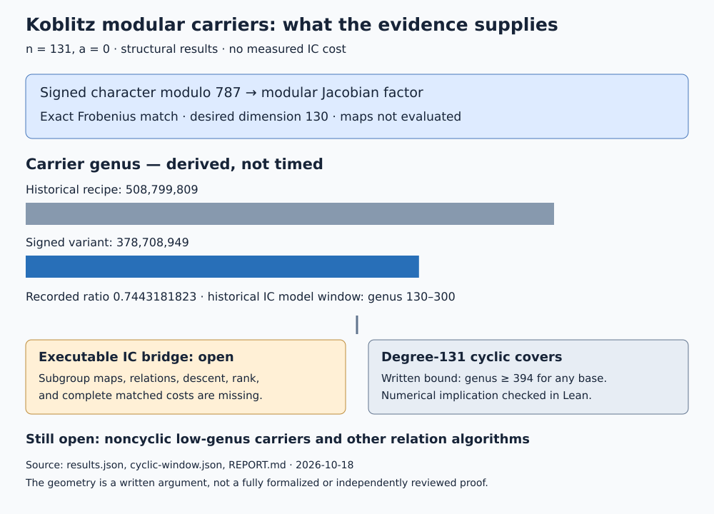

# Koblitz curves, modular carriers, and index calculus

2026-10-18. Structural investigation of the supplied Klein-quartic and
modular-twist lead. All new computation is native Rust; no DLP was run.

The lead is mathematically real, and the repository already explored it in
[its curve-construction study](../notes/ecc2k130/RESEARCH_ECC2K130_CURVE_CONSTRUCTION.md).
This investigation adds a smaller signed-character modular carrier and a
written extension of the cyclic-cover obstruction. Neither supplies an
executable improvement to the current index-calculus pipeline.



## Scope and exact target

The source is E_0: y^2+xy=x^3+1 over F_(2^131), with prime subgroup
`r=680564733841876926932320129493409985129`, cofactor 4, and registry slug
`icv1-f2m131-tm22283658519494248867-115e0dc5`. Its field modulus is
`0x800000000000000000000000000002007`. The registry leaves its EC1 generator
binding unresolved. This work uses the family, Frobenius, and subgroup order;
it imports no challenge point and runs no unknown-scalar recovery.

Let A_n(E) be the connected trace-zero factor of Res_(F_(2^n)/F_2)(E).
For n=131 its dimension is 130. At F_2, #A_131(E_0)=r exactly.
Polynomial conventions below use P(X)=det(X-Frob); L(T)=T^(2g)P(1/T).

## 1. What is established about the original lead

For C: x^3 y+y^3 z+z^3 x=0 over F_2, the replay gives point counts
`3,5,24,17,33,38,129,257` over extensions of degrees 1 through 8.
The first three counts and reciprocity determine

    L_C(T)=1+5T^3+8T^6.

This identifies J(C), up to F_2-isogeny, with Res_(F_8/F_2)(E_1).
It agrees with the classical characteristic-2 Klein-quartic picture in
[Elkies](https://library.slmath.org/books/Book35/files/elkies.pdf).
An isogeny class is not an evaluated subgroup transfer. In particular, the
obvious F_2-rational cyclic quotient to E_1 detects the elliptic factor;
it kills the trace-zero factor. Obtaining the trace-zero transfer needs
other correspondences, rather than that quotient alone.

For an odd prime n !=7, take the conductor-49 CM newform f with a_2(f)=1
and an odd-conductor character chi whose value chi(2) is primitive of
order n. The conjugate Frobenius roots of f tensor chi are
alpha*zeta^j and beta*zeta^j, 1<=j<n, where alpha+beta=1, alpha*beta=2.
These are precisely the roots of P_(A_n(E_1)). This uses the standard
twisting and modular-abelian-variety constructions, not a new modularity
theorem. See [Atkin--Li](https://doi.org/10.1007/BF01390245) and
[Stein's modular abelian variety construction](https://wstein.org/books/modform/modform/periods.html).
The exception n=7 must be handled separately: the CM field already lies
in Q(zeta_7), and the trace-zero factor splits, as the repository observed.

For composite n, one primitive-order twist generally supplies only the
primitive cyclotomic piece. At n=9, the full trace-zero dimension is 8,
the primitive-order-9 piece has dimension 6, and the missing order-3 piece
has dimension 2. Both the character's value at 2 and the lower-order pieces
must be accounted for. The broad existence construction can use multiple
twists and their common modular level; one order-n twist is not enough
in general.

## 2. New construction: absorb the sign into the character

The historical E_0 construction first twists f by the quadratic character
of conductor 3, then by an order-131 character modulo 263. Its level is
441*263^2=30,503,529 and its carrier genus is 508,799,809.

Instead choose chi modulo 787 with

    chi(2)=exp(2*pi*i/262).

The native check proves that 787 is prime and 2 is a primitive root modulo
787 (by factoring 786 and testing its prime divisors). Thus chi is
primitive of order 262. Every embedding of Q(zeta_262)=Q(zeta_131) takes
chi(2) to a primitive 262nd root, equivalently minus a primitive 131st
root. The Frobenius roots are therefore minus the E_1 roots times all
primitive 131st roots: exactly A_131(E_0).

The coefficient field is exactly Q(zeta_131): it is contained there because
f has rational coefficients, and a_2(f tensor chi)=chi(2) generates it.
Consequently the attached modular abelian variety has dimension 130.
Since 787 is coprime to 49, the twist has level 49*787^2=30,349,081.
Its nebentypus chi^2 has order 131, so it occurs on the character-kernel
curve X_H(N), H=ker(chi^2), of degree 131 over X_0(N).

The character chi is odd. This is permitted: the weight-2 form's
nebentypus is chi^2, which is even. Requiring chi itself to be even would
miss the construction.

| Structural quantity | Historical E_0 recipe | Signed-character variant |
| --- | ---: | ---: |
| Character modulus | 263, plus separate sign at 3 | 787 |
| Character order at 2 | 131, plus sign | 262 |
| Modular level | 30,503,529 | 30,349,081 |
| Index over X_0 | 131 | 131 |
| Genus of X_0 | 3,883,969 | 2,890,909 |
| Genus of carrier X_H | 508,799,809 | 378,708,949 |
| Dimension of desired factor | 130 | 130 |

The carrier-genus ratio is 0.7443181823207013, a reduction of about 25.57%.
This is a genus reduction, not a speed measurement or an IC improvement.
The new genus is still over 1.26 million times 300. The scan covers prime
moduli <=10,000, excluding the overlapping conductor 7; it establishes
the best result within that family and bound, not the smallest possible
carrier among all curves or modular quotients.

For n=5 the same device uses an order-10 character modulo 11: it realizes
the E_0 factor at genus 2,841 instead of the old genus 36,001. This is a
useful control, while the repository's direct-search questions at much
smaller genus remain separate.

### Genus calculation and verification

For N=49*787^2, mu_0=56*787*788=34,728,736, c_0=8*788=6,304,
e_2=0, e_3=4. The degree-131 character cover is unramified over cusps:
at every cusp denominator c|N the lower-right entry of its parabolic
stabilizer is 1 modulo 787, because 787 divides c*N/gcd(c^2,N).
It is also unramified over elliptic points: their stabilizer orders
are 2 or 3, coprime to 131. Hence

    g_H=1+131*(g_0-1)=378,708,949.

This proves the split-cusp assertion for this construction rather than
inferring it only from small tests. The genus formula is standard; see
[Snowden's derivation](https://websites.umich.edu/~asnowden/teaching/2013/679/L12.html).
Complete coset controls at six small levels check generalized kernels,
including kernels larger than {+1,-1} and an order-3 elliptic-ramification
case. No full-size coset enumeration was attempted.

The Frobenius calculation is checked coefficient by coefficient over Z,
using two constructions: monic division of X^(2n)-s_n X^n+2^n, and the
quadratic norm of sum(alpha^j X^(n-1-j),j=0..n-1). Twenty checks cover
both trace signs at n=3,5,7,11,13,41,53,61,83,131. This replaces the
historical large-target floating-point evaluation check with an exact one.
The full-size identity certificate is
[IDC1h650837b4b977a1d0](identity-n131-balanced.json): 64 issuer points and
128 additional checker points, plus an independently implemented quadratic
norm versus monic-division coefficient comparison in the native driver.
The two arithmetic constructions are distinct; the replay remains
same-agent/same-host rather than an independent validation.

## 3. New written bound: no degree-131 cyclic carrier below genus 394

**Statement.** Let C and B be smooth projective geometrically connected
curves over F_2, and C->B a finite separable map, geometrically Galois
with cyclic group of order 131. If J(C) has A_131(E_0) as an F_2-isogeny
factor, then g(C)>=394. The same argument applies to E_1. This is a
written mathematical argument with an arithmetic replay and conditional
Lean proof; the geometric bridge is not formalized or independently reviewed.

**Proof.** Put g=g(C), b=g(B), and let R count geometric branch points.
The cover is tame, and every ramified point is totally ramified. Therefore

    g=131*(b-1)+1+65*R.                                      (1)

Let d|130 be the order of Frobenius acting on the geometric deck group.
On the Prym, Frobenius permutes the 130 nontrivial character spaces in
cycles of length d, so its eigenvalue multiset is stable under mu_d.
The roots of A are alpha*zeta^j and beta*zeta^j, 1<=j<=130.
The alpha/beta ratio is not a root of unity (the elliptic curve is ordinary),
and gcd(d,131)=1. Their mu_d orbit therefore has 260d distinct elements.
For b<130, simplicity of A puts it in the Prym, giving

    g-b >=130*d.                                            (2)

For completeness, simplicity follows because pi=alpha*zeta_131 generates
Q(sqrt(-7),zeta_131), of degree 260: pi^131 is a nonrational element of
Q(sqrt(-7)), so alpha and then zeta_131 can be recovered in Q(pi).
The two constituent fields are disjoint. This uses the ordinary ratio
condition to exclude rationality of alpha^131.

Suppose g<=393. Equation (1) gives b<=3. Equation (2), together with
d|130, gives d=1 or 2. The deck group becomes constant over F_(2^d).
Every abelian variety D of dimension b over F_2 satisfies #D(F_2)<=5^b.
One proof writes its real Weil roots as lambda_i. The positive algebraic
integer product prod(3+lambda_i) is >=1, so AM--GM gives mean(lambda_i)>=-2;
a second AM--GM gives prod(3-lambda_i)<=5^b. This is also a special case
of [Aubry--Haloui--Lachaud, Corollary 2.2](https://arxiv.org/abs/1201.4967).
The quadratic twist D^- obeys the same bound, and

    #D(F_4)=#D(F_2)*#D^-(F_2).

For b<=3 each factor is <=125<131. Thus J(B)(F_(2^d)) has no 131-torsion.
Unramified geometric cyclic degree-131 covers over this field are
therefore excluded by geometric class field theory. See
[Conrad's geometric CFT notes](https://math.stanford.edu/~conrad/249BW09Page/handouts/geomcft.pdf).
There must be a branch place. Since the extension has constant cyclic
Galois group and is tame, its residue field contains mu_131. Since
ord_131(2)=130, that place has degree at least 130/d over F_(2^d).
Consequently R>=130/d>=65. Equation (1) now gives g>=4095, a contradiction.
Thus g>=394. QED.

The arithmetic replay finds 30 tuples satisfying (1) and (2) below genus
394; all are rejected by this branch constraint. It enumerates integer
constraints, not curves. The bound does not assert existence at genus 394.
The earlier >=1300 bound for bases of genus <=1 remains stronger in its
smaller family. The new statement extends the exclusion to every base
through genus 393, closing this particular cyclic mechanism throughout
the historical genus-130--300 IC window.

## 4. What remains for index calculus

Neither an abstract modular factor nor a small dimension supplies a
smoothness oracle. The factor dimension 130 must not be substituted for
the carrier genus 378,708,949 in a Jacobian smoothness estimate. Conversely,
large ambient genus alone is not a theorem against every projected or
modular-specific relation algorithm. Such an algorithm remains unconstructed.

The historical genus window and log2 cost 37.17 at genus 130 are model
outputs, not measured recovery costs. A small carrier would still need
validated transfer, rank and relation-distribution tests, individual
descent, and complete setup/online/recovery pricing before an IC claim.

| Requirement | Status | Evidence or missing bridge |
| --- | --- | --- |
| Audit the Klein and modular claims | Verified at stated polynomial/construction scope | Eight Klein counts; exact prime-degree polynomials; composite control |
| Seek a smaller modular carrier | Verified structural result in scanned family | Signed character modulo 787; genus proof and controls |
| Test the direct cyclic generalization | Written bound plus checked numerical implication | g>=394 under the exact hypotheses above |
| Explicit curve equations and evaluated subgroup maps at n=131 | Not implemented | No Hecke projector, kernel certificate, or target lift evaluated |
| Faster IC on the projected factor | Not implemented or measured | No modular relation/decomposition algorithm, descent, rank or cost data |
| Noncyclic low-genus carrier | Open | No existence or nonexistence proof in genus 130--300 |
| Full formal proof of geometry and modularity | Partial | Only arithmetic implication is in Lean; see proof map |

The next discriminating work is a low-genus carrier outside the excluded
degree-131 cyclic family: noncyclic/non-Galois constructions, gluing and
polarization on A times a small cofactor, or a modular quotient with
verified action preserving A. A quotient must preserve the desired factor;
its existence cannot be inferred from an abelian-variety quotient alone.
The n=5 rung is a useful first test. The n=7 carriers are positive controls,
but A_7 splits into two three-dimensional factors, so that rung cannot
stand in for the simple n=131 case. See the repository's
[Torelli toy study](../ic_next10_20261014/10-torelli-toy/README.md).

Keep the missing executable-transfer and relation-algorithm obligations in
[the problem record](../../problems/koblitz-modular-carrier-transfer.md).

## 5. Reproduction, proof map, and reporting limits

See [PROTOCOL.md](PROTOCOL.md), [results.json](results.json),
[cyclic-window.json](cyclic-window.json), [native source](native/src/main.rs),
and [VALIDATION.md](VALIDATION.md). First-run outputs are preserved.

```sh
cargo test --release --offline --locked --manifest-path research/koblitz_modular_ic_20261018/native/Cargo.toml
mkdir /tmp/koblitz-carrier-replay
cargo run --release --offline --locked --manifest-path research/koblitz_modular_ic_20261018/native/Cargo.toml -- /tmp/koblitz-carrier-replay
cmp research/koblitz_modular_ic_20261018/results.json /tmp/koblitz-carrier-replay/results.json
cargo run --release --offline --locked --manifest-path research/koblitz_modular_ic_20261018/native/Cargo.toml -- --cyclic-only /tmp/koblitz-carrier-replay/cyclic-window.json
cd research/koblitz_modular_ic_20261018
lean CyclicWindow.lean
```

| Mathematical step | Lean declaration / verification |
| --- | --- |
| Numerical cyclic genus implication | `cyclic_window_numeric`; kernel checked with Lean 4.34.1; only propext, Classical.choice, Quot.sound |
| 5^3=125<131 | `dimension_three_order_bound`; kernel checked without axioms |
| Curve/Prym/Frobenius and CFT bridge | Written argument above; not formalized |
| Signed modular carrier and exact genus | Written argument plus native exact checks; not formalized |
| Trace-zero polynomial identity | Native coefficient equality plus identity.certificate/v1 records; evaluation certificates alone prove only their finite-field scope |

No custom axioms, `sorry`, native-decide bypasses, or assumed genus
conclusions occur in the successful Lean file. An initial failed elaboration
log is preserved separately and is not a proof. Full formalization needs
the finite-field curve, abelian-variety, Prym-character and CFT dependencies;
the conditional arithmetic theorem does not replace them.

Graph review: the [canonical scoreboard](../../docs/index-calculus-scoreboard.html)
and [current-state summary](../../docs/ic-current-state.html) update the
carrier genus and scoped cyclic bound. Their performance values, the progress
timeline and IC leaderboard remain unchanged: this study has no measured
cost, S, speedup, or admitted performance row. The new diagram and PDF record
the structural findings without changing those values.
All checks here are same-agent/same-host, not independent-host validation.
