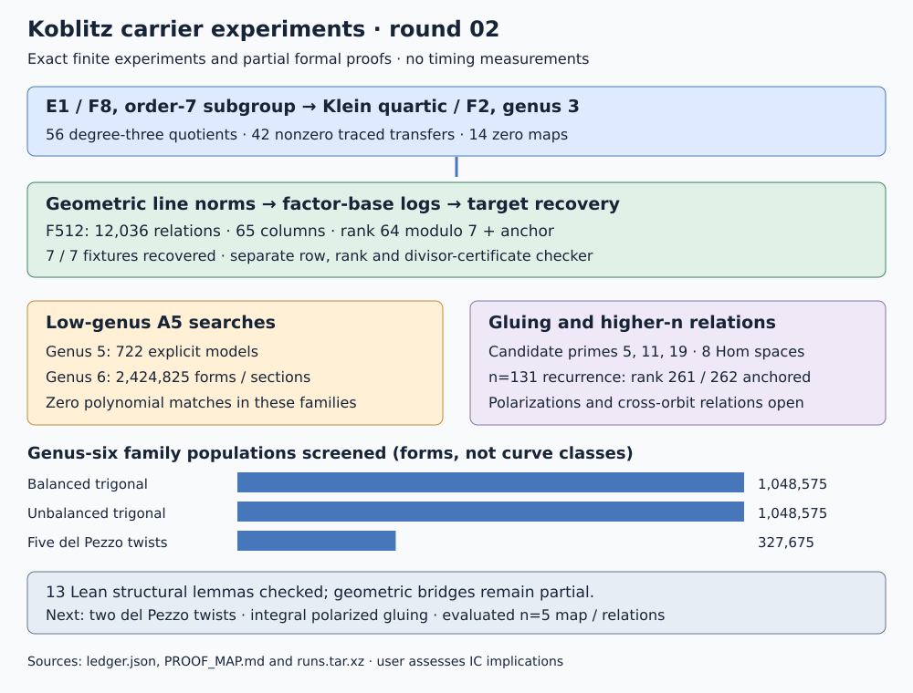

# Koblitz carriers and direct relations: round 02

2026-10-18. Parent commit `047074d9912d64842995f9d590d8c0babdd48042`.
This round follows the user's direction to generate experiments, track
results, and supply relevant Lean proofs. The user assesses implications for
faster IC. No timing or performance comparison was performed.

The concrete positive result is an evaluated n=3 transfer and a geometric
relation solver on the Klein quartic. Of 56 degree-three quotient maps,
42 give nonzero transfers on the complete order-seven source group. Norms
of 12,036 split line functions over F512 produce rank 64 on 65 closed-point
factor-base columns modulo seven. After fixing the rational flex-divisor
anchor, these relations recover all seven public source fixtures. A separate
checker reconstructs the relations, recomputes rank with BigInt elimination,
and checks 65 divisor-class certificates without interpolation solving.

## Evidence and coverage

The native [ledger](ledger.json) records input and source hashes, requirement
status, results and next experiments. The frozen [protocol](PROTOCOL.md)
contains amendments recorded before each added experiment. All raw outputs,
failures and verification logs are in [runs.tar.xz](runs.tar.xz), checked by
[runs.tar.xz.sha256](runs.tar.xz.sha256) and [runs.sha256](runs.sha256).
The [replay script](REPLAY.sh) reproduces thirteen outputs byte for byte.
[README.md](README.md) gives extraction and verification commands.

| Experiment | Exact executed scope | Observed result |
|---|---|---|
| LC0 | 690 genus-5 Artin--Schreier double covers of five elliptic classes, declared rational odd pole partitions | No A5 or A3 target match |
| LC0b | 32 genus-5 covers of E1, branch O plus one of four degree-three places, all trace-one parameters and constant twists | No A5 match; rational expressions and removable limits checked |
| LC1 | All 1,048,575 nonzero bidegree-(3,4) forms on P1 x P1 | No A5 divisibility candidate for either sign |
| LC1b | All 1,048,575 nonzero sections of 3C0+7F on the split Hirzebruch surface F2, C0 squared=-2 | No A5 divisibility candidate for either sign |
| LC2 | Five del Pezzo Frobenius types, 65,535 nonzero sextic sections each; 327,675 total | No A5 divisibility candidate for either sign |
| MR0 | Orbit recurrences at n=3,5,7,131; actual small-subgroup point controls | At n=131: ranks 130,260,261,262 for one block, two blocks, anchor, supplied cross row |
| MR1 | Five inert good primes, signed n=131 level 30,349,081; n=3,5 controls | n=131: all five necessary-condition gcds equal one; small controls pass |
| KT0/KT1 | 168 automorphisms; 56 quotient maps; seven source scalars, all fibers split over F512 | 42 nonzero maps, 14 zero maps; 393 principal-divisor checks pass |
| MR2 | All 66 fully split F8 lines, nine factor-base columns | Rank 8; four fixtures recovered; three unsupported fibers retained |
| MR2b | All 262,657 F512 lines screened; 12,036 fully split lines, 65 columns | Rank 64; seven of seven fixtures recovered and checked |
| GL0/GL1 | Both A5 signs, all elliptic cofactor traces; eight nonempty gluing-prime cases | Candidate primes 5,11,19; all eight Frobenius Hom spaces have dimension two |
| PF0 | Thirteen structural lemmas in pinned Lean/mathlib, plus prior cyclic numerical lemma | Kernel builds and axiom audits; geometric bridges remain partial |

Genus-six forms include singular, reducible and nonreduced sections. The
point-count/Newton/divisibility test is a necessary test for a smooth genus-six
carrier. Since there are no divisibility candidates, none reaches a smoothness
promotion. These searches do not prove that all genus-five or genus-six
carriers are absent. LC2 covers Frobenius types 1+1+1+1, 2+1+1, 2+2, 3+1,
and 4, using four general-position blowup points; types 5 and 3+2 remain open.
No classification theorem upgrading these families to exhaustive genus-six
coverage is claimed.

## Curve, map, and subgroup identities

The source control is E1: `Y^2+X*Y=X^3+X^2+1` over F8, with its unique
order-seven subgroup. E0, the other sign, is `Y^2+X*Y=X^3+1`.
A_n denotes the full trace-zero factor of the restriction from F_(2^n) to
F2; at n=5 it has dimension four. All target polynomials are constructed
exactly, independently of the carrier enumeration. The large rung is the
registered E0/F_(2^131) curve
`icv1-f2m131-tm22283658519494248867-115e0dc5`, subgroup order
`680564733841876926932320129493409985129`.
Its signed-character modular carrier and polynomial identity are preserved
from [round 01](../../REPORT.md); no large-rung point was targeted.

The Klein model is `x^3*y+y^3*z+z^3*x=0`. For
`a=x+y+z`, `b=x*y+y*z+z*x`, `c=x*y*z`, the cyclic quotient is
`X=a*c/b^2`, `Y=1+a^3*c/b^3`. At b=0 in the tested odd-degree fields,
c=0 maps to (0,1) and c nonzero maps to the origin. There are no a=b=0
points in these fields; a global resolution at geometric exceptional
points remains part of the written map argument. Conjugation by all 168
projective automorphisms yields 56 distinct maps. A separate verifier
expands each recorded matrix against the quartic polynomial.

D=(0:1:0)-(1:0:0) has exact order seven. For each quotient phi, the transfer
is the Frobenius trace of phi-pullback of `(Q)-(O)`. Over F512 all cubic
fibers split; the source still lies over F8. The 392 input/map combinations
have explicit principal-function certificates expressing the transfer as
an element of the cyclic group generated by D. Together with the witness
for 7D, the separate checker verifies 393 principal divisors.

The Klein modular-curve interpretation and characteristic-two geometry
are classical; see [Elkies, sections 3.3 and 4](https://library.slmath.org/books/Book35/files/elkies.pdf).
Our arithmetic claims concern exactly the displayed F2 model, including
its descent, rather than treating all F2 twists as interchangeable.
The explicit transfer and relation data in this round are native calculations.

## Direct geometric relations and recovery

MR0 uses inverse-Frobenius indexing, giving
`u_j-t*u_(j+1)+2*u_(j+2)=0`. Homogeneous relations in separate orbit blocks
leave independent scalar freedom. The extra cross-orbit row in MR0 is an
explicit information control; it is not a generated modular relation. The
Lean scaling lemmas establish the structural reason. This does not exclude
other sources of modular relations.

MR2/MR2b instead generate actual principal divisors of `Norm(ell/z)`.
Every row comes from a line function, without target scalars or the KT class
answers. The nullspace has one free scale, fixed by D. Certificates verify
the factor-base logs after multiplication by two, removing the irrelevant
two-part of Jac(C)(F2), whose order is 14. The transfer is seven-torsion,
so the seven-part suffices. The first map with a nonzero solved base log is
selected using the relation solution. Recovery receives point inputs,
reconstructs fibers and traces, takes their solved logs and divides by the
base log. Known fixture scalars are compared only after solving.

The F8 factor base has nine columns and recovers scalars 0,1,2,4. Scalars
3,5,6 have nonsplit cubic fibers there. MR2b expands the coordinate field and
factor base; it recovers all scalars 0 through 6. This is a full finite control
for that particular seven-element group. It supplies no extrapolated relation
yield, descent coverage or cost at n=5 or n=131.

MR1 tests a narrower arithmetic condition. If character values epsilon,eta
satisfy epsilon^D=eta^D=1 and epsilon+p*eta=0, then (-p)^D=1. For
N=49*787^2, D=4,330,074, the five primes 3,5,13,17,19 each give
`gcd(r,(-p)^D-1)=1`, with Bezout witnesses. Thus the tested character-pair
congruence is absent. The n=3 control uses N=7^4 (2401), rather than a
minimal conductor, and the n=5 control uses N=5929; both pass this screen.
No theorem identifying every cuspidal or modular-unit relation with this
character-pair test has been supplied. Interior relations remain open.

## Gluing and formal verification

The real-Weil resultants against elliptic cofactors supply primes 5,11,19.
All eight companion-module cases have a two-dimensional Frobenius Hom
space. There are 24,100,360 injective intertwiners at primes 5,11,19,
respectively; full elliptic torsion field degrees are 24,10,72. These are
finite-module calculations for the companion Z[pi] lattice. They do not
construct an alternating pairing, a principal polarization or a Jacobian,
and they do not enumerate every integral isogeny representative.

The [proof map](PROOF_MAP.md) states all thirteen Lean declarations, their
hypotheses, readable divisor and relation arguments, and missing bridges.
The final kernel proofs use only propext, Classical.choice and Quot.sound.
The degree-eight certificate `IDC1h2d387a2f2db3e737` ([integer-lift certificate](identity-klein-lift.json)) records
`Delta=F*F_reverse+2H`; [exact expansion](identity-klein-expansion.json)
records the even residual coefficients. Its v1 checker works over the
specified odd prime. The Lean quotient identity independently proves the
characteristic-two reduction; the scopes are explicit, and the odd-prime
certificate is not mislabeled as a characteristic-two proof.

## Controls, failures, and limitations

Walsh counts agree with 54 direct LC1 checks, 42 direct LC1b checks and
180 direct LC2 checks. Native unit tests also exhaust all small (1,2)
forms over three fields and check elliptic group laws on all five base
classes. LC0/LC0b have exact base-elliptic divisibility checks. No positive
A5 curve was found or inserted as a control; the known Klein target and
original polynomial identities remain the positive target controls.

The first native build, initial Lean elaborations, and a later cosmetic
rename failed; the logs are preserved. A cache setup requested an obsolete
mathlib path after downloading the cache and returned nonzero; later builds
succeeded. The first all-scalar F8 output has unsupported fibers and a null
first-nonzero-map metadata field; it is incomplete coverage, not evidence
that every transfer vanishes. Its v3 rerun changes only schema/scope/field
metadata. The first byte replay consequently failed on that version change;
the revised replay compares v3 to v3. No frozen output was rewritten.

All generation and checks here were performed by the same agent; separate
algorithms and solver-free certificate checks are available, but this is
not independent external review. Full geometry in Lean and higher-n maps
remain unresolved. No performance leaderboard row was promoted. The two
canonical carrier summaries were updated with this round's structural
scope; progress-timeline and timing graphs have no new measured quantity.

## Requirement status and next experiments

| Requirement | Status | Next discriminating experiment or proof |
|---|---|---|
| Low-genus carriers | Partial; specified families exhausted | Descend the two remaining del Pezzo Frobenius types 5 and 3+2, controlled against the five executed types |
| Direct modular relations | Partial; n=3 geometric solver verified | Evaluate interior principal-function relations on an n=5 modular factor; supply the Hecke/cusp bridge before extending MR1 |
| Transfer and recovery | Complete on the specified n=3 subgroup; higher n open | Construct an n=5 map/projector and verify nonzero subgroup action and exceptional fibers |
| Gluing/polarization | Candidate modules verified; construction open | Enumerate Rosati-compatible integral lattices at 5,11,19, then check maximal isotropy, principal polarization and Jacobian realization |
| Lean proofs | Thirteen lemmas checked; full geometry partial | Formalize the divisor-certificate criterion and connect it to the explicit curve, Picard classes and instantiated recovery |
| IC efficiency assessment | Not attempted in this round | User determines the assessment and subsequent matched cost protocol |

These are generated follow-up experiments, not jobs running in the background.
The shared unresolved record is
[the carrier-transfer problem](../../../../problems/koblitz-modular-carrier-transfer.md).

The final proof update also checks the Klein gradient's common-zero criterion,
bringing the structural module to thirteen theorems. The first ledger draft
was assembled while two verification logs were still growing; it is retained
in the raw archive as an unverified draft. The canonical ledger was assembled
after verification finished, and excludes its own open assembly receipt.
The archive manifest covers every finalized receipt, including that draft.
