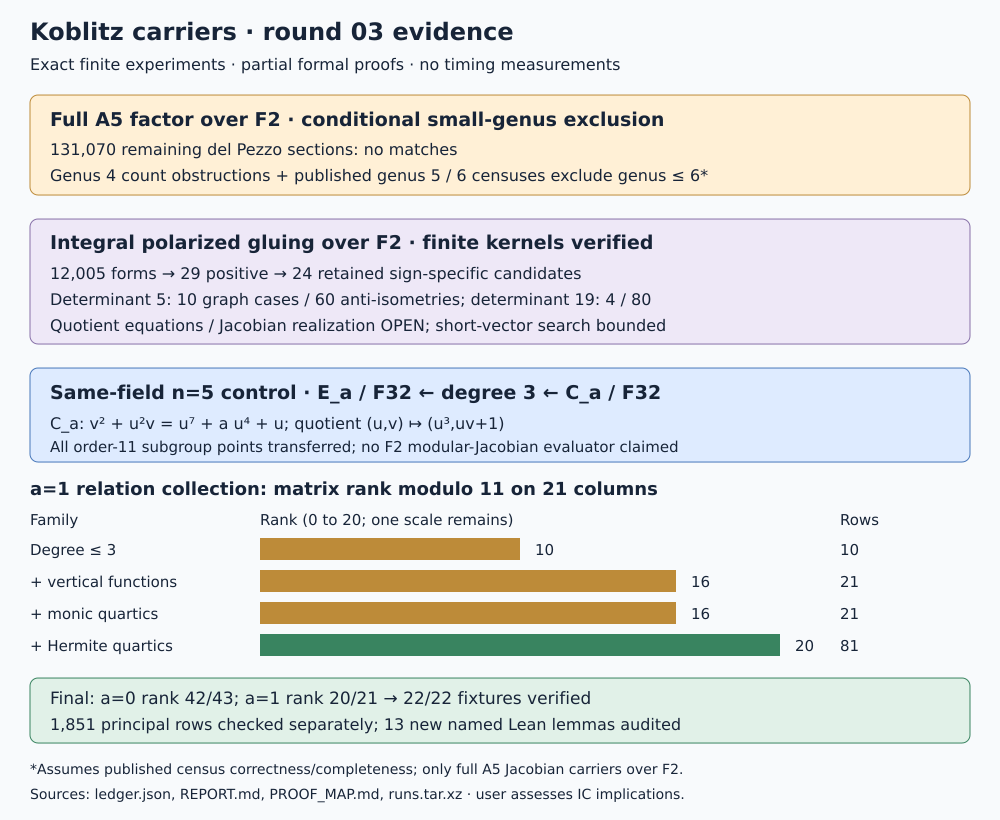

# Koblitz carriers: twists, polarized gluing, and n=5 relations

Round 03, 2026-10-18. Experiment parent
`d6c722e19a381f2b6178b6d5d75ce6a87aea4335`.
The user's requested three tracks were executed as separate bounded
experiments, with failures preserved and thirteen new Lean lemmas. No
performance measurement or IC efficiency assessment was made.

The two missing del Pezzo twist searches are complete within their specified
linear systems. Integral gluing now has explicit positive forms, polarization
kernels, pairings and anti-isometry graphs. The n=5 same-field cubic-cover
control recovers all 22 public fixtures from geometric principal-function
relations, after three weaker collections exposed a rank deficiency.
An evaluated F2 modular-Jacobian map and its interior relation collector
remain open.

## Recorded results

| Experiment | Actual scope | Result |
|---|---|---|
| DP3 | Types(5),(3, 2), 65,535 sections each, six extension counts | 131,070 sections; no A5 polynomial candidate for either sign |
| GL2 | 2,401 integral circulant parameters, coefficients in[-3, 3] | 15 positive; five determinant 5 forms before sign duplication; scope misses four congruence cosets |
| GL2b | Five congruence cosets, 12,005 forms | 29 positive; 24 retained sign-specific candidates:10 determinant 5, 14 determinant 19 |
| Gluing graphs | All elliptic cofactor traces in[-2, 2] | 10 determinant 5 cases with 60 anti-isometries; 4 determinant 19 cases with 80 anti-isometries |
| GL4 | All6,560 nonzero eight-coordinate vectors in[-1, 1] per determinant 19 gluing case | Four cases, minimum 3 within the box, no norm-one witness; global minimum and indecomposability unresolved |
| GL3 | Published genus 5 census, three strata | 7,829 point-count records; no A5 match |
| DP4 | Published genus 6 census | 38,327 isogeny classes, 72,227 curves; no A5 match; all label/Newton roundtrips pass |
| G4 | Putative genus 4 polynomial for both signs | Positive sign N1=4>N2=2; negative sign N5=77>published maximum 71 |
| MR3 | Determinant-compatible character screen, five primes, n=3, 5,131 | n=5 fails at 3 and 5; n=3 controls pass; scope remains a necessary character-pair condition |
| N5d,a=0 | 43 rational-point columns; cubic, vertical and monic-quartic functions over F32 | 1,770 rows, rank 42 modulo 11, 11/11 fixtures recovered |
| N5d,a=1 | 21 columns; add Hermite-generated quartics | 81 rows, rank 20 modulo 11, 11/11 recovered; 34,804 subdivisions give 22,514 unique interpolants and 60 additional rows |
| Formal checks | New module plus prior proofs | 13 new named Lean lemmas build; 14 declarations audited including the defining equation; standard foundations only |

The [ledger](ledger.json) contains the input/source hashes, requirements,
failed and partial runs, and next experiments. The [protocol](PROTOCOL.md)
records each added test before execution. [REPLAY.sh](REPLAY.sh) reproduces
the eight final outputs and runs separate verifiers. The [raw archive](runs.tar.xz)
and [file hashes](runs.sha256) preserve intermediate failures and published
inputs. [VALIDATION.md](VALIDATION.md) records checks and their actual outcomes.

## The two del Pezzo searches

The five-point conic construction realizes both missing Frobenius types.
The degree-five anticanonical system consists of quintics double at five
conic points. Its square consists of decics quadruple there; the respective
native dimensions are 6 and 16. Count the zero divisor on the blowup, using
order-four Hasse jets at exceptional fibers, then contract the conic. The
independent conic check verifies that restriction is either zero everywhere
or nowhere zero, including exceptional tangent directions. The correction
is subtract q when the whole conic lies in the zero divisor.

There are 72 direct section-count controls, 12 surface-count controls and 264
conic-fiber vector checks across the two types and six fields. Every section
is tested for both A5 signs. Singular/reducible sections remain in the
enumeration; a smooth carrier would necessarily pass the polynomial test,
and none does. Together with round 02, all seven del Pezzo Frobenius types
have now been tested in these anticanonical-square systems. This alone does
not classify every genus-six curve. The construction and geometric argument
are given in the [proof map](PROOF_MAP.md), with a primary-source link.

## Polarized gluing: explicit progress and remaining geometry

GL2 starts with the actual augmentation lattice of E to the fifth power,
with endomorphism order O_-7. An initial integral circulant sublattice
misses four congruence classes. GL2b includes them by dividing the restricted
circulant matrices by 5 after explicit integrality checks. It finds small
positive forms of determinants 5 and 19; it finds none of determinant 1 or 11
within its stated coefficient range. That bounded absence is not a general
polarization obstruction or a search over all isogeny representatives.

For each retained form the record contains H, its positive leading minors,
J, the actual Frobenius matrix, kernel basis, kernel pairing and all elliptic
cofactor Hom/anti-isometry counts. The separate checker uses integer Bareiss
determinants and exhaustive two-by-two matrix enumeration, avoiding the
generator's Hom-nullspace solver. It confirms 24 forms, 24 kernel pairings and
14 nonempty graph cases. Four determinant 19 cases have 20 anti-isometries
each, matching elliptic trace-2 for target trace-1 and trace+2 for target
trace+1. The other ten determinant 19 cases do not match any F2 elliptic
cofactor in the five tested isogeny classes.

These graphs are Frobenius-stable and maximal isotropic in the finite
polarization kernel, with trivial factor intersections. Under the standard
Hermitian-to-polarization identification and polarization-descent theorem,
they specify principally polarized quotients. The [proof map](PROOF_MAP.md)
exposes those geometric bridges and the exact finite evidence. No quotient
coordinate equations, curve equation or Jacobian realization was constructed.
The genus 5 census result below concerns the entire isogeny classes, so a
principally polarized fivefold from this route is not automatically a
Jacobian. The bounded norm-one search supplies no decomposition witness;
it does not prove these polarizations indecomposable.

## Full-A5 carriers through genus 6: conditional census conclusion

The native genus 5 lookup scans 1,070 hyperelliptic, 2,854 trigonal and 3,905
complete-intersection vectors in the pinned
[Dragutinovic census](https://github.com/DusanDragutinovic/MT_Curves).
All have integral Newton polynomials, and none is divisible by either A5
polynomial. The native genus 6 lookup scans every exported isogeny class in
the pinned [Huang--Kedlaya--Lau census](https://github.com/junbolau/genus-6),
including strata outside our del Pezzo searches. It verifies all encoded
coefficient labels and recovers every polynomial from its point counts;
there are no A5 matches. No Sage or Python research program was executed.

At genus 4, the positive sign is excluded by N2>=N1. The negative sign has
N5=77, whereas [Xarles, Example 16](https://arxiv.org/abs/2007.07822) gives
maximum 71 among F2-defined genus-four curves. Smaller genera cannot contain
the four-dimensional full factor. Thus the combined evidence excludes
**F2 Jacobian carriers containing the full A5 factor through genus 6**,
conditional on the published census results and maximum. This is not an
independent Lean classification and not a bound on arbitrary finite-subgroup
representations or other base fields. It does not extrapolate to n=131.

## n=5 maps and geometric relations

The source curves are E_a/F32: Y squared+X*Y=X cubed+a*X squared+1.
They have group orders 44 and 22, with unique order-eleven subgroups. The
augmentation embedding is the Frobenius tuple (P,F(P),...,F to the fourth(P)).
All eleven points and 121 additions per sign are evaluated and checked for
Frobenius-fixedness and trace zero. The glued quotient and modular-Jacobian
coordinates are not evaluated by this representation.

The concrete relation control uses the existing cubic map
`C_a/F32: v^2+u^2*v=u^7+a*u^4+u -> E_a`,
`(u,v) -> (u^3,u*v+1)`.
The source curve has genus 3. Pullback is nonzero and injective on the entire
order-eleven subgroup, checked directly and supported by the written
prime-to-three push-pull argument. Every target is represented by a reduced
Mumford pair, including nonsplit fibers. The field is F32, not F2.

The initial collector exhausts all 32 to the fourth power polynomials of
degree at most 3. For a=0 this suffices; a=1 yields only ten rows of rank 10
on21 columns. Adding vertical functions raises that rank to 16. The selected
monic-quartic family adds no a=1 rows. These failures are frozen. Finally,
Hermite interpolation enumerates all allowed effective degree-five rational
subdivisors, covering the missing completely split quartic functions. It
adds 60 rows and reaches the unique-scale condition.

The final solver anchors a nonzero projected factor-base class, verifies
every projected log using independent library arithmetic, and performs
bounded individual descent with principal-function witnesses. It uses
at most 32 trials per fixed offset and at most eight point offsets after the
unshifted attempt. All22 fixture answers pass elliptic multiplication. The
separate verifier reconstructs 1,851 principal rows, recomputes ranks 42 and 20
with BigInt elimination, checks 64 projected classes, and checks all 22
individual descents. Fixture labels enter final comparison only; no planted
logarithm is a matrix row or solver input.

This supplies an executable n=5 map/relation control over F32. The requested
evaluated F2 modular factor and its interior relations remain unresolved.
General F32 Jacobian-class pushforward is unsupported in the reused library;
we do not claim that norm capability. The determinant-compatible screen
removes a narrower Eisenstein character-pair possibility at n=5: with the
determinant condition, u squared=-p and u^D=1 imply (-p)^(D/2)=1.
For D=2310 the p=3, 5 tests fail modulo 11. This is not a complete theorem
excluding every modular-unit, cusp or interior relation.

## Proof coverage, failed attempts, and next experiments

The [proof map and written arguments](PROOF_MAP.md) state all thirteen new
Lean declarations and their exact hypotheses. They cover the normalized
character square, halved exponent, CM norm, alternating determinant,
anti-isometry graph isotropy, both graph intersections, quotient injectivity,
cubic substitution, conic intersection arithmetic, conditional adjunction,
and two genus 4 count obstructions. The first proof attempts failed; the
final module and transitive audit pass. Geometry and census completeness
are not hidden as custom axioms.

The first N5 build needed borrowed point coordinates. The initial Lean
file-write used the wrong directory; its following build did not build any
round 03 theorem. Two later Lean builds failed product subtraction/zero
simplification. All are retained. N5c's historical polynomials_tested field
reports 1,048,576 although two families, 2,097,152 per sign, were executed;
N5d corrects that metadata without rewriting the old file. The matrix-rank
failures and bounded short-vector negative are results, not nonexistence
proofs. Generation and verification were performed by the same agent using
separate algorithms; external independent replay has not been claimed.

| Requested track | Status | Next discriminating work |
|---|---|---|
| Remaining del Pezzo twists | Specified searches verified complete | Full-A5 F2 carriers in nonexcluded higher genera; retain census assumptions |
| Polarized gluing | Integral forms and finite graphs verified; geometric realization partial | Complete short-vector enumeration from inverse-Hermitian bounds; classify quotient polarizations and seek explicit equations |
| n=5 maps and relations | Both same-field subgroup controls verified; modular evaluator open | Actual divisor evaluator/projector on the specified n=5 modular factor, with subgroup and exceptional-point checks |
| Lean proofs | Thirteen new named lemmas checked; full geometry partial | Instantiate Picard/divisor certificate, polarization and modular-cusp bridges |
| IC efficiency | Not measured in this round | User assesses implications and selects any subsequent timing protocol |

These are named follow-up experiments, not background jobs. The shared
[carrier-transfer problem](../../../../problems/koblitz-modular-carrier-transfer.md)
remains open. Canonical carrier summaries are updated; timing graphs and
performance leaderboard rows have no new measured value to add.
