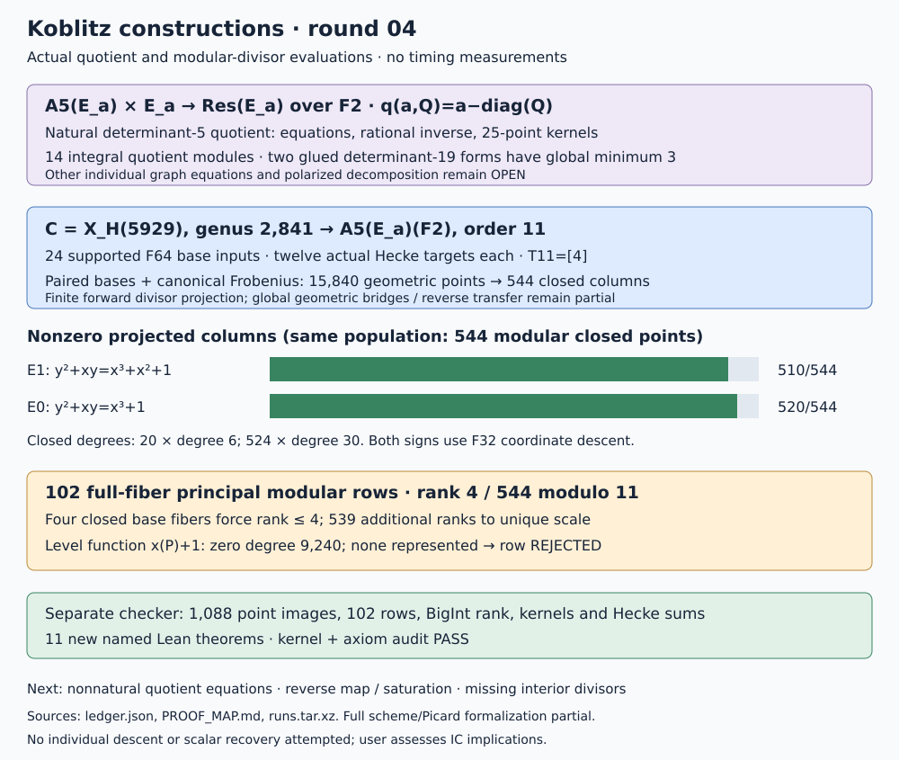

# Explicit polarized quotients and direct n=5 modular relations

Round 04, 2026-10-18. Parent
`f5b90fb286dde2e8b0fa15b127a37514a8d64258`.
The requested geometry and modular-map tracks now have explicit additional
constructions. This round evaluates a modular twisting correspondence on
closed divisors and collects principal relations on the modular curve.
Its relation matrix has rank 4 on 544 columns; no scalar recovery or timing
experiment was attempted. The user assesses implications for IC.

## Recorded outcomes

| Experiment | Result | Scope limit |
|---|---|---|
| Q1 | 14 explicit quotient bases, integral principal alternating forms and Frobenius matrices | Prime-to-2 polarization presentations; equations for individual nonnatural quotients remain missing |
| Q1 short vectors | Both distinct determinant-19 Hermitian forms have global minimum 3, with ten vectors of norm 3 each | Minimum on A5, not an indecomposability theorem for the glued fivefold |
| Q2 | Natural quotient A5(E) x E -> Res(E), affine F2 equations and rational inverse for both signs | Target is a principally polarized fivefold; mixed projective charts use the abstract Weil-restriction gluing |
| Q2 kernel | All 25 geometric kernel points per sign over F_(2^24); 2,420 F2 rational additions checked | No curve/Jacobian realization follows |
| M1/M2 | Actual X0(49) coordinates, two degeneracy maps and degree-11 j-correspondence through extension degree 10 | A compatible j-pair alone is not transported level structure |
| M3b | 24 supported F64 base inputs; twelve actual transported Hecke targets each; T11=[4]; fixed Weil pairing | 18 ordinary nonzero-j inputs outside the selected trace classes remain unsupported; six j=0 inputs are outside this ordinary chart |
| M4 | 15,840 geometric modular points, 544 closed columns: 20 of degree 6 and 524 of degree 30 | Selected finite divisor domain; no arbitrary Jacobian normal-form arithmetic |
| M4 images | 510 nonzero columns for a=1, 520 for a=0, in their order-11 trace-zero groups | Forward factor projection, not a reverse subgroup embedding into the modular Jacobian |
| M4 relations | 102 principal-function rows, rank 4 modulo 11 | 539 further independent ranks are needed for unique scale; no individual descent |
| M5 | x(P)+1 has ordinary zero degree 9,240, with zero zeros represented in this factor base | Rejected collector extension; unresolved zeros and poles, no admitted row |
| Lean | Eleven new named structural theorems build and pass the transitive axiom audit | Modular moduli/descent and full divisor/polarization geometry remain written bridges |

The [ledger](ledger.json), [protocol and amendments](PROTOCOL.md),
[proof map](PROOF_MAP.md), [validation](VALIDATION.md) and
[replay](REPLAY.sh) expose the inputs, exact scopes and remaining obligations.
All research arithmetic and assembly are Rust. Python only renders this
report and the recorded figure. Raw outputs, failed runs and the published
modular-polynomial input are frozen in [runs.tar.xz](runs.tar.xz).

## Explicit polarized quotient geometry

For every retained graph, write its integer top block as G=K*M and set
B=[[ell*I8,G],[0,I2]]. The quotient lattice has basis B/ell. The inclusion
matrix is Q=[[I8,-G],[0,ell*I2]]. Native exact checks give integral
J'=B^t*diag(J_A,ell*J_E)*B/ell^2, determinant one, integral quotient
Frobenius, and both polarization-pullback and Frobenius identities.
The separate checker repeats these checks with BigInt matrices. The elliptic
Frobenius must be its signed integer companion, not positive modular residues;
the first failed run exposed that distinction.

The determinant-19 short-vector result is now global. For the doubled real
Gram matrix S, every norm-at-most-three vector satisfies
z_i^2 <= 6*(S inverse)_ii. Exact inverse cofactors force every coordinate
into [-1,1]. Rational LDL enumeration gives ten norm-three vectors and no
norm-one or norm-two vectors for each distinct form. A separate exhaustive
box check, positive-minor checks and BigInt cofactors agree. The earlier
round's bounded statement remains unchanged as historical evidence.

The natural determinant-five graph has actual quotient equations:
q(a,Q)=a-diag(Q) maps A5(E) x E onto R=Res_(F32/F2)(E). Its kernel is
(diag(T),T), T in E[5]. Over the algebraic closure the target is E^5 with
its product principal polarization. Restriction to the augmentation lattice
gives H=I4+ones4, while the diagonal block is 5 and mixed terms vanish.
The report's universal pairing identity is proved in Lean.

In the pinned F32 basis, expand X=sum(X_i*z^i), Y=sum(Y_i*z^i) and the
elliptic equation. Q2 records the five resulting F2 polynomials in ten
variables. It checks every affine solution (43 and 21), all rational points
(44 and 22), all additions, and all eleven subgroup points. Infinity uses
its identity chart. The full Weil-restriction scheme supplies mixed charts;
a single affine patch is not represented as a complete projective embedding.
The inverse uses the trace to remove the diagonal component. Full five-torsion
and all 1,250 kernel additions are checked again with the maintained binary
library over F_(2^24).

This supplies one explicit polarized quotient for each sign. The other
individual graph quotients, especially the determinant-19 cases with
supersingular elliptic cofactor, still have integral polarization data
rather than explicit coordinate equations. A complex uniformization for
an ordinary variety cannot simply be asserted for those mixed products.

## Actual modular transport and factor projections

The modular base is E1=X0(49)/F2: Y^2+XY=X^3+X^2+1. The integral change
from the minimal model to eta coordinates reduces to
x=X, y=(X^2+X+1)*Y+X+1. This avoids reducing a formula with denominator 2.
Its equation and both characteristic-zero and characteristic-two polynomial
identities are checked in Lean. The degeneracy parameters are x^4/y and y.
The two maps to j are (t^2+t+1)^4/t^7 and (t^2+t+1)^4/t.
These come from [Kilford--McMurdy, section 2](https://arxiv.org/abs/1110.6801).

M3 transports the two successive cyclic-seven kernels across all twelve
cyclic-eleven isogenies, using actual kernel polynomials and characteristic-two
Velu x-maps. It checks the commuting square, the published
[Sutherland degree-11 polynomial](https://math.mit.edu/~drew/ClassicalModPolys.html),
reconstruction on X0(49), and the complete T11=[4] sum. The paired extension
uses Miller functions, alternation and a bilinearity control to put every
basis at the same primitive eleventh root. The unpaired output is preserved
and is not used for relations.

The modular source C is the conjugated full-eleven-level model over X0(49),
with canonical determinant-normalized descent. Its analytic group is conjugate
to X_H(5929), d congruent to +/-1 modulo 11, of genus 2,841. The explicit
moduli/descent argument is in the proof map. Enumerating SL2(F11)/{+/-I}
gives all 660 level bases per supported ordinary base point. Canonical
Frobenius, including the quadratic-twist correction of the universal elliptic
model, produces the 544 closed-point columns. Every one of the 15,840
geometric inputs satisfies the computed twisting-tuple equivariance.

Even sums of Hecke images give the order-five character; signed odd
differences give the order-ten character. Integral augmentation and the
twisted Frobenius trace evaluate their images in A5(F2). The odd character
uses the quadratic isomorphism over F4 before descending to E0(F32).
The map outputs actual points, not just Frobenius-module labels. The Gauss-sum
identification with the twisted newform is a written geometric bridge using
[Atkin--Li twisting](https://doi.org/10.1007/BF01390245), not a new full Lean
modularity theorem. The finite evaluator supports the recorded closed divisors;
arbitrary Jacobian-class reduction, the reverse map and saturation at 11
remain separate requirements.

## Direct modular relations and the observed failure

For lines and verticals on X0(49), take their norm from F64 to F2 and pull
back the entire divisor to C. Every admitted ordinary fiber includes all
660 level points. Partial rational fibers are rejected. Modular cusps map
to cusp points on X0(49), killed by 14, so their projected order-11 images
vanish; the coprime-torsion implication is checked in Lean. Multiplicities,
functions and full rows are retained, not inferred from a zero point sum.

The 102 resulting rows are verified against both sets of actual projected
points. A separate checker reconstructs every row, repeats its group sum
with the maintained binary library, and computes rank 4 with BigInt forward
elimination. Their dependence on only four closed base fibers explains the
rank ceiling, now proved as a general matrix theorem in Lean. This collector
cannot reach rank 543 by collecting more functions with the same four-fiber
support pattern.

The next function, x(P)+1, depends on the eleven-level section and could
break that pattern. Its exact division polynomial at x=1 has degree 15 in b,
with no roots in F64. Its complete ordinary zero degree is 15*56*11=9,240;
the current factor base contains none. This attempt therefore admits no row.
The next discriminating work is to factor that b-polynomial, construct the
missing cyclic49 and complementary-eleven orbits, and resolve the poles.
A vanishing image of a partial divisor would not repair the missing support.

## Validation, failures and outstanding work

The separate checker verifies 14 quotient modules, two global short-vector
certificates, 1,250 geometric-kernel additions, 24 Hecke/basis controls,
1,088 projected point classes, all 544 closed orbits, all 102 principal rows
and independent rank 4. Native tests and the full repository library pass.
Seven frozen output files replay byte for byte. Eleven named Lean theorems
build and audit with standard foundations only. The PDF includes the full
proof map and is inspected page by page.

Failed receipts include an incorrect integer lift, the degree-one Rabin
edge case, a projective-point counting error in the first Hecke check,
first Lean elaborations, a ledger-builder borrow error and a replay mismatch
from newly added unpaired metadata. Corrections preserve earlier outputs;
matching historical serialization is restored. The rank deficiency and
incomplete interior-function support are mathematical/collector outcomes,
not build failures or nonexistence claims.

The open requirements are explicit equations/decomposition for nonnatural
quotients, full formalization of the modular/Picard bridges, a reverse
order-11 subgroup transfer or optimal saturation certificate, richer direct
relations and individual descent. No recovery or speed conclusion follows
from the current rank. The [shared problem](../../../../problems/koblitz-modular-carrier-transfer.md)
remains open. Canonical carrier summaries are updated; performance charts
have no new measured quantity to add. Named next experiments are not
background jobs.
