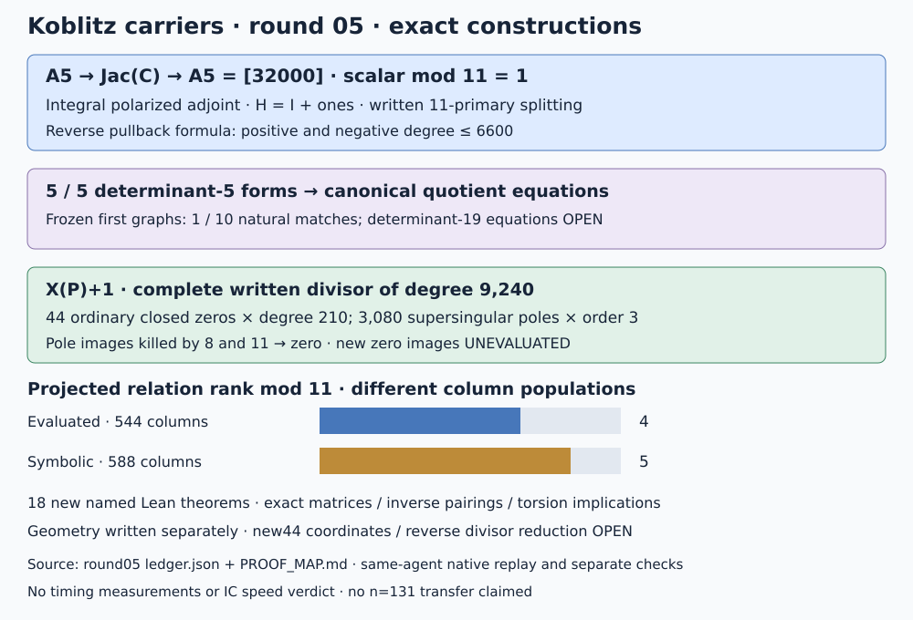

# Koblitz carriers: reverse transfer and a level-dependent divisor

Round 05, 2026-10-19. Parent 75b902661. All arithmetic is native Rust.
No timings or IC efficiency assessment are made.

The n=5 modular map has a written integral reverse correspondence whose
composition is [32000], a unit at 11. Five determinant-5 forms now have
explicit polarized equivalences and canonical quotient equations. The
function X(P)+1 gives a complete written principal divisor beyond the old
four-fiber span. Its new closed-point images remain unevaluated.

| Requested track | Result | Remaining gap |
|---|---|---|
| Quotient equations | Five explicit unimodular equivalences; transported diagonal graphs use the known five F2 equations | Nine frozen first graphs fail the natural-kernel test; determinant-19 equations open |
| Reverse transfer / saturation | Integral polarized adjoint, composition 32000; split injection on 11-primary torsion | Reverse fibers and reduced Jacobian divisor not evaluated; global optimal quotient not computed |
| Relations beyond rank 4 | Complete written divisor and one symbolic projected row: rank 5 on 588 columns | 44 new closed-point coordinates/images unevaluated; evaluated matrix stays rank 4 on 544 |
| Lean | 18 new named theorems, including five explicit inverse/pairing certificates | Moduli, adjunction, local valuation and divisor geometry remain written proofs |

## Reverse correspondence with the actual polarization

Let C be the determinant-normalized full-eleven-level curve over X0(49),
of genus 2841, used in round 04. Its twelve maps phi_a to E49=X0(49)
each have degree 660. The deck group PSL2(F11) has order 660 and acts
transitively on the 132 ordered distinct pairs of lines. The Hecke sum is
sum phi_a=[4]pi on Jacobians. These facts force the Gram matrix
G=640*I12+20*ones12: diagonal 660, off-diagonal 20.

For either signed five-coordinate construction, put S=5*I5-ones5 and
U_i=phi_(2^i) plus or minus phi_(-2^i), with the alternating sign in the
odd case. In the first-four-coordinate model of A5, let F be the first
four rows of S*U. The induced target polarization is H=I4+ones4,
of degree 25. It must be retained in the adjoint calculation:

    F * G * transpose(F) * H = 32000 * I4.

Consequently r=lambda_C^(-1)*Psi^dual*lambda_A is an integral homomorphism
A5 -> Jac(C), and Psi*r=[32000]. Since 32000-2909*11=1, r is a
right inverse on A5[11] and injects its order-11 F2 subgroup. On all
11-primary torsion and the 11-adic Tate module, normalize r by the inverse
of 32000. This gives a split summand, with no denominator at 11. Native
Bezout certificates cover 11^k for k=1 through 8; the general conclusion
uses coprimality. This says nothing about optimality or the kernel at other primes.

There is an explicit divisor-correspondence formula. For a geometric
trace-zero tuple (P_i), sum the ten signed pullbacks
phi_(+/-2^i)^*([5*epsilon_i*P_i]-[O]), with epsilon_i=1 in the even
case and (-1)^i in the odd case. This represents r(P). The total positive
and negative degrees are each at most 6600. The formula and its composition
are established; its fibers have not been split into coordinates or reduced
in a Jacobian implementation. The full geometry is written in PROOF_MAP.md;
Lean proves the matrix identities and the group implications under the
stated composition, rather than assuming a modular scheme library exists.

## Quotient equations and the graph distinction

Search all 390625 vectors in [-2,2]^8 in the cyclic O_-7 algebra. Of these,
410 give unimodular matrices. Each of the five distinct determinant-5
forms has ten hits. The records contain an explicit U with
U^dagger*H_natural*U=H_candidate and determinant +/-1. Generated Lean
certificates check both integral inverse identities and the alternating
pairing identity for each form.

Thus q_U(a,Q)=U(a)-diag(Q) gives a principally polarized quotient onto
Res_(F32/F2)(E). Its kernel is (U^(-1)diag(T),T), T in E[5]. The target
equations are exactly the five F2 polynomials in ten affine variables from
round 04; these are genuinely the same target, with a new explicit source
map. The identity and mixed projective charts retain their round-04 scope.
This gives a construction for both signs of every determinant-5 form.

The frozen first anti-isometries are checked separately. After U, their
four torsion blocks agree, but only one of ten common blocks is +/-I.
That hit has trace -1 and is the already natural graph. The nine other
blocks are not silently replaced by a diagonal graph. Their equations,
the trace+1 companion/CM symplectic identification, and all determinant-19
mixed ordinary/supersingular quotient equations remain open.

## The first relation beyond the four base fibers

The former function x(P)+1 is denoted X(P)+1 here, reserving lowercase x
for a smooth supersingular deformation. Its zero polynomial is

    b^15+b^13+b^12+b^10+b^6+b^2+1.

It is irreducible over F2; exhaustive division by all possible proper
small factors independently checks this. A root defines F_(2^15), with
modulus bits 46149. The a=0 curve has 33000 points and trace -231. On
the a=1 twist, (1,11254) has order 11; its trace is +231 and order 32538.
The first run failed because a division-polynomial x root need not have
a rational y on the chosen twist. That failure is preserved.

The discriminant -77711 is a 7-adic unit. The companion Frobenius on
P1(Z/49) is therefore justified by the maximal unramified order, rather
than guessed from the characteristic polynomial. Modulo 49 its matrix is
[[0,13],[1,35]]. It has four orbits of length 14. The normalized eleven
complements transform by r -> -r under Frobenius^15. Their product gives
44 closed zeros of degree 210, each simple: total degree 9240. None lies
in the old factor base, whose closed degrees were 6 and 30.

The poles are now resolved as a complete geometric stratum. In the
supersingular deformation y^2+s*x*y+y=x^3, normalize the ordinary curve
by x=s^2*X+1/s, y=s^3*Y+1/s^3. Then

    X=(s*x+1)/s^3,
    Y^2+X*Y=X^3+s^(-3)*X^2+(1+s^3)/s^12.

Every finite nonzero eleven-torsion section has pole order 3 in X.
There are 56*660/12=3080 geometric supersingular points of C. Hence
the full pole degree is also 9240. Monicity of psi11 in X excludes
other poles at finite b, including the cusps. The deformation identity
is checked by an integer identity certificate and by Lean; versality,
torsion lifting and valuation are written geometric steps.

Every eleven-isogenous target of a supersingular input remains
supersingular. The modular base has six such points, all in E49(F4),
killed by 8. Native enumeration and maintained-library scalar multiplication
check all six. The closed pole divisor's projected images lie in A5(F2),
of order 11, and are killed by 8, so they vanish. Lean checks this
coprime-torsion implication. The 44 zero columns therefore give the
symbolic projected principal row (1,...,1).

Append those 44 disjoint columns to the old 544 and extend the old 102
rows by zeros. This one new row raises rank from 4 to 5 on 588 columns,
checked by both finite-field elimination and separate BigInt elimination.
The 44 new individual column images are not evaluated. The previously
evaluated matrix remains rank 4/544. A geometric divisor certificate is
not reported as a completed point-image replay or as scalar recovery.

## Evidence, failures and next experiments

[Protocol](PROTOCOL.md), [ledger](ledger.json), [proof map](PROOF_MAP.md),
[validation](VALIDATION.md) and [replay](REPLAY.sh) record the bounds and
requirement statuses. Raw inputs, unsuccessful runs and receipts are in
[runs.tar.xz](runs.tar.xz). The prior round-04 replay still matches all
seven outputs byte for byte. No prior archive is rewritten.

The initial twist failure, overly narrow maximal-order screen, nine graph
misses, missing Lake module declaration and failed Lean simplifications
are retained. M6's rejected row and rank-4 outcome are historical outputs;
M7 is a separately frozen experiment after an explicit protocol amendment.

Next: evaluate the 44 degree-210 closed-point images and check the new
row directly in both target groups; split and reduce a reverse pullback
divisor for a nonzero order-11 point; construct coordinates for one
specified nonidentity gluing block or a determinant-19 quotient. No n=131
reverse transfer, individual modular descent, IC cost comparison or
background execution is supplied by this round.
