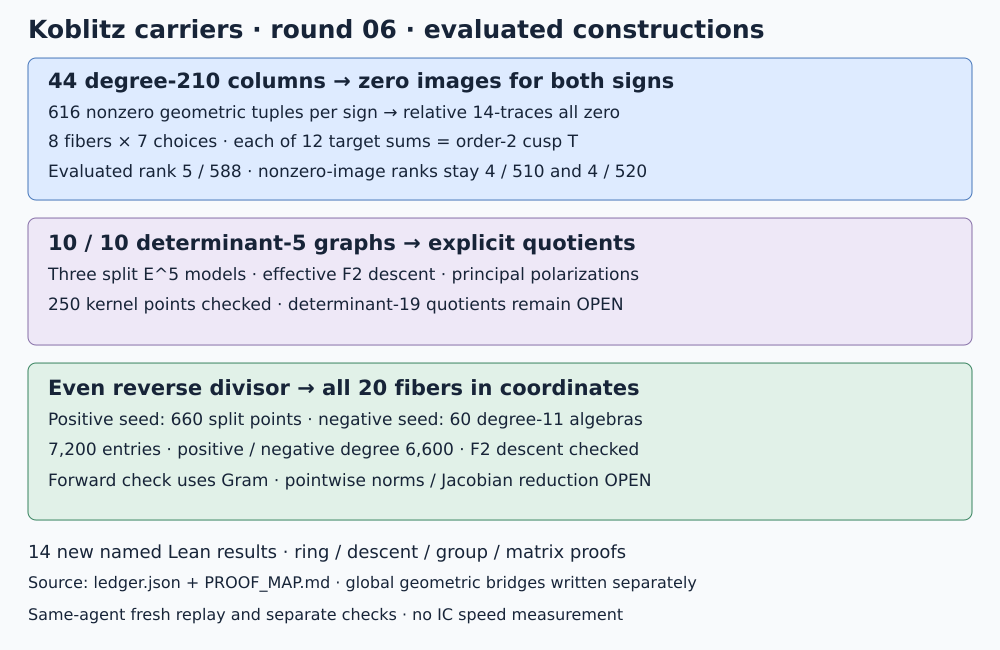

# Round 06 — column images, reverse divisor coordinates and polarized quotients

Client date 2026-10-18; host date 2026-10-19 UTC. Parent round05 is preserved.
This is exact construction and verification, with no IC timing experiment.

All44 degree210 columns now have evaluated images: **zero for both signs**.
The evaluated principal matrix has rank5 on588 columns, but removing the
new zero-image columns restores rank4. The nonzero-image submatrices remain
rank4 on510/520 columns. Thus this particular additional row gives no new
constraint on the old nonzero-image columns.

| Track | Verified result | Remaining obligation |
|---|---|---|
| Degree210 images | All44 closed traces evaluated for each sign; all616 geometric tuples are nonzero; all44 relative14-term traces already vanish | Relations distinguishing second7 choices |
| Polarized quotients | All10 frozen determinant5 graphs realized with explicit torsion basis binding; three split models, effective F2 descent and positive unimodular polarizations | Determinant19 mixed quotients; expanded F2 projective equations; Jacobian identification |
| Even reverse divisor | All20 pullbacks in explicit coordinates; positive and negative degree6600;7200 point-algebra entries of degree1 or11; F2 descent checked | Independent pointwise forward norms, reduced Jacobian arithmetic and odd reverse divisor |
| Lean | 14 new named theorems,15 audited declarations including a generated equation; no nonstandard axioms | Global modular/Picard and divisor geometry remain written |

## Why the new images vanish

The pinned evaluation field is F2^210 with polynomial x^210+x^7+1.
The F30 and F32 embeddings are retained explicitly. Native enumeration
constructs56 cyclic49 chains and all12 transported eleven-isogeny targets
for each chain, checks commuting7/11 squares, and partitions616 paired
labels into44 closed degree210 orbits. The first trace implementation
sums210 Frobenius conjugates; a separate path sums14 actual orbit members
and then15 conjugates. Both return zero in every column for both signs.
All616 Frobenius15 equivariance tests pass for each sign;672 field products
also agree with independent schoolbook reduction.

Grouping the chains by their first7 kernel gives eight fibers of seven.
For each of the12 target maps, every fiber sum is the same order2 cusp
T=(0,1):96 exact checks. The degree7 map t0=x^4/y explains this constant
sum. Even pair sums give2T=0 and odd differences giveT−T=0 before
augmentation. The proof map separates the written fiber argument from
the Lean cancellation and ring identities. This is a structural explanation
for this family’s vanishing, not a universal obstruction to modular relations.

## Quotient equations for every determinant5 graph

Over F32 each model is E_a^5, with five projective equations

    Y_i^2 Z_i + X_i Y_i Z_i = X_i^3 + a X_i^2 Z_i + Z_i^3.

For k=0,4,8 its F2 form is specified by coefficient Frobenius followed by
the explicit order5 automorphism

    T_k(Y1,Y2,Y3,Y4,Z)=(-Y4,Y1−Y4,Y2−Y4,Y3−Y4,Z+pi^k Y4).

Here Y1,…,Z denote elliptic points, rather than the homogeneous coordinates
in the preceding equation. The quotient sends (a1,…,a5,Q), with sum a_i=0,
to (a1−a5,…,a4−a5,pi^k a5−epsilon Q), after the retained integral U.
The explicit Hermitian polarization has upper block I4+alpha J4,
alpha=(2^k−1)/5, last column conjugate(pi^k), and last entry5. Its
determinant is1, its leading minors are positive, and its quotient pullback
and descent identities hold exactly.

The trace+1 companion basis is now bound explicitly to a CM basis by
[[3,3],[4,1]] modulo5. Actual five-torsion coordinates realize that binding.
All250 points in the ten frozen kernels pass the quotient equations;
a separate maintained-library path checks them again. All7260 additions
among the F2-rational inputs pass. These are split equations with effective
F2 descent, not an expanded F2 ideal or a claim that the varieties are Jacobians.
The earlier nine failed direct-natural-graph matches remain preserved;
the new basis binding and nontrivial pi powers supply the missing constructions.

## The complete even reverse divisor as explicit point algebras

Choose the first nonzero order11 point P0 of E49(F32). The twelve reverse
eleven-neighbors over P0 all have full eleven-torsion x coordinates over
F2^120, with polynomial x^120+x^4+x^3+x+1. This corrects the initial
prediction of degree11 complements, whose failed assertion is retained.
The full paired fiber contains660 points, with all pairings verified.

Over −P0 the corresponding neighbors have only the five known rational
x roots. The attempted split fiber fails as recorded. A Weil-pairing
resolvent in a rank110 quadratic coordinate algebra instead produces five
irreducible degree11 components per neighbor. Their x minimal polynomials
and y coordinate polynomials specify all660 geometric points without
enumerating F2^1320. Product, irreducibility, curve, order11 and pairing
checks all pass.

For Pi=Frob^i P0, 5Pi=Frob^(i+1)P0 and6Pi=−Frob^(i+1)P0.
The translated representative [6Pi]−[Pi] gives the required [5Pi]−[O]
class using ordinary fibers. Frobenius conjugation and explicit determinant1
basis changes produce all20 pullbacks for the ten signed lines. The result
has600 degree11 entries in its positive part and6600 degree1 entries in
its negative part, each of geometric degree6600. No cancellation or
Jacobian reduction is claimed. Both seed descents and the full20-term
Frobenius permutation are checked. A separate parser rechecks all7200
coordinate entries and their requested line.

Its forward image agrees with the source generator using the already proved
Gram correspondence:32000P=P on order11. This is a correspondence-based
check with evaluated target points. An independent pointwise forward norm
of the entire divisor is still unimplemented. The odd reverse divisor and
general genus2841 Jacobian reduction also remain open.

## Evidence, failures and next experiments

The [ledger](ledger.json), [protocol and amendments](PROTOCOL.md),
[proof map](PROOF_MAP.md), [validation](VALIDATION.md) and
[replay script](REPLAY.sh) record exact scope and requirements. The immutable
archive retains two compiler failures and both unsuccessful fiber assumptions.
Fresh replay reproduces24 JSON outputs and the generated Lean matrix source
byte for byte. Prior rounds04 and05 also replay unchanged. Construction and
checks are by the same agent; the separate paths share arithmetic primitives.
There is no external independent audit.

The next discriminating experiments are target-function norms on the
degree11 reverse components; functions separating second7 choices for
nonzero new column images; and an explicit mixed determinant19 quotient.
Each remains an open requirement. The user assesses their IC significance;
no scalar recovery, solver cost or n=131 transfer is established here.

Primary formulas and context: [Kilford–McMurdy, X0(49) equations](https://arxiv.org/pdf/1110.6801),
[Miller algorithms in the Handbook of Elliptic and Hyperelliptic Curve Cryptography](https://www.hyperelliptic.org/HEHCC/chapters/chap04.pdf),
and [binary-curve arithmetic reference](https://tsapps.nist.gov/publication/get_pdf.cfm?pub_id=917341).
The new constructions and finite calculations above are repository results.
