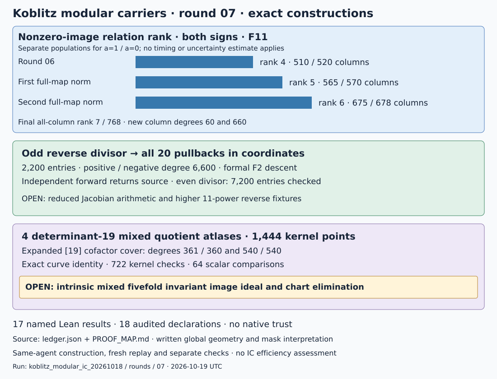

# Round07 — independent norms, odd reverse divisor and nonzero-image rank6

2026-10-19 UTC. Parent b582a94c2; rounds01–06 stay frozen.
This round performs exact constructions and checks. It measures no IC costs.

Two complete full-map principal relations raise the nonzero-image rank
from4 to5 and then6 for both signs. The final evaluated matrix has
rank7/768, including the earlier row on44 zero-image columns. The
nonzero-image submatrices have rank6 on675/678 columns. New columns
have degrees60 and660; no individual descent or solver experiment is supplied.

| Requested track | Result | Remaining gap |
|---|---|---|
| Independent forward norms | All7200 even reverse entries checked; actual modular targets and point-algebra traces return the source without Gram evaluation | Reduced genus2841 Jacobian arithmetic |
| Corrected odd reverse divisor | All20 fibers,2200 point-algebra entries; degree6600 each side; formal F2 descent and independent forward equality | General Jacobian representation/reduction and higher11-power fixture evaluation |
| Expanded determinant19 quotients | Four actual mixed translation atlases; all1444 kernel points checked; expanded supersingular[19] cover equations and exact identity | Intrinsic mixed five-dimensional invariant image ideal and full chart elimination |
| Relations beyond nonzero-image rank5 | Second full-map norm raises both signs to rank6, with120 new columns and no geometric joins to prior columns | Further relation families, collection costs and individual descent |
| Lean | 17 new named results;18 declarations audited without nonstandard axioms | Global modular/Picard geometry and polynomial-mask interpretation remain written |

## Full-map functions distinguish the second7 choices

Let P0 be the recorded order11 point of E49(F32), and let phi_a be the
twelve degree660 modular maps. The first function is

    f0 = Norm_F32/F2(x(phi0)+x(P0)).

Its target quintic is x^5+x^4+x^3+x^2+1. Its simple zeros are exactly
the ten nonzero rational11-torsion points of E49(F32). Pulling them back
gives55 closed columns of degree60 from the split seed and five of
degree660 from the etale seed, total degree6600. The pole divisor is
10 phi0^*(O). Cusp images vanish after projection: the eight E49 cusps
are F8-rational and killed by14, while the target group is killed by11.
The complete row has coefficient1 on each of the60 new columns.

For the second function use

    f1 = Norm_F1024/F2(x(phi1)+x(P0)).

Frobenius moves its lines through2^j modulo11. Its complete degree13200
zero divisor has110 degree60 and ten degree660 columns. Split columns
are joined by complete geometric basis keys; none overlap prior columns.
For etale columns, nonconstant P coordinates and the nonconstant
half-period transform −P+2Q certify the stated disjointness, with the
Galois bridge written in the proof map. Multiplicities are retained.

| Evaluated population | All-column rank | Nonzero a=1 columns/rank | Nonzero a=0 columns/rank |
|---|---|---|---|
| Round06 | 5/588 | 510/4 | 520/4 |
| After f0 | 6/648 | 565/5 | 570/5 |
| After f1 | 7/768 | 675/6 | 678/6 |

Unlike the previous x(P)+1 row, these new rows have nonzero new column
images. Each complete principal sum is zero. Separate F32 arithmetic
checks every new image and both sums; independent modular elimination
agrees with the BigInt ranks. The change in column population is explicit:
these ranks do not measure relation-generation or destination-solving cost.

## Independent even and odd forward calculations

For the even reverse divisor, reconstruct the modular target coordinates
from seven/eleven kernels in the split field or each degree11 point algebra.
Check the commuting isogeny squares and take elliptic point traces over
the coordinate algebra. Exact deck and Frobenius permutations then evaluate
all7200 entries of the20-fiber divisor. The resulting forward image equals
the source generator and agrees with the prior Gram receipt. The Gram
matrix is not used to compute these norms.

For the odd sign, twist an order11 E0(F32) point to S0 on E49(F1024).
It satisfies Frob(S0)=7S0 and Frob^5(S0)=−S0. The correct full11
evaluation field is F2^660, with modulus x^660+x^10+x^8+x^5+1.
The underlying F1024 curve has trace53; Frobenius modulo11 has order22.
The twelve reverse neighbors yield55 split points and55 irreducible
degree11 components, total geometric degree660.

Use the formally antisymmetric divisor [8T]−[−8T]. Its class is
16T=5T on11-torsion. The ten signed lines produce20 pullbacks with
2200 coordinate entries, positive and negative degree6600. Every term
has explicit point-algebra coordinates. Seed Frobenius10 descent and the
complete formal-divisor Frobenius permutation pass. All12 target maps
are independently evaluated on every seed component, and the full forward
image is the source odd trace-zero tuple. A separate parser checks all2200
coordinate entries, their curves, torsion and selected line. An independent
F32 check confirms the final source is nonzero of order11 on E0.

These are unreduced divisors. Neither result implements general Jacobian
reduction; the odd representative is explicitly specialized to11-torsion.

## Expanded determinant19 geometry: what was obtained

The four frozen graphs glue an ordinary fourfold to a supersingular
elliptic cofactor of trace±2. The exact common torsion field is F2^360,
with modulus x^360+x^5+x^3+x^2+1. Actual CM and companion bases have
matching Weil pairing. Each361-point graph lies in the correct polarization
kernel and passes its geometric Frobenius permutation. The records give
all translation maps, the mixed projective atlas and factored invariant
coordinate circuits. Specializations agree under both graph generators.

The supersingular cofactor cover is now expanded. For
v²+v=u³+u+c, c=0 or1, native rational-function group arithmetic gives

    [19](u,v) = (Nx(u)/Dx(u), v+Nr(u)/Dr(u)).

The numerator/denominator degrees are361/360 and540/540. The artifact
q5b-expanded-cofactor-equations.txt lists all four polynomials explicitly.
On the declared affine chart the equations are

    Dx(u) U + Nx(u) = 0,
    Dr(u) (V+v) + Nr(u) = 0,
    v²+v=u³+u+c,   V²+V=U³+U+c.

Exact polynomial arithmetic verifies the cleared curve identity. A Lean
kernel certificate checks its binary polynomial masks; a universal Lean
identity explains curve preservation under the exposed rational identity.
All722 cofactor kernel checks and64 pointwise scalar comparisons pass.

These are expanded cofactor-cover equations for the mixed atlas. The full
intrinsic invariant image ideal of the five-dimensional quotient has **not**
been eliminated. That original requirement remains partial; a translation
atlas and cover equations are not presented as a completed mixed ideal or
a Jacobian equation.

## Failures, proofs and replay

The first odd adapter inherited a q-mod11 matrix entry and degree5
embedding modulus from the even F32 case. It produced no accepted fiber.
The matrix and modulus are corrected, full group orders are checked before
torsion extraction, and primary loops are bounded. Interrupted probes and
the explicitly stopped stale probe are retained. A determinant19 invariant
sample initially hit infinity; the corrected sample condition excludes
kernel translates. A BigInt type-inference failure is also retained.

The [ledger](ledger.json), [protocol and amendments](PROTOCOL.md),
[proof map](PROOF_MAP.md) and [validation](VALIDATION.md) identify exact
requirements, checks and open bridges. Fresh replay compares50 new JSON
records, expanded cover equations and generated Lean byte for byte.
Round06 replays unchanged. Construction and checking are by the same agent;
separate paths share primitives where stated. There is no external audit.

The universal identities carry certificates
[IDC1h4a9fbbb8fcf6dd5d](identity-deck-line-transport.json) and
[IDC1h9c84bbd67b8b148a](identity-supersingular-coordinate-lift.json),
each with64 issuer and128 extra checks and a Lean source hash.
The frozen protocol inherited America/Los_Angeles timezone metadata from
the prior round; the current user environment and this report use UTC.

Primary references for the written bridges are
[Kilford–McMurdy’s modular equations](https://arxiv.org/pdf/1110.6801),
[Miller arithmetic](https://www.hyperelliptic.org/HEHCC/chapters/chap04.pdf),
[finite free quotients](https://stacks.math.columbia.edu/tag/07S5), and
[Milne’s abelian-variety notes](https://www.jmilne.org/math/CourseNotes/AV.pdf).
The new finite results and constructions above are repository calculations.
