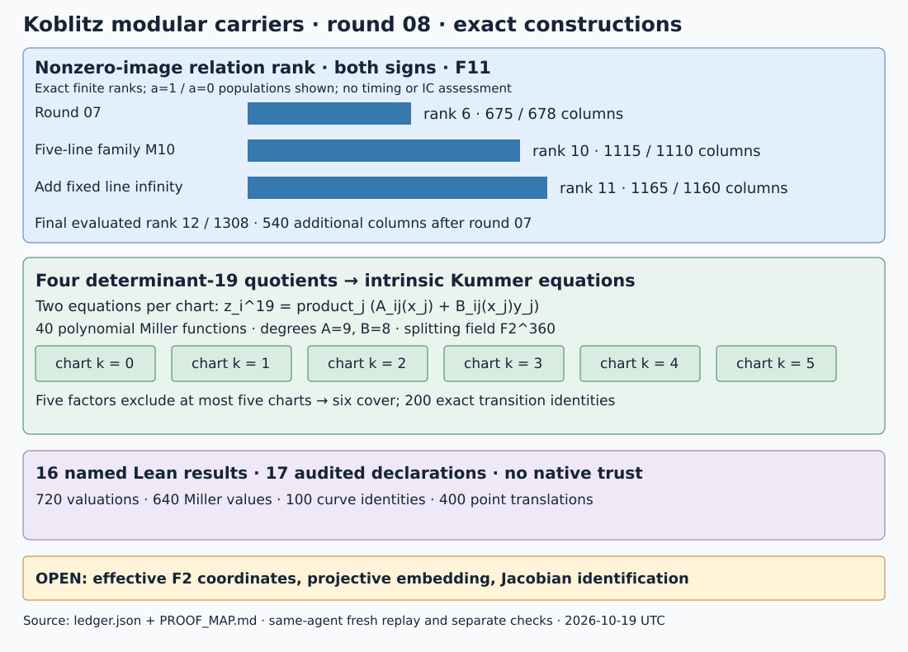

# Round08 — complete line norms and intrinsic Kummer charts

2026-10-19 UTC. Parent 244f1b850c. Earlier rounds remain frozen.

The remaining line-norm functions raise nonzero-image relation rank from
6 to **11 for both signs**. The final evaluated matrix has rank **12/1308**;
its nonzero-image populations have 1165 and 1160 columns. These rows have
new supports: the larger ranks are reported with the larger column sets.

For each of four determinant-19 graph quotients, two explicit Kummer
equations now describe a dense intrinsic chart over F2^360. Their 40
Miller functions pass exact divisor checks. A written dual-isogeny argument
identifies the rooted cover with the polarized quotient. Six covering
charts per graph now have explicit transitions, checked by200 exact
rational identities. A closed projective embedding and F2 coordinate
descent remain open.

| Requested direction | Verified result | Remaining gap |
|---|---|---|
| More direct relations | Five nonzero-line norms and the fixed line∞; complete supports and geometric joins; independent images and ranks | Coupled functions beyond this family, relation costs and individual descent |
| Intrinsic determinant-19 equations | Two localized Kummer equations and six covering charts per graph, expanded coefficient arrays and exact transitions | Closed projective embedding and explicit F2 descent on these coordinates |
| Lean | 16 new named results for coordinate changes, Miller divisors, Kummer identities, chart coverage and cocycles | Native finite-field certificates and global Picard/isogeny identification remain written |

## Complete line-norm family

Use the same genus-2841 determinant-normalized full-eleven-level curve C,
with twelve degree-660 maps phi_a to E49. Over F2 the normalized E49 model
is E1: y²+xy=x³+x²+1; E0: y²+xy=x³+1 is its quadratic twist. The
order-11 point P0 is (8,31) over the pinned F32 polynomial basis. Actual
modular target traces come from the independently reconstructed round07
point-algebra data, rather than a Gram matrix.

M10 evaluates

    f_a = Norm_F1024/F2(x(phi_a)+x(P0)),  a=1,2,3,4,5.

The a=1 row is the byte-exact round07 control. Each function has 110
degree-60 zero columns and ten degree-660 columns, total zero degree
13200. The poles have the same degree and their projected cusp images
vanish as in round07. Lines a and−a give the same norm: reindex the ten
Frobenius factors by five, using 2^5=−1 modulo11 and Frob^5(P0)=P0.

The four additional rows have no joins to previous columns and add 480
columns. M10 gives evaluated rank 11/1248 and nonzero-image rank 10 on
1115/1110 columns. The final M11 function is

    f_infinity = Norm_F32/F2(x(phi_infinity)+x(P0)).

Its 55 degree-60 and five degree-660 zero columns have total degree6600.
None join the previous supports. This yields the final counts below.

| Evaluated population | All-column rank/count | Nonzero a=1 rank/count | Nonzero a=0 rank/count |
|---|---|---|---|
| Round07 | 7/768 | 6/675 | 6/678 |
| Five-line family M10 | 11/1248 | 10/1115 | 10/1110 |
| Add fixed line∞ M11 | 12/1308 | 11/1165 | 11/1160 |

Column identity is geometric. Split orbits use the complete modular-base
point and ordered torsion basis, modulo simultaneous sign. For nonsplit
degree-11 components, the code changes primitive generator to x(Pnew),
finds its minimal polynomial and expresses every other coordinate in
that generator by invertible 11×11 field linear algebra. Substitution
checks both directions. The canonical keys include the actual curve,
base point, minimal polynomial and all remaining basis coordinates;
they compare whole components independently of their field presentations.
Ten or five coefficient-Frobenius phases close each orbit. Equal projected
images are never used to identify columns.

The line∞ change is (P,Q)→(−Q,P). Its normalized Frobenius5 action commutes
up to simultaneous sign, so it uses the original length-12 seed cycles.
The other lines use (P,Q)→(−aQ,a^−1P+Q) and length-6 Frobenius10 cycles.
All component degrees, coordinate keys and principal sums are checked.
Separate small-field arithmetic checks all five coordinates of every new
image and every principal row; independent modular elimination agrees
with the BigInt ranks. This is a same-agent check with shared primitives,
not an external audit. No IC cost or efficiency verdict is supplied.

## Two equations for each mixed quotient chart

Let B=E^4×E', let Γ be one of the four frozen actual graph kernels, and
let A=B/Γ with its principal polarization. The ordinary factor has trace
±1; E': y²+y=x³+x+c has trace±2, with c=0 or1. All coordinates use
F2^360 defined by x^360+x^5+x^3+x^2+1. The prior polarization certificate
gives diag(H,[19])=q^dual λ_A q. The two chosen graph generators are
the recorded kernel points at indices1 and19.

For each component T_ij of generator i, compute

    f_ij(x_j,y_j) = (A_ij(x_j)+B_ij(x_j)y_j)/D_ij(x_j),
    div(f_ij) = 19([T_ij]−[O]).

The coefficient arrays are fully expanded in q6-intrinsic-Kummer-charts.json.
All40 denominators reduce to1; each A has degree9 and each B has degree8.
The mixed equations are factored polynomial generators, not orbit circuits:

    z_i^19 product_j D_ij(x_j)
      + product_j (A_ij(x_j)+B_ij(x_j)y_j) = 0,  i=1,2.

Together with the five elliptic equations, localize at every displayed
numerator and denominator. Equivalently add w*Delta+1=0, where Delta is
their product. This gives seven equations in twelve affine coordinates,
plus the single localization coordinate/equation: dimension five.

Every one of the 40 functions has a normalized pole of order19 at O.
All denominator roots lie among its nonzero19-torsion multiples. Exact
local jets through order64 give order19 at T and zero at each of the
other17 nonzero multiples. There are 720 finite valuation checks. A
separate pointwise Miller recurrence agrees at 640 nonsupport points.
The parser rechecks the stored coefficient arrays and all those checks.

The two graph classes are independent, checked by their projections to
the supersingular companion basis. Therefore their Kummer classes give
a connected degree-361 cover. The Jacobian entries in z_1,z_2 are
z_i^18 product_j D_ij, units on the declared chart; this is a finite etale
cover of the base open set. The proof map explains the Picard and dual
isogeny identification, including the choice above the origin that removes
constant twists. It uses standard global geometry in a written argument.

For global gluing over the splitting field, choose R_j=19S_j on each
factor, with19dR_j nonzero for1≤d≤5. Six diagonal translates kR_j,
k=0..5, have pairwise disjoint bad sets on each factor. A point can fail
at most one chart per factor, so at least one of the six charts contains
every point of the fivefold. Lean proves the finite coverage implication.

Explicit Miller line quotients h_T,R satisfy

    f_T(P+R)=f_T(R) h_T,R(P)^19 f_T(P).

All200 needed rational identities pass exactly, and all200 constants
f_T(R) have recorded, verified19th roots. Multiplying each h by its root
gives the transitions of the two Kummer coordinates. Ratios give the
transitions between any two charts, and their cocycle telescopes.
A parser rechecks all200 stored transition functions,100 exact curve
translation identities and400 point translations. This supplies an
explicit global covering atlas over F2^360.

A closed projective embedding and explicit F2 transitions remain uncomputed.
Neither a fivefold equation nor a principal polarization alone identifies
a genus-5 Jacobian. That low-genus carrier question remains open.

## Failures, proofs and reproducibility

The first build lacked an explicit collection type and failed; its log is
retained. The first M11 execution had incomplete function metadata even
though its rows and ranks were computed. Its JSON is preserved separately;
the corrected execution records the line∞ function and matches those
mathematical outputs. A patch application failed before changing source.
No failed arithmetic result is promoted.

The [protocol](PROTOCOL.md), [ledger](ledger.json), [proof map](PROOF_MAP.md)
and [validation](VALIDATION.md) retain requirements, exact bounds, failures,
source hashes and remaining work. Sixteen new named Lean results pass the
kernel build and audit. Two source-bound identity certificates each pass
64 issuer plus128 extra checks. Fresh replay reproduces all eight new JSON
records byte for byte, and round07 replays unchanged. All earlier archives
remain frozen.

The universal identities carry certificates
[IDC1h8a89a6a228e61b7e](identity-binary-function-product.json) and
[IDC1hc94fb6c016c0ae78](identity-kummer-jacobian-inverse.json), each with
64 issuer and128 extra checks and a Lean source hash.

Primary sources for the written bridge are
[Kummer theory, Stacks 03PK](https://stacks.math.columbia.edu/tag/03PK),
[Milne on dual isogenies](https://www.jmilne.org/math/xnotes/AVs.pdf), and
[Miller functions](https://www.hyperelliptic.org/HEHCC/chapters/chap04.pdf).
The finite constructions and numerical counts above are new repository
calculations. No timing or destination-solver experiment was run.
