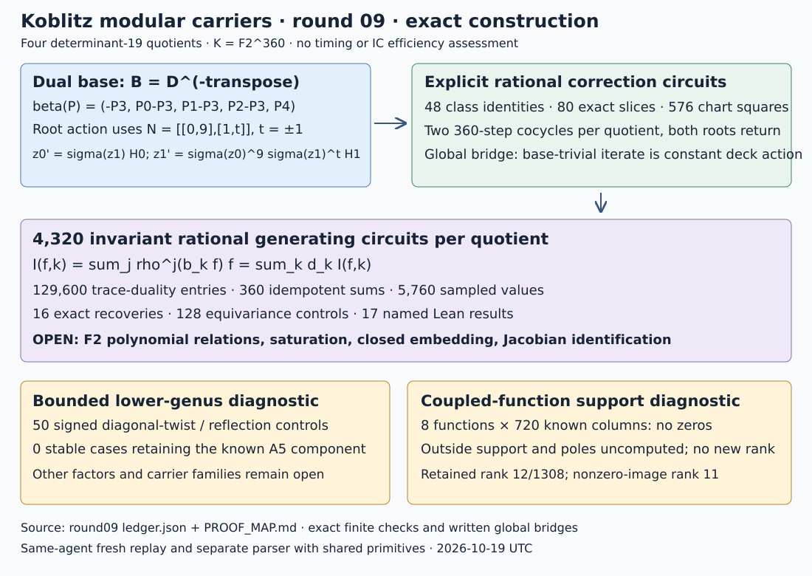

# Round09 — explicit Frobenius and invariant rational generators

2026-10-19 UTC. Parent92688745f0ffadf854367ad1d2f33fa05bf7ce2a.
The four determinant19 quotients now have explicit Frobenius coordinate
circuits and4,320 invariant rational generating circuits each. This is a
function-field construction. F2 polynomial relations, denominator
saturation and a closed projective embedding remain open. Relation ranks
are unchanged; no timing or IC efficiency conclusion is made.

## Quotient descent: what is explicit

Use K=F2^360 with the frozen modulus z^360+z^5+z^3+z^2+1 and the four
round08 graph kernels. Each split chart has five elliptic factors and two
Kummer coordinates, z_i^19=product_j f_Tij(P_j), with40 actual polynomial
Miller functions across the four graphs. The six charts and200 transition
factors remain frozen inputs.

The ordinary augmentation source uses D, but the dual chart base uses
B=D^(-transpose). Its action is

    beta(P)=(-P3,P0-P3,P1-P3,P2-P3,P4).
    alpha_base(P)=beta(sigma(P)), sigma(a)=a^2 on K.

The product principal polarization used over K does not identify the two
descent actions. The pairing identity and both inverse matrix products are
proved in Lean. B^5=1 is checked there as well.

For graph generators in the order(Frob S,S), the actual point checks give
M=[[2t,1],[-2,0]], with t=±1. Its signed inverse modulo19 is
N=[[0,9],[1,t]]. The root lift is

    z0'=sigma(z1)*H0(sigma(P)),
    z1'=sigma(z0)^9*sigma(z1)^t*H1(sigma(P)).

For t=-1 the last factor is an inverse. All H factors are retained as
explicit coefficient arrays and fixed-point line/group rational circuits;
there is no uncomputed correction symbol. The exact formula, constants,
fixtures, slices and chart transport are in
q7-Frobenius-coordinate-circuits.json. The written derivation and its
formalization limits are in PROOF_MAP.md.

| Check | Total | Scope |
|---|---|---|
| Univariate class/sum identities | 48 | Exact rational-function equality |
| Coefficient-Frobenius Miller identities | 40 | All actual factors |
| One-variable full-lift slices | 80 | Two fixtures, five variables, two roots, four graphs |
| Generator semilinear steps | 2,880 | Two360-step cocycles per graph |
| Parsed semilinear steps | 2,880 | Recomposition with shared primitives |
| Chart squares | 576 | All36 chart pairs, both roots and fixtures |
| Old transition coefficient checks | 400 | All200 factors, both fixtures |

Both roots and every base point return after360 steps. This alone is a
pointwise check. The global argument first proves that the360-fold lift
is a base-trivial automorphism of the connected Kummer function field,
hence a constant mu19^2 deck action. A nonzero-root fixture then determines
both constants to be1. The second fixture is an additional control.
The global connectedness/Picard bridge is written, not fully Lean.

## An explicit invariant generating family

Let b_k=z^k, k=0..359, and d_k be its trace-dual basis. Exact binary
linear algebra computes d_k; native checks verify129,600 trace-pairing
entries,360 separability-idempotent sums and64 direct trace controls.
For each of the twelve chart coordinates f, retain the circuit

    I_(f,k)=sum_(j=0..359) rho^j(b_k*f),
    rho^j(f)(P)=sigma^j(f(alpha^(-j)(P))),
    f=sum_(k=0..359) d_k*I_(f,k).

The rho orbit sum is fixed, and the idempotent identity gives recovery.
This supplies4,320 possibly redundant rational generators per quotient,
not4,320 algebraically independent coordinates. The constant extension of
the field generated by these invariants recovers the original function
field. Galois descent supplies the fixed-field interpretation; see the
written proof and [Stacks Galois descent](https://stacks.math.columbia.edu/tag/0CDQ).
Trace duality uses the nondegenerate separable trace pairing described in
[Stacks trace and norm](https://stacks.math.columbia.edu/tag/0BIE).

All360 weights are evaluated for x0,y0,z0,z1 at one fixture per graph:
5,760 invariant values,16 exact coordinate recoveries and128 equivariance
controls pass, with1,440 additional point steps. At a general K-point,
the correct identity is I(alpha(P))=I(P)^2. Its value need not belong toF2.
The universal recovery formula applies to all twelve functions; only the
four specified coordinate families are evaluated in this point control.
No invariant polynomial relation ideal or saturation has been computed.

## Bounded lower-genus quotient diagnostic

Test five diagonal twists g^u and five reflections g^j R, for both traces:
50 signed controls on the known augmentation component. Here g=D^2,
R D R=D^-1 and D R D^-1=g R. Twisted Frobenius on that component is
D^(2u+1) tensor the elliptic Frobenius companion.

A reflection is stable exactly when2u+1=0 mod5, hence u=2. That twist
collapses the known component to E_t^4; its reflection-fixed part has
polynomial(E_t)^2 and dimension2. The other twists retain the known
four-dimensional A5 component but no tested reflection is stable. Thus
zero of50 controls gives both properties. Exact integer characteristic
polynomials and all commutators are checked. This does not exclude A5 in
other Jacobian factors, or other lower-genus carrier families.

The carrier genus is2841. Conditional Riemann-Hurwitz arithmetic gives
reflection-quotient genus≤1421; its actual genus, ramification and equations
are not computed. The inequality is proved in Lean with its hypothesis.

## Direct relations: eight coupled functions

M12 restricts x0+xinf+c, y0+yinf+c, x0*xinf+c and
x0*yinf+xinf*y0+c, c=0,1, to all720 known norm-family columns
(indices588..1307). These are actual target coordinates after the deck
maps in split or degree11 coordinate fields. All40,320 component/function
evaluations agree within each closed-column cycle. Every one of the eight
functions has zero known columns in this population.

This records support information, not complete principal divisors. Zeros
outside these columns, their multiplicities and poles remain uncomputed.
No new relation or rank is promoted. The retained evaluated matrix has
rank12 on1308 columns; the nonzero-image matrices have rank11 on1165/1160
columns. General Jacobian reduction and individual descent remain open.

## Evidence, failures and next experiments

The ledger records each requirement as partial or not attempted at its
actual scope. Five new JSON records replay byte for byte; the separate
Q7 parser checks the recorded correction functions and chart action.
Round08 replays unchanged. Seventeen new named Lean results pass the
pinned kernel build and transitive axiom audit. Two source-bound universal
identities each receive64 issuer and128 extra evaluation checks. Native
finite-field semantics and the global geometric arguments remain outside
those Lean statements. Same-agent checks share declared primitives;
there is no external audit.

The archive preserves the initial Rust parsing error, the stale-binary
output-path rejection and the failed Lean recovery statement missing a
DecidableEq parameter. No accepted result uses them. A wrong relative
append path left one intermediate build checking only the earlier source;
that receipt is labeled separately. Final checks are in VALIDATION.md.
Earlier archives remain unchanged. The main-branch merge only resolves
blocked verifier metadata; its receipt is retained, and no executable
verification command was disabled.

Next quotient experiment: reduce the trace family using a
Frobenius-adapted base, then compute an invariant relation ideal on a
specified open chart with exact inverse substitutions and denominator
saturation. Verify gluing and the retained polarization on the descended
model. Next relation experiment: compute complete outside zero support
and poles for a coupled function before joining new columns and reporting
rank. Next lower-genus experiment: compute actual reflection quotient
geometry or test other Jacobian components/families. The bounded negatives
above are not nonexistence theorems. The user makes the IC efficiency
assessment; this round contains no timing or solver measurement.
