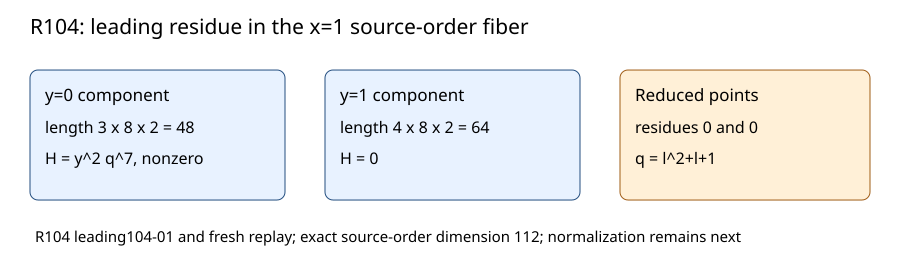

# R104: the cleared N51 leading residue is a socle element

5 November 2026. Exact marked-23 Koblitz source-order calculation.

The 22 worst R102 coefficients give
`H=y²(y+1)⁴(l²+l+1)⁷` in the x=1 fiber. The monic source equations are
`f=y³(y+1)⁴` and `G=(l²+l+1)⁸`; their quotient has F2 dimension 112.
H is nonzero in its standard basis. Its two closed-point residues are both
zero, because H is the y=0 socle element `y²q⁷` and vanishes on y=1.

The pinned Singular producer and fresh replay passed with identical
exports. A separate F2 support checker reconstructed the factorization
from all 105 R102 rows; Lean checked the concrete factor identities.
The one-term deletion control changed the quotient residue.

This proves that 9 is the least clearing power in the displayed monogenic
order. Normalized branch valuations require integral closure.

Raw archive SHA-256: `ac0d2364774167d2a79871484326308fd27d42b5c4b6d6fbd428a2a0aa3c3af4`.
Sources: R101 fiber, R102 rows, R104 producer/replay, and
[Stacks](https://stacks.math.columbia.edu/tag/00FD).
