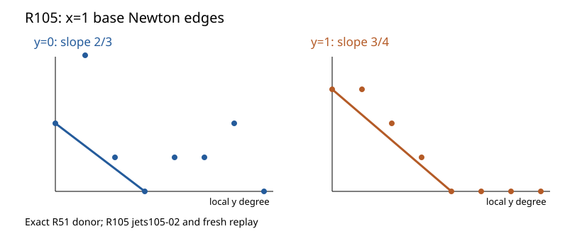

# R105: the marked-23 x=1 local Newton data

5 November 2026. Exact degree-112 source-order calculation from the R51 donor.

The degree-7 base equation has lower Newton edges ((0,2))–((3,0))
near (y=0) and ((0,3))–((4,0)) near (y=1), where coordinates mean
(local y-degree, (t=x+1) order). The coprime slopes give one base-field
place over each cluster, with ramification 3 and 4 respectively.

The full lambda equation has (G_1=G_2=G_3=0) and
(G_4=y^3(y+1)^3\lambda(\lambda+1)(\lambda^2+\lambda+1)).
Endpoint evaluation alone hides this first mixed correction.

The accepted amended run passed fresh byte-identical replay, an altered
donor-hash control, independent bit-polynomial expansion, and Lean numerical
checks. The incomplete first attempt is retained. The next calculation
substitutes local base uniformizers into the full lambda equation.

Raw archive SHA-256: `bbb4005d3a3a747f3ff15b8d887e1c905d4a40d8d19856f135cbf6d5d178933c`.
[Newton polygon theorem](https://www.math.columbia.edu/~gyujinoh/ANT_revised.pdf);
[Stacks branches](https://stacks.math.columbia.edu/tag/0C1S).
