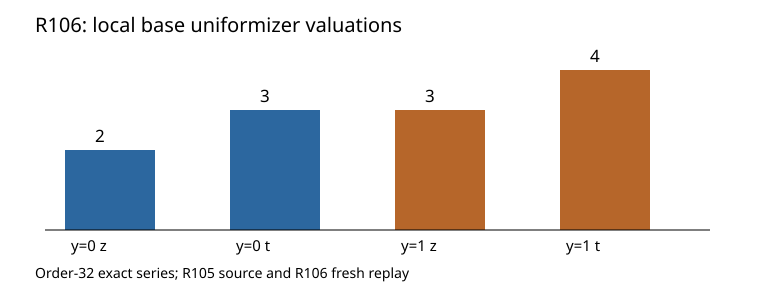

# R106: explicit base uniformizers at x=1

5 November 2026. Source-bound degree-7 base-completion calculation.

With (t=x+1), take (z=y) or (y+1) and (s=t/z). The two transformed
equations are (z^2H_0(s,z)) and (z^3H_1(s,z)); both (H_i) have a
simple zero at ((0,0)). Hensel lifting gives unique formal (z(s)).
The exact order-32 truncations satisfy the original equation, with
((v_s(z),v_s(t))=(2,3)) and ((3,4)) respectively.

The producer, byte-identical fresh replay, changed-hash rejection,
independent bit evaluator, and Lean residual checks passed. The next
calculation substitutes these two base series into the full lambda equation.

Raw archive SHA-256: `315e624c9045f92392cbccf6a2b24d880761b7df8693da99fb38c8e6aab1eb50`.
[Stacks Hensel lemma](https://stacks.math.columbia.edu/tag/04GE).
