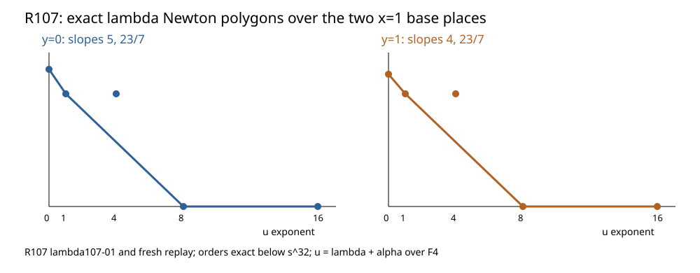

# R107: four normalized places above x=1

5 November 2026. Exact marked-23 degree-112 source-field local calculation.

After substituting the verified base uniformizers and translating
(\lambda=\alpha+u) over (mathbf F_4), the coefficient orders at
(u^0,u^1,u^4,u^8,u^{16}) are (28,23,23,0,0) above (y=0) and
(27,23,23,0,0) above (y=1). Every order is below the source precision
32. The positive Newton edges have slopes (5,23/7) and (4,23/7).

The coprime degree-7 edges and degree-1 edges yield two closed places
over each base place. All four have residue field (mathbf F_4); their
(x+1) ramification indices are (3,21,4,28). The local-degree sum is
112. Fresh replay, changed-hash rejection, independent Hasse composition,
and Lean hull arithmetic checked the source-bound computation.

Raw archive SHA-256: `193db048167c2fd0e349a1af992095b008e8ea3425e9ee4243120d0c38f90e70`.
Next evaluate N51 on explicit degree-1 and degree-7 lambda branches.
[Newton polygon theorem](https://www.math.columbia.edu/~gyujinoh/ANT_revised.pdf).
