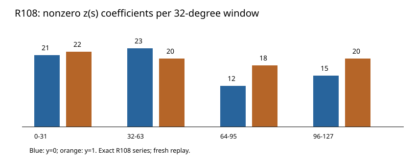

# R108: order-128 base-completion series

5 November 2026. Exact marked-23 source-bound base calculation.

The two local (z(s)) series now have 128 checked coefficients. Every
coefficient below 32 matches R106, and the original base equation
vanishes modulo (s^{128}). The chart counts nonzero coefficients by
32-degree window; it illustrates the recorded support, not a cost metric.

The largest N51 denominator at (x=1) has order 9, which becomes 27
or 36 in these base uniformizers. The extended series are the input to
N51's branch valuation test. Fresh replay, altered-hash rejection,
independent 128-bit evaluation, and Lean residual checks passed.

Raw archive SHA-256: `99dcbbc8daaecdb718715b7ae978431d6723ada3108f94d3e99f63f1cab79a87`.
[Stacks Hensel lemma](https://stacks.math.columbia.edu/tag/04GE).
