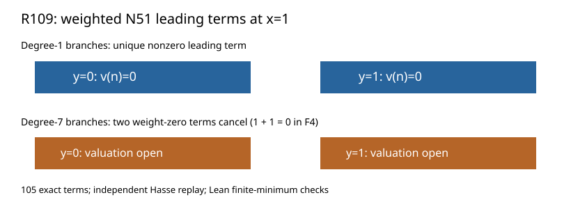

# R109: N51 at the x=1 branches

The exact N51 rational function has valuation zero at the two degree-1 branches. At the two degree-7 branches, its weight-zero terms cancel, so their valuations require a further local lift.

| Branch over F4 | Weighted minimizers | Leading sum | Conclusion |
|---|---|---|---|
| y=0, degree 1 | u^0 | 1 | valuation 0 |
| y=1, degree 1 | u^0 | 1 | valuation 0 |
| y=0, degree 7 | u^0, s^-23 u^7 | 0 | unresolved |
| y=1, degree 7 | u^0, s^-23 u^7 | 0 | unresolved |

The chart displays these four branch tests. All 105 source terms were included. Fresh replay, changed-donor rejection, independent Hasse evaluation, and Lean finite-minimum lemmas passed. The independent verifier's initial 128-bit indexing error was corrected and recorded in CM.md.

Source-bound raw archive: SHA-256 `263825efee003c4075a89f892765620c485cb7d6b10e675c6da0e2f9d20c4987`, 24,344 bytes. Exact result JSON: SHA-256 `92d6e8ae94bc3a2d7457a11c07508b95e0f384a0ce290a7a225ce4f985eee938`.
