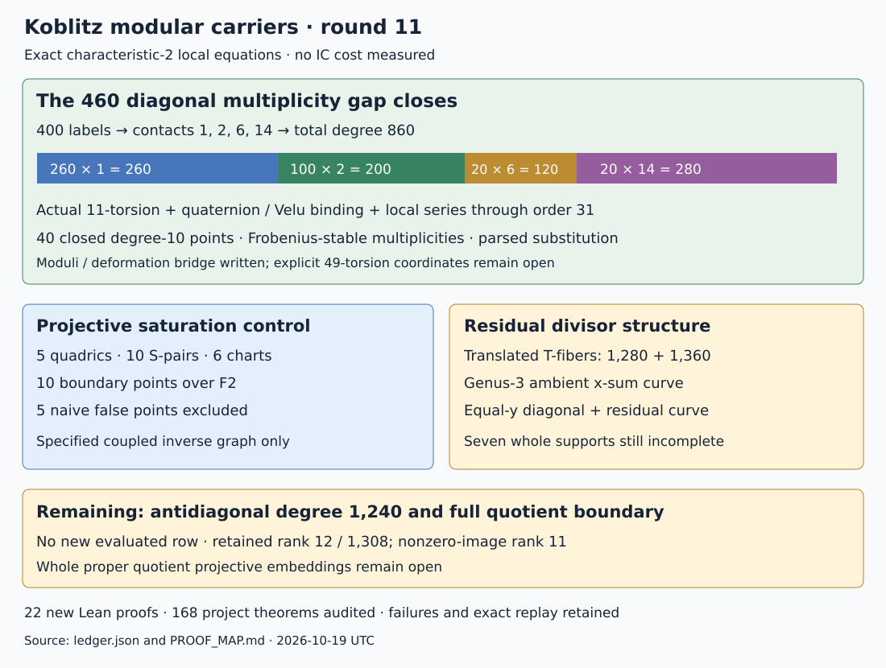

# Round11: closing the diagonal multiplicity gap

2026-10-19 UTC. Parent33db29ba4bcf5f72f5fe8d908b0fb80c0f44d7bc.
The local characteristic2 equations account for all860 noncuspidal diagonal
multiplicity. Projective saturation advances on a controlled coupled
circuit. Seven whole noncuspidal divisors and the proper quotient
embeddings remain incomplete. No IC cost is measured or assessed.

## Diagonal:400 labels,860 multiplicity

The round10 matching labels are retained unchanged. Direct local series,
computed without fitting the global degree, give:

| Contact | Geometric labels | Closed degree10 points | Degree contribution |
|---|---|---|---|
| 1 | 260 | 26 | 260 |
| 2 | 100 | 10 | 200 |
| 6 | 20 | 2 | 120 |
| 14 | 20 | 2 | 280 |
| Total | 400 | 40 | 860 |

The former lower sum400 missed460 multiplicity. The new sum860 equals
the independently retained diagonal degree1280 minus cuspidal degree420.
All contacts are Frobenius invariant. The raw closed divisor gives each
orbit of the original labels and its exact multiplicity. This completes
the noncuspidal diagonal under the written moduli/deformation bridge in
PROOF_MAP.md. The bridge and native field semantics are not fully Lean
formalized. Explicit49-torsion point coordinates remain uncomputed.

Use E_s:y²+sxy+y=x³ over F1024[[s]]. Enumerate all1089 special-fiber
points,121 points of11-torsion and60 nonzero x-coordinates. The actual
I,J automorphisms identify a torsion basis with the split quaternion
module. Each simple11-division root is lifted through s^31. For the five
x-values in a cyclic kernel,let c(s) be their sum. Velu's normalized
quotient has a1=s,a2=0,a3=1 and

    a4=s+s²*c, a6=1+s*c+s³+s⁴*c.

Every chosen norm11 quaternion is bound to this actual quotient map,
up to a recorded target automorphism,on1078 nonkernel points. The12936
point checks exceed a written global degree bound400 for the doubled
map differences. All24 unit bindings are additionally checked on1089
points each. Coordinates of all twelve kernels are exported.

For each of the400 matches,solve the Weierstrass a2,a3,a4,a6 isomorphism
equations with the recorded special-fiber unit. The remaining a1 residual
is s*(u+1). Its first nonzero order is1,2,6 or14;none reaches the precision
limit32. A separately invoked parser rechecks1920 division-root and51200
transformation coefficients from exported parameters,without solving again.
It shares native primitives and is not an external audit.

The return endomorphisms have norm121 and traces3,4,10,11,17,18,with
counts100,100,20,80,80,20 respectively. Their characteristic identities,
49-line preservation and maximal scalar congruence depths at2 are checked.
No contact length is inferred from trace or depth alone.

## Projective saturation:five quadrics

For xy=z,xu=1,yv=1,the exact projective closure in coordinates
[x:z:y:u:v:h] has homogeneous ideal

    xy-zh, xu-h², yv-h², zu-yh, zv-xh.

A native elimination followed by graded reverse lex computation checks
all10 S-pairs. Every leading monomial is h-free. Explicit h-power
membership certificates identify this ideal with the h-saturation of
the first three equations. All six dehomogenized chart ideals are
exported. The closure has10 F2 boundary points and excludes5 spurious
points of the naive homogenization. Its h-chart recovers the original
two-dimensional torus graph;the ideal is prime by injective localization.

This settles this coupled graph closure and its closed projective
embedding. It does not compute the full quotient ideal's saturation,
recover that quotient's global boundary,or establish its proper polarized
projective model. The four round10 closed affine open embeddings remain
the effective quotient models available.

## Seven residual divisors:more exact structure

The rational two-torsion point T=(0,1) on X0(49) satisfies x(P+T)=1/x(P).
Consequently

    div(x0*xinf+1)=(phi0-phiinf)^*(T)+(phi0+phiinf)^*(T)
                  -2phi0^*(O)-2phiinf^*(O).

The two positive fibers have degrees1280 and1360. This is an exact
Cartier decomposition,not an evaluated finite divisor. Neither fiber
has been enumerated.

The ambient zero correspondence x0+xinf+1=0 has a connected genus3
normalization. With u=x+1,y=x*z+1,v=(x+1)*w+1,on x!=0,1:

    z²+z=x+1+1/x,
    w²+w=x+1/(x+1).

The third quadratic subcover has right side1+1/(x*(x+1)). The three
subcovers each have two simple poles and genus1;Riemann-Hurwitz gives
genus3 for the connected biquadratic cover. This is an ambient
correspondence. A cover from C or a new carrier transfer has not been
constructed from it.

For y0+yinf=0,the two elliptic equations factor into the diagonal and
v=y,y=x²+x*u+u²+x+u. The pulled-back residual curve has degree2680;
its support is not evaluated. The completed diagonal also occurs here,
with the usual polar corrections. All three new identities receive
212363 finite-field controls across F4 through F256,plus universal Lean
identities. Point controls do not replace the written Cartier arguments.

The noncuspidal x0+xinf zero degree2100 now splits into the completed
diagonal860 and an unresolved antidiagonal1240. All seven whole residual
supports remain incomplete. No new relation row or evaluated column is
promoted. Ranks remain12/1308 and nonzero-image11 on1165/1160 columns.

## Failures and checks

Retained failures include a Rust expression delimiter,a wrong source
working directory,an unnecessary Lean tactic after field_simp,and two
unsuccessful lex-order h-regular certificates. Grevlex resolves the
certificate issue. A write-once save correctly rejected replacing the
preliminary local export;the original survives as an attempt artifact.
A full temporary filesystem interrupted tool startup;this task's older
temporary artifacts were preserved on the workspace disk before resuming.

Twenty-two new named Lean proofs cover the universal Weierstrass
transformation,Hamilton norm,chart recovery,saturation identities,AS
relations and degree bookkeeping. The pinned full proof gate checks168
project theorems with zero native trusts. Two source-bound identities
receive64 issuer and128 additional checks each. Native and root tests,
new/prior byte replay,site/workflow checks and archive validation are
recorded beside the immutable raw archive. Standard Lean foundations
are retained;global moduli geometry remains written.

## Next discriminating work

Construct the antidiagonal degree1240 support and the two translated T
fibers,with local multiplicities and projected column images. For the
quotients,apply controlled saturation to an actual coefficient circuit
boundary and recover its retained Kummer charts;the torus prototype does
not discharge that obligation. Complete each of the seven finite divisors
before making a whole-row relation or rank claim.

Sources: [raw ledger](ledger.json),[protocol](PROTOCOL.md),[proof map](PROOF_MAP.md),
[replay](REPLAY.sh),[previous round](../10/REPORT.md). Primary geometric
sources and exact proof scopes are given in the proof map.

The first formatter invocation also supplied paths relative to the wrong
working directory;its four file-not-found errors are retained in
format-01.log. Formatting with explicit source paths then passed.
