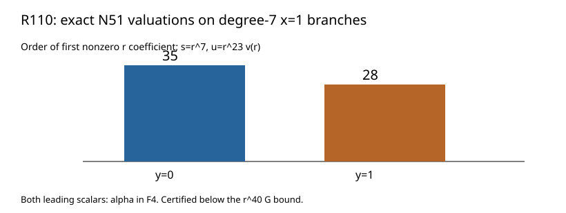

# R110: degree-7 local N51 valuations

The Hensel lift of the two degree-7 x=1 branches resolves R109's exact leading cancellation. With s=r^7 and u=r^23 v(r), the translated G equation determines the root v(0)=1. Substituting into all 105 N51 terms gives:

| Branch | First nonzero r order | F4 leading scalar | G precision bound |
|---|---:|---:|---:|
| y=0, degree 7 | 35 | alpha | 40 |
| y=1, degree 7 | 28 | alpha | 40 |

Each branch has residue degree 2, so their combined local zero-divisor degree is 126. The previously checked degree-1 branches have valuation zero. The other finite supports and infinity remain for the complete divisor.

The result was byte-identical on fresh replay; altered source was rejected. An independent Hasse/schoolbook verifier reconstructed G and N51 from the donor and checked both first nonzero coefficients. Lean verified the finite order and degree arithmetic. The first verifier attempt had a list/tuple comparison error, corrected before the successful full rerun.

Result SHA-256: `4b8445ffb9243c369010078602fd5e59caee60b1373f3af31dffc3cfb1c7c738`. Raw archive SHA-256: `1b31ba7b59590240e03d54c247c0396778975a137cc019e7268e71a784ad7e02` (940 bytes). [Stacks Henselian lifting](https://stacks.math.columbia.edu/tag/04GE).
