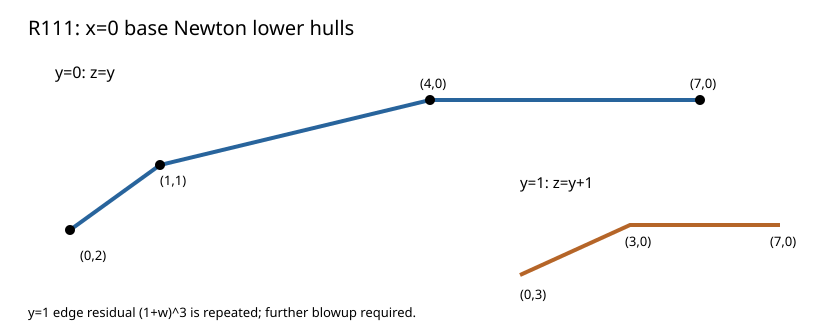

# R111: the x=0 Newton entry

The marked-23 degree-112 source has two base clusters at x=0. Exact expansion of its degree-7 base equation yields:

| Cluster | Positive slopes for `v_x(z)` | Residual edge polynomial | Immediate consequence |
|---|---|---|---|
| y=0 | 1, 1/3 | 1+w; 1+w³ | two edge stages to lift |
| y=1 | 1 | (1+w)³ | repeated root; blow up again |

These are exact source-bound Newton supports. The displayed G51 lambda coefficient weights are termwise lower bounds, and the normalized lambda and N51 valuations await base-series lifts. Fresh replay, changed-source rejection, independent binomial/supporting-line verification, and Lean finite factorization checks passed. The mistaken known-fiber assertion in the first frozen source was corrected before data and retained in Git history.

Result SHA-256 `e35e271cb6c86fc440676f1884709430eb091482f8531635294bc7dbdf49c4e5`; raw archive SHA-256 `4eda8f1652c97d1140c4f5a76fb3a717a2d3e60ae287b05f65618fb178fcc52f` (1,000 bytes). [Stacks integral closure](https://stacks.math.columbia.edu/tag/00GH).
