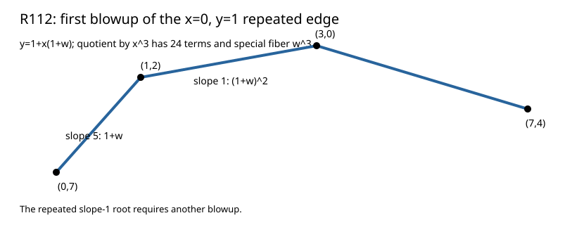

# R112: the repeated x=0 edge after one blowup

Substituting `y=1+x(1+w)` and dividing the actual degree-7 base equation by `x^3` gives a 24-term F2 polynomial with special fiber `w^3`. Its lower Newton hull is `(0,7),(1,2),(3,0),(7,4)`.

| New edge | Residual polynomial | Next operation |
|---|---|---|
| slope 5 | `1+w` | Hensel lift the simple root |
| slope 1 | `1+w²=(1+w)²` | blow up `w=x(1+w1)` |

Fresh replay, altered-source rejection, independent bivariate substitution, and Lean finite edge arithmetic passed. The normalized branch census and N51 values await the next lift.

Result SHA-256 `0ca85dd551bb1e288aea9f3d2175061750a19b58e9f94d1dbc58f4eb61171fab`; raw archive SHA-256 `7048bfae8468b1223442297a3fbbdb09ec5ed2968484ad29a6f67dcfe5932a43` (864 bytes). [Stacks Henselian lifting](https://stacks.math.columbia.edu/tag/04GE).
