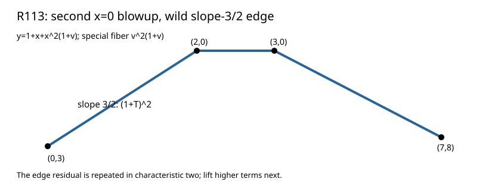

# R113: the remaining x=0 base edge

A second exact blowup, `y=1+x+x²(1+v)`, yields a 34-term quotient after dividing by `x^6`. Its special fiber is `v²(1+v)`: the simple `v=1` control is already separated, while `v=0` remains double.

The lower hull at `v=0` is `(0,3),(2,0),(3,0),(7,8)`. Its positive slope is **3/2**, with residual `1+T²=(1+T)²`. The repeated residual calls for higher characteristic-two terms after `x=r², v=r³(1+h)`.

Fresh replay, changed-source rejection, independent R112 composition, and Lean finite checks passed. No normalized place count or N51 valuation is inferred from this repeated residual.

Result SHA-256 `41996e050fa85958218d4d205cb5cdeec599d59e4176fa0e11db38f6c467ef26`; raw archive SHA-256 `c4eeb180dfb476450ff566fad3bd9c3b6e493c772fd8f617138a76b653a7e009` (876 bytes). [Stacks Henselian lifting](https://stacks.math.columbia.edu/tag/04GE).
