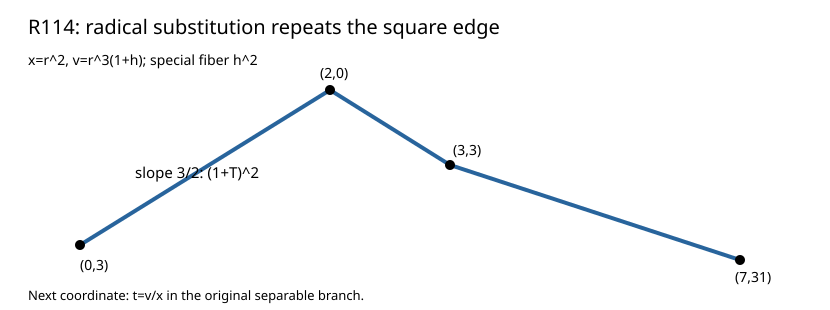

# R114: the radical lift repeats the square residual

The exact substitution `x=r², v=r³(1+h)` produces a 74-term quotient with special fiber `h²`. Its lower hull is `(0,3),(2,0),(3,3),(7,31)`, and the positive slope remains **3/2** with residual `(1+T)²`. A linear `h` term first appears at r order 3.

This result points to `t=v/x` as a local coordinate in the original branch: R113's slope would give normalized orders 3 for v and 2 for x, hence order 1 for t. The next step is to derive and solve the exact equation for x(t), with irreducibility and degree accounting checked separately.

Fresh replay, altered-input rejection, independent composition from the original f51 donor, and Lean arithmetic passed. The radical substitution's repeated residual is retained as a scoped null result.

Result SHA-256 `c7c5664c9956f9af5f709bd08cc6bf4ae91c2ba465224b5f0af3356b7dd71bc0`; raw archive SHA-256 `fc2ac6aea07d37f7fd0b975b98a454306e5a88ddf0627455fc89f19f6c2778e7` (976 bytes). [Newton polygon theorem](https://www.math.columbia.edu/~gyujinoh/ANT_revised.pdf).
