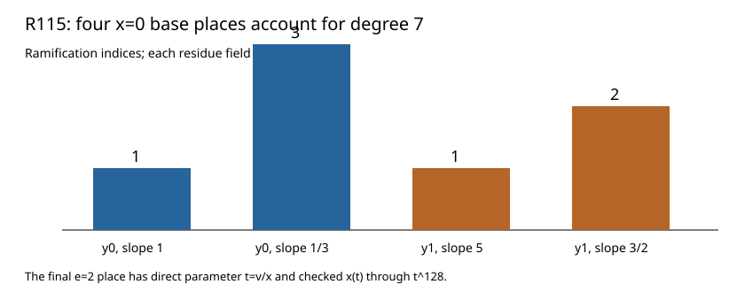

# R115: a direct parameter for the x=0 wild branch

The remaining x=0 base branch now has an explicit uniformizer (t=v/x). The divided equation (E(x,t)) begins (x+t^2) and has unit (x)-derivative at the origin. Its unique Hensel series through order 128 satisfies the original degree-7 equation, with (v_t(x)=2) and (v_t(v)=3).

The x=0 base-field place census closes using the exact Newton edges from R111–R113 and the coprime-slope irreducibility criterion:

| Cluster and edge | Ramification index | Residue degree |
|---|---:|---:|
| y=0, slope 1 | 1 | 1 |
| y=0, slope 1/3 | 3 | 1 |
| y=1, slope 5 | 1 | 1 |
| y=1, slope 3/2 | 2 | 1 |

The indices sum to the degree-7 base field. Fresh replay, changed-source rejection, independent source composition, and Lean finite residual and arithmetic checks passed. The full lambda equation has x-denominators up to x^161, so its evaluation needs longer base series than the order-128 certificate here.

Result SHA-256 `fbbd1e37c16a2ef28d08410671eef8a1cd41837decaea49c8fb95753b7ffaff1`; raw archive SHA-256 `ed536af4261f0aa90377bbb71e5560f89ba2a2bec8f809d61bff72eba8efc384` (964 bytes). [Stacks Hensel lemma](https://stacks.math.columbia.edu/tag/04GE); [Newton theorem](https://www.math.columbia.edu/~gyujinoh/ANT_revised.pdf).
