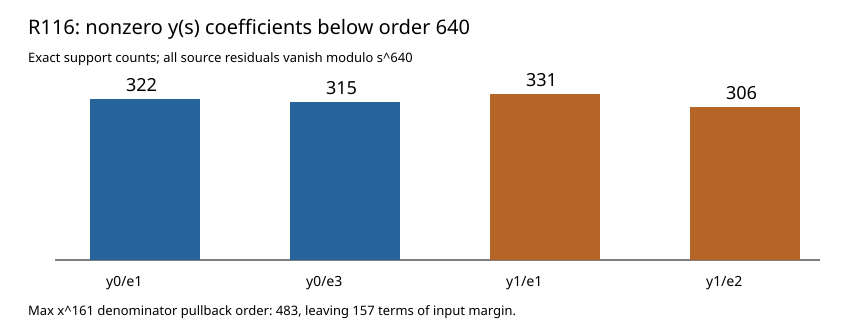

# R116: four x=0 base series through order 640

All four normalized x=0 base places now have source-bound local series beyond the largest G51 denominator pullback. Every transformed equation and the original degree-7 source equation vanish modulo (s^{640}); Lean checks all four finite transformed residuals at that precision.

| Place | (v_s(x)) | Pullback order of (x^{161}) | Nonzero y coefficients below 640 |
|---|---:|---:|---:|
| y0/e1 | 1 | 161 | 322 |
| y0/e3 | 3 | 483 | 315 |
| y1/e1 | 1 | 161 | 331 |
| y1/e2 | 2 | 322 | 306 |

The smallest input margin is 157 terms. Fresh replay, altered-source rejection, independent source evaluation, and Lean source-bound full-precision checks passed. The next calculation aggregates the actual 29 G51 terms at each place; any cancellation must be assessed against its remaining bound.

Result SHA-256 `7b7de659d6a6993ef7fba9d6177ff8f8131e8d341e02f161def8c553360a66e9`; raw archive SHA-256 `3a257463b2496b6aaa951c839cf61fdc9188647eaee9113dceb68d649c87c8ac` (3,384 bytes). [Stacks Henselian lifting](https://stacks.math.columbia.edu/tag/04GE).
