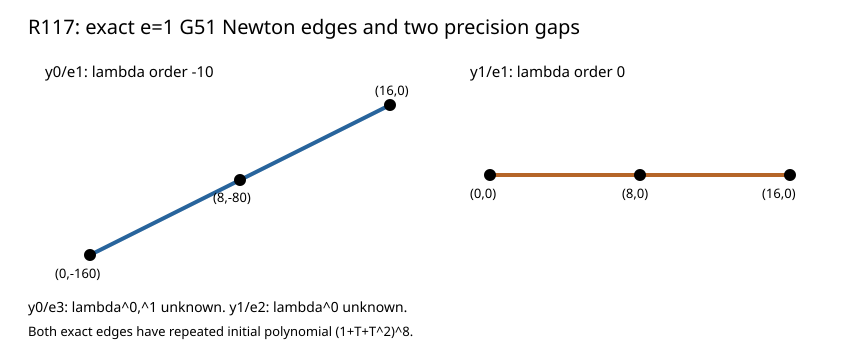

# R117: G51 coefficient orders at x=0

The actual 29-term G51 equation has two certified Newton edges over the x=0 e=1 base places. Its combined coefficient orders at lambda powers 0,1,4,8,16 are `[-160,-127,-97,-80,0]` over y0/e1 and `[0,23,23,0,0]` over y1/e1. The corresponding lambda orders are -10 and 0. Both initial edge polynomials are `1+T^8+T^16=(1+T+T²)^8`, so their repeated roots require another lift.

On y0/e3, the lambda^0 and lambda^1 orders remain above recorded lower bounds -323 and -125; on y1/e2, lambda^0 remains above -4. These are cancellation/precision gaps, and no Newton hull is entered for those places. A larger base precision is the next exact test.

Fresh replay, changed-source rejection, independent schoolbook rational evaluation of every row, and Lean finite edge checks passed. Result SHA-256 `b1786c05cca9509a8e9c0dd21c781c1110ced4b0a545b15c08120edbb467f393`; raw archive SHA-256 `82427e80dd28742853e934d7f34cde66bd8e95c4b1d4acc9c1063a3af89eab15` (3,580 bytes). [Newton theorem](https://www.math.columbia.edu/~gyujinoh/ANT_revised.pdf).
