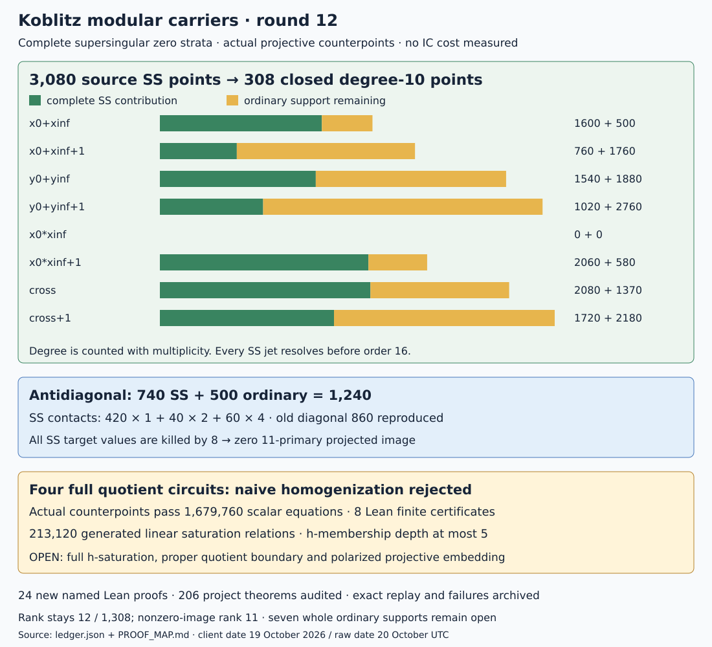

# Round 12: supersingular divisors and actual projective saturation

19 October 2026, America/Los_Angeles; raw protocol date 20 October UTC.
Parent commit: 539325b5e66719f4cea7ee1315659808103d5bcb.

All supersingular zeros of the eight coupled functions now have closed
supports and exact multiplicities, under the written modular and etale
bridges. The antidiagonal contributes degree 740 there, leaving ordinary
degree 500. Every whole unfinished divisor still has an ordinary part.
The four actual quotient circuits have explicit false points under naive
homogenization and a certified intermediate linear saturation step.
Whole proper quotient embeddings remain open. No IC costs are assessed.

## Complete supersingular strata

The 56 cyclic-49 labels are now attached to actual points of the minimal
X0(49) model y²+xy=x³+x²+1. All six target points lie in F4; four have
12 labels each and two have 4. We enumerate all 3,080 supersingular source
points, their Frobenius permutation, and 308 closed points of degree 10.
Every function is evaluated through order 15. No zero jet remains censored.

| Function | Complete SS zero degree | Remaining ordinary degree | Noncuspidal degree |
|---|---|---|---|
| x0+xinf | 1600 | 500 | 2100 |
| x0+xinf+1 | 760 | 1760 | 2520 |
| y0+yinf | 1540 | 1880 | 3420 |
| y0+yinf+1 | 1020 | 2760 | 3780 |
| x0*xinf | 0 | 0 | 0 |
| x0*xinf+1 | 2060 | 580 | 2640 |
| x0*yinf+xinf*y0 | 2080 | 1370 | 3450 |
| x0*yinf+xinf*y0+1 | 1720 | 2180 | 3900 |

The complete x0*xinf divisor was already cuspidal in round 10. The other
seven whole divisors remain incomplete. Their ordinary degrees are derived
by subtracting the complete supersingular contributions from the independent
round-10 noncuspidal degrees; they are not enumerated ordinary supports.

For x0+xinf, the old diagonal degree 860 is reproduced at all 400 geometric
labels, including contacts 14. The antidiagonal has 420 contacts of order 1,
40 of order 2, and 60 of order 4: degree 740 on 52 closed degree-10 points.
Its remaining degree 500 is ordinary. The full antidiagonal and full x-sum
principal relation are therefore not complete.

Every supersingular target value is killed by 8. The previously established
transfer projections preserve this property; their 11-primary images are
zero by coprimality. These completed strata cannot add nonzero 11-primary
columns. This is a structural image calculation, not an IC efficiency
assessment. Evaluated rank stays 12/1308 and nonzero-image rank 11 on
1165/1160 columns. No new whole principal row is promoted.

## Actual level-49 coordinate adapter

Use E0:y²+y=x³ over F4096. It has 3,969 rational points and 49 points of
7-torsion. Calibrate the actual basis P,I(P) to the retained quaternion
module modulo 7. The 192 norm-7 Hurwitz elements give 8 kernels. Each
chosen map is bound to an actual normalized Velu map and target unit by
3,962 nonkernel point checks: 31,696 checks in all, with a written global
degree bound. Explicit points of order 49 have not been constructed.

A cyclic-49 subgroup gives a nonbacktracking chain of two 7-isogenies.
For each retained abstract line S, its first quotient is alpha7. Dividing
alpha7(S) by 7 modulo 49 identifies the second kernel in the actual
7-torsion basis. All 56 chains are distinct. The compatibility of this
module lift with actual 49-torsion remains a written Tate-module bridge.

Lift the 24 source 7-torsion x-roots and 24 roots on each of the 8 first
quotients through order 127. For quotient coefficients A,B, use the actual
general Weierstrass 7-division polynomial. A kernel trace c changes them by

    A' = A+s+s²*c,
    B' = B+1+s*c+s³+s⁴*c.

With discriminants d0,d1, recover the 7-Hauptmodul t from

    t^6=d0/d1,  t^8+t^4+1+j0*t^7=0.

Both supersingular constant candidates are retained until one satisfies
the equations through order 63. The two edge parameters give eta x via
x^4=t1*t2. The minimal y coordinate is recovered from
(eta_y+x+1)/(x²+x+1), including leading-term division at its vanishing
constant denominator. This distinguishes branches that j-triples alone
cannot distinguish at supersingular points.

All target x-series coefficients lie in F4. Normalize each of the 12
11-quotients back to E_z with z=s/u and its actual recorded special-fiber
unit. Composing these parameters with the target series produces the
local modular coordinates. The minimal y-series is recovered by the
implicit elliptic equation, whose derivative in y is a unit here.
This supplies all eight local functions on all 3,080 source labels.

A separate parser substitutes exported data and checks 27,648 division-root,
8,192 Hauptmodul, 768 normalization, and 394,240 function coefficients.
It shares primitives with the generator and is not an external audit.
The Frobenius orbits preserve every recorded valuation.

## Four actual homogenized systems fail; an intermediate repair is explicit

Each full round-10 circuit now has a projective F2 point satisfying every
homogenized equation but violating a certified saturated linear relation.
The native checker checks all 1,679,760 scalar equations across the four
systems. Eight generated Lean theorems check the four restricted finite
circuits and the four nonzero missing relations in the kernel. The passage
from these finite scalar restrictions to the full coefficient algebra is
identified separately in the proof map.

The defect is an auxiliary constant multiplication, not an obstruction
intrinsic to the abelian quotient. If a is a node representing constant c,
its homogeneous equation is a=c*h. The multiplication gate gives
h*out=a*input. Their saturation contains out=c*input, since

    h*(out-c*input)=(h*out-a*input)+input*(a-c*h).

The false points violate this relation at h=0. Thus the original full
homogenized ideals are strictly smaller than their h-saturations.

Native constant propagation now evaluates every constant-only node over
the pinned F2^360 and emits 150,150,146,146 new K-linear relations, or
213,120 generated scalar linear relations. The maximum certified h-power
membership depth is 5. The original equations are retained; the enlarged
ideal has the same h-chart and sits inside the full h-saturation. Relations
may be redundant. No independence, elimination, full saturation, global
boundary gluing, or proper polarized quotient embedding is claimed.

## Proofs, failures and remaining work

Twenty-four new named Lean proofs are supplied: eight actual-circuit
certificates and sixteen algebraic or structural results. These include
saturation membership, strictness from a counterpoint, parameter recovery,
local-order invariance under a unit, coprime-primary image vanishing, the
six target points and exact degree partitions. Full project audit counts
and axiom receipts are in ledger.json and the raw archive. Modular geometry
and native field semantics remain partially formalized.

Preserved attempts include the first incorrect one-branch stabilizer bound,
8-jets censoring twenty diagonal points, the first aggregate h-depth count
omitting scaling relations, and interrupted duplicate Lean builds before
minimal imports and sequential compilation. The unrestricted root test run
also exposed a shared-counter failure. That test passes in isolation, and
the full serial rerun passes: 4,405 passed, zero failed, 118 ignored. The
native suite passes 106 tests with one ignored; the site and workflow
suites pass 49 and 4 tests. The original failure remains archived. No test
was removed or weakened.

Two earlier statements are corrected explicitly. Round 11's proof map
called the three Artin-Schreier subcovers independent: there are two
independent characters and their nonzero sum, the three nontrivial
characters of a rank-2 group. The genus-3 result is unchanged. The previous
status misidentified expected TODO negative-test output as a CI failure;
the actual backlog failure is a concurrent-claim integration test.
The study's round-11 Lean CI job passed. Broader CI failures and cancelled
checks remain separate publication gates.

Next: construct the ordinary antidiagonal support of degree 500 and the
ordinary x-product-plus-one support of degree 580, with every closed point,
local length and projected image. On quotient geometry, continue saturation
of the actual circuits after the explicit constant-gate step, and recover
the proper Kummer boundary charts and polarization. The present results
do not discharge those requirements.

[Protocol](PROTOCOL.md) · [proof map](PROOF_MAP.md) · [ledger](ledger.json) ·
[exact replay](REPLAY.sh) · [previous round](../11/REPORT.md).

The first main Lean build also needed explicit normalization of nested
powers in the characteristic-2 parameter factorization. That failed
elaboration log is retained; only the successful rebuilt module and full
axiom audit support the formal claims.

An early ledger invocation ran before the proof-gate wrapper had exported
its audit receipt and failed on that missing file. Its log and partial
identity exports are retained; the final ledger is issued after the proof
gate finishes and all raw logs are closed.
