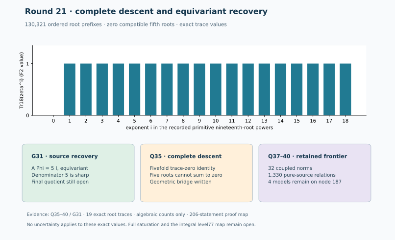

# Round 21: complete descent controls and equivariant recovery

24 October 2026 UTC. Parent 63bc089, Conductor T-299, PR #2215. The requested
integral level-77 map, theta descent, proper polarized quotient embedding
and complete saturation remain the scope. This round adds a universal
root obstruction, an explicit equivariant recovery map and source-bound
polynomial repairs. The integral modular map and whole saturation remain
open. No IC efficiency assessment is supplied.

## The old scalar boundary cannot ignore coefficient descent

Q35 exhausts 130,321 ordered four-root prefixes in an irreducible F(2^18)
model and finds zero compatible fifth roots. Its 19 roots span binary
rank 18, with the all-ones relation; equal pairs and all 19 roots provide
positive zero-sum controls. Lean proves the universal characteristic-two
statement for every five-tuple, including repetitions, under an explicit
primitive nineteenth-root hypothesis. This is stronger than a finite-field
search result.

The actual source descent implies P0+sigma(P0)+...+sigma^4(P0)=O, where
sigma acts on finite coefficient components. It fixes the arc parameter.
An ordinary source function U=y*S(x), S monic of degree 8, has exact pole 19
at O. A complete source arc with scalar leading U=1 would therefore give
five leading parameters of nineteenth power1 summing to zero, contradicting
the root theorem. The four Q34 models on nodes 123, 124, 126 and 127 are excluded under
the written DVR/split-coefficient/proper-elliptic/formal-group bridge in
SATURATION.md. Lean also proves the trace-zero implication from the four
actual descent identities. Those geometric semantics are still written,
not a full Lean elliptic-scheme proof or an expanded saturated separator.

## All factors matter in the polynomial repairs

Q36 retains every earlier constraint and adds the eight qualified ordinary
scalar zeros. It returns four complete models on155,157,184,186, with 51
visits per graph; no search cap is reached. Q37 independently computes 32 coupled norms,
covering both ordinary functions on all four factors in all four graphs.
Each has 186 terms, degree 19, top(U+V)^19 and exact denominator-cleared
elliptic substitution zero. Four reject the Q36 models. Their reduced
U=V consequences are polynomial source consequences independent of the
Q35 geometric bridge.

Q38 still returns four models on nodes 180 and 182, with 71 visits per graph; no search cap is reached.
Q39 extends the exact pure-source resultant family to all five elliptic
x-inputs in each graph: 20 input families, 1,330 relations, 66 per family for
a=0 and 67 for a=1. Every full univariate substitution is zero and every
normalized relation has its certified unique lower-node top power. The
recorder corrected an initial 1,340-count assumption; the failed assertion
and original source are retained.

Q40 retains all old constraints and the new repairs, and returns four
models supported only on node 187, with 9 visits each and no search cap reached. Node 187 is the
first cumulative product of two ordinary Miller functions. These are
complete finite necessary-system models, not complete source arcs or
proof of a genuine boundary component. Full coupled divisors/relations
for that product and equality of the saturated ideal remain open. The
registered round stops here and preserves every intermediate survivor.

## A sharp denominator in descent-compatible recovery

G31 averages the actual Round 20 recovery over five rotations:
A=sum R^(-k)*L*Pi^k. Exact CM arithmetic gives A*Phi=5I and A*Pi=R*A.
76 of 80 CM entries have a coefficient not divisible by 5. All three actual
coefficient identities, including row equivariance, are kernel checked.
Under the written CM-morphism bridge, A descends and recovers [5].

Modulo 5, the augmentation source has zero norm but a nonzero fixed vector.
Every fixed vector of the four regular target cycles is a norm. An
equivariant scalar recovery dI must therefore have d=0 modulo5. Lean
proves this over any commutative characteristic 5 ring, with nontriviality
required for the no-retraction corollary. CM reduction/denominator clearing
is the written bridge. Thus denominator 5 is sharp in this presentation.
The Round 20 proper closed source immersion still descends; it need not
have an equivariant integral ambient retraction. This says nothing against
other embeddings or the integral level-77 map.

## Verification and remaining requirements

PROOF_MAP.md maps 206 named statements to exact hypotheses and separates
native finite-field/DAG/elimination semantics from written geometry.
VALIDATION.md and its retained receipts give the final complete pinned
build, transitive audit, repository tests, identity records and replay
outcomes. A failed build or incomplete cache/import load is never a proof.
Only the standard Lean foundations are accepted; no trusted native
verification, custom axiom, sorry or admit is accepted in the final audit.
Two universal identity certificates bind the geometric-series and local
chart identities to the final Lean source and receive 128 extra parsed
checks each. They do not certify characteristic-specific geometry.

Rounds 01–20 remain frozen. The proper final105/19 quotient and its 243 sections,
full theta actions/rational divisor trivialization, and integral level-77
normalization/pole spaces/factor-divisor evaluator remain open. Round 21 does
not rerun the modular ansatz searches. Canonical textual trackers and the
blocked backlog are refreshed; historical IC rank/cost/performance graphs
stay unchanged because no new relation rank or performance was measured.
The report's root-trace plot and geometry diagram are exact algebraic
records, not an IC speed comparison.

Migration/Diem receipts and EKS inventory were reconciled before repeating
any external lane. No duplicate generator, new cluster job or separate
waiting-freeze followup was started. The existing lab overview supplies
read-only inventory after local kubectl's absent-context/worker-role
failures. PR publication remains subject to its exact head's applicable
CI and reviews. Sources, failure records, deterministic archives and
replay/source-pin checks are linked in README.md and SOURCES.md.
