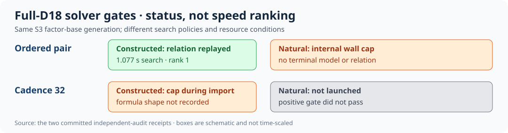

# D18 solver-gate result and AWS handoff

Curve `icv1-f2m83-tm6151469093347-debefd74`; one frozen full-D18 factor-base generation, 32,643 signed-Frobenius columns and 5,418,738 point rows. This result combines the [ordered run](../run-20261025T2339Z-ordered-d18/REPORT.md) and [cadence-32 run](../run-20261026T0121Z-cadence32/REPORT.md) as **distinct controls**. Their source commits, host conditions and caps differ, so they are not paired performance arms. The [outcome diagram](diagram.svg) shows the gate each reached.

| Variant (n=1 each) | Positive gate | Natural gate | Cold IC S / rho S |
|:--|:--|:--|:--|
| Ordered D18, cap 2,400 s | Verified, rank 1 | Censored at cap | Missing / missing |
| Cadence-32 D18, cap 300 s | Censored before model | Skipped | Missing / missing |

For the ordered positive, measured search was 1.077 s after 66.994 s import; its verified rows were `[0,166,332,498]`. Neither variant supplies a measured full cold IC or same-target rho result, so the factor-base choice is unset.

The table reports observed quantities with units; there is one attempt per row and no interval. For this primary `a=0` 81-bit subgroup, a verified complete cold one-target IC baseline on the same frozen instances has **not** yet been established. The [K1107/root11 cold result](../../../n83_k992_cold_followup_20261017/RESULT.md) (mean 99.562 s on ten sealed points) belongs to the distinct diagnostic `a=1` 53-bit subgroup and is not a valid D18 reference. Any primary-arm performance claim needs a verified cold one-target IC reference with all phases and answer replay, plus matched rho and its precomputation convention. Neither D18 attempt measures natural relation yield or full cost, so the cost ratio is unset. `selected_best_total_runtime=null`. This is a capacity and solver-gate result, not a total-runtime improvement or a finite-grid selection.

The full D18 object was provider-checked in both runs at SHA-256 `eaef94ef45b3d2d4cd2ec2f40c1173b4cdb2a437b7e618a858c73fb1caf3902b`. The AWS handoff is [AWS_RESUME.md](../../verification/d18-full-orbit-20261025/AWS_RESUME.md). The investigated AWS principal lacked read access to the exact object at inspection; an IAM proposal remains unapplied, and the model artifact upload was blocked by automatic approval review. An earlier separately approved source archive upload does not grant those actions. The existing [N83 problem record](../../../../problems/n83-mixed-orbit-factor-base-selection.md) has checkable exit criteria and retains the mixed-orbit 5+1/4+2 obligations.

Requirements: exact base provenance, native cadence implementation, unit differential verification and constructed ordered control are verified; native cadence full-input control, natural relation yield, graph closure/rank, full-width logs, unseen target, matched rho and broad combination coverage remain pending. The scoreboard, `docs/ic/progress-timeline.json` and existing canonical factor-base plots were checked and left unchanged: these two censored gates add no comparable end-to-end point. The next discriminating run is the resource-qualified native full-D18 positive and natural pair, with fresh provider-checked input and independent replay. Preserve both censored receipts and charge unsuccessful attempts in any later total-runtime analysis.
