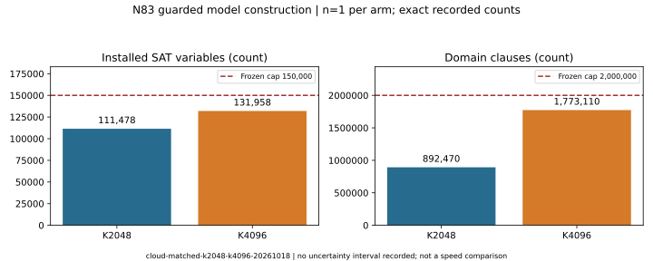
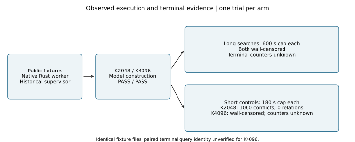

# N83 guarded factor-base continuation, 18 October 2026

Run `cloud-matched-k2048-k4096-20261018`, first container start 2026-10-18T21:30:47Z.
This is a diagnostic continuation, not an admitted performance comparison. Both
models constructed within the frozen variable/domain-clause limits. No cold
runtime winner is selected; no scalar recovery or speed improvement is claimed.

## Frozen method and provenance

The [main protocol](../../verification/cloud-matched-k2048-k4096-20261018/PROTOCOL.md)
is commit f08f9f887ba9f87d0b8976ec1c7a6cd65eb63127; the separately added short
control is 19c2f73268be9c4fa16b18f55f234e077ffb5e53. Frozen native Rust worker
SHA256: 9aa6f722d79f460d9388f63954c6ddbed1c2672e08c35c0bd34e697f5d7ddfc0.
This worker was supervised and audited by historical Python tooling before the
updated native-only policy arrived through the upstream merge. Those archived
helpers are provenance, not a supported harness for another comparison. A native
supervisor and auditor are required before further research runs.

Exact primary curve: `icv1-f2m83-tm6151469093347-debefd74`,
`y^2 + x*y = x^3 + 1` over `GF(2^83)` with polynomial
`z^83 + z^45 + z^2 + z + 1`; subgroup order
`2417851639230796216685689`, cofactor `4`. Generator polynomial words
(hex): `(477f77103dfad59850800, 2fa5e737d542c4e4fd5c3)`. These
identities are pinned by the frozen exporter source and archive manifests.

Public synthetic N83 Koblitz fixtures, m=5 orbit-phase chained S3; one trial,
32-model limit; 150,000 variables and 2,000,000 domain clauses. K2048 precedes
K4096. Each capacity arm uses affine-mask zero with 180 s wall limit; long
searches use 100,000 conflicts / 600 s; short controls use 1,000 / 180 s.
[Query identity](../../verification/cloud-matched-k2048-k4096-20261018/query-identity.json)
records the public terminal query evidence. Both use the same public fixture
files, but paired terminal query equality remains unverified for K4096.

Host: native x86_64 cloud VM; Docker network disabled, read-only inputs,
1 CPU quota, 4 GiB memory, zero swap. Quotas are verified, but timing isolation,
A/A controls and matched external performance reference are not established.
Docker was started and six containers completed and were cleaned up. Both
factor-base archives were fetched back and hash-verified from
`setec-astronomy-artifacts`; historical old-bucket sidecars remain unchanged.

## Recorded observations (n=1 per stage and arm)

| K | installed variables | domain clauses | capacity outer ms | long search outer ms | short control outer ms / outcome |
|---|---:|---:|---:|---:|---|
| 2048 | 111478 | 892470 | 23314.246807 | 600612.228016 / wall cap | 162630.491881 / 1000 conflicts |
| 4096 | 131958 | 1773110 | 12539.253286 | 601214.695177 / wall cap | 181095.333452 / wall cap |

Values are recorded counts and supervised process wall milliseconds, not
throughput estimates; no spread or uncertainty interval was recorded. Domain
clause limit applies to domain clauses, not total clauses (K4096 total 2021197).
K2048 short control emitted 1 SAT call, 1000 conflicts, 0 models, 0 relations,
rank 0 and passed independent original-group replay. All three wall-censored
search/control runs have **unknown** final conflicts, models, relations, rank
and worker peak memory. Coarse start events do not establish SAT entry.
All six stage audits passed in their applicable complete/censored scope;
six forged-result controls were rejected. See [summary](../../verification/cloud-matched-k2048-k4096-20261018/summary.json),
[validation](../../verification/cloud-matched-k2048-k4096-20261018/VALIDATION.md),
[accounting](../../verification/cloud-matched-k2048-k4096-20261018/accounting.json),
and [raw evidence manifest](../../verification/cloud-matched-k2048-k4096-20261018/raw-artifact-manifest.json).

Editable sources: [figure-data.json](figure-data.json), [render.py](render.py),
[report.typ](report.typ). [PDF](report.pdf). Rendering uses Python only to lay
out recorded values and inspect the PDF, as allowed by research-visuals.

## Limits and next discriminating work

The full finite-grid sweep and historical total-cost reconciliation remain
partial. Native K4096 phase markers, a public positive control and native
supervision/auditing are needed before the next comparison; see
[observability problem](../../../../problems/n83-native-k4096-terminal-observability.md).
The independent emulated K4096 5000-conflict result in the study is a separate
host/binary and cannot fill this native run's missing counters. Historical
frozen-source tests and current integration tests are separate receipts.

Canonical graphs checked: `docs/ic-leaderboard.html`,
`docs/index-calculus-scoreboard.html`, `docs/ic/progress-timeline.json`.
They remain unchanged: this bounded diagnostic supplies no qualified gain,
full cold winner, or new completed surface-transfer edge. The capacity facts
are graphed locally. Benchmark copies are diagnostic only.

The prepared 5,771,044-byte raw ZIP remains local: automatic approval review
rejected upload of the broader worker/source/log payload. Factor-base storage
succeeded independently. No raw ZIP upload is claimed.

Post-merge native [integration validation](INTEGRATION.md): 4397 library
passes (118 ignored), 19 exporter passes. The combined outer tool reported
143 despite complete passing summaries; exporter confirmation captured 0.
This is a separate validation receipt, not new research measurement evidence.
